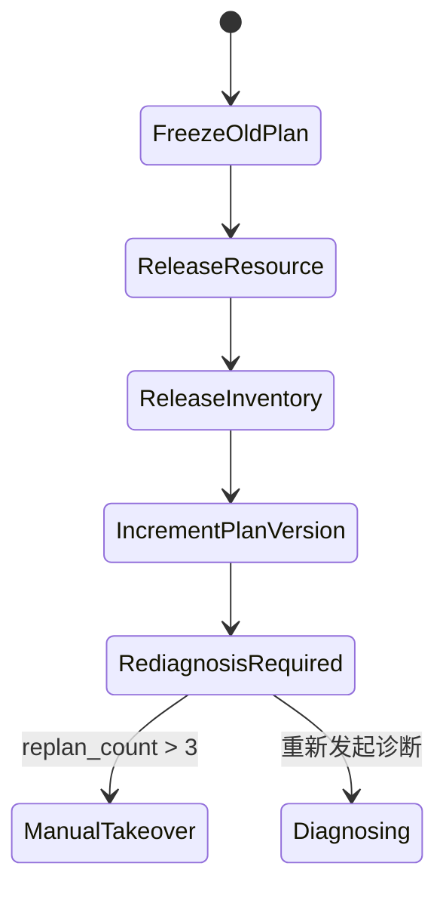

# Agent 编排、HITL 与一致性

## 1. Parent 和 Workflow 为什么必须分开

LLM 擅长理解非标准表达、发现缺失信息和从多个领域中做粗路由，但不擅长保证“审批一定发生”“两条支线都成功后才继续”“失败时补偿顺序正确”。因此本项目把控制面分成两类：

- **Parent Agent**：处理开放世界问题，输出结构化 `ParentDecision` 和 `TaskPlan`。
- **显式 Workflow**：处理封闭世界的不变量，例如并行履约 Join、改诊补偿、人工门禁。

面试时可以用一句话概括：**让 LLM 决定做什么，让状态机和 Workflow 决定什么时候能做、失败后怎么办。**

## 2. Task Plan 不是普通 Todo List

`TaskPlan` 有四个关键语义：

1. `tasks[].depends_on` 表达依赖图，而不是展示顺序。
2. `tasks[].status` 区分运行、等待审批、成功、失败、冻结和补偿。
3. `plan_version` 是每次 REPLAN 的单调版本。
4. `frozen_versions` 保存不可再执行的旧方案，防止迟到回调污染新计划。

初始计划的依赖是：`diagnose -> expert_confirm -> (dispatch || parts) -> service -> archive`。其中 `dispatch` 与 `parts` 在专家确认后可以并行，但 `service` 必须等两者完成。

## 3. Checkpoint、Interrupt、Resume 的真实语义

`NativeApprovalWorkflow` 使用 LangGraph `MemorySaver` 作为演示 checkpointer：

1. `start(thread_id, request)` 运行到 `interrupt(request)`。
2. 图返回 `__interrupt__`，状态已按 `thread_id` 保存。
3. 人工决定后调用 `resume(thread_id, decision)`。
4. `Command(resume=decision)` 从中断点继续，不重新执行之前的节点。

为什么不能简单地“前端弹窗后再调用下一接口”？因为真实流程可能跨分钟或跨天，服务会重启，人也可能换班。Checkpoint 保存的是可恢复执行状态；审批表保存的是业务审计事实，两者职责不同，生产系统通常两者都要。

## 4. 并行履约和 Join

`build_parallel_fulfillment_graph()` 从 START 同时连到 dispatch 和 parts 节点，两节点完成后进入 join。图的 join 只表示候选准备完成；真正允许开工的业务 Join 是：

```text
selected_resource_id != null AND reserved_part_codes is not empty
```

选择这种“双 Join”是因为候选生成是机器步骤，而派工批准和库存预占是带副作用的人工/工具步骤。不能因为候选都生成了就误认为履约已就绪。

## 5. 审批令牌为什么存在

派工是敏感写操作。候选列表生成后创建 `Approval(action="dispatch.assign")`，并生成随机 token。批准时同时验证：

- 当前角色具有 `dispatch:approve`；
- 工单处于 `FULFILLING`；
- token 对应当前待审批动作且未过期/未消费（演示实现验证当前 pending）；
- resource_id 来自已验证候选；
- 独立验证器重新校验高压资质等硬条件。

生产中 token 应是短时、有 audience、绑定工单版本的签名令牌，并在数据库事务中一次性消费。演示代码保留了关键语义，但没有假装实现完整 IAM。

## 6. 改诊为什么用 Saga，不用数据库回滚

人员预占、库存预占、物流订单可能跨 Redis、PostgreSQL、WMS 和第三方物流，无法依靠一个本地数据库事务整体回滚。因此 `report_mismatch` 执行语义补偿：



补偿不等于时间倒流。例如物流已出库时，“取消物流”本身也是新业务事件，必须留痕。RoadMind 的本地适配器只释放租约和库存，但事件结构为外部补偿预留了位置。

## 7. Outbox 解决什么问题

结案要同时保存工单并发布 `workorder.closed`。若先存数据库再发 Kafka，进程可能在两者之间崩溃；若先发再存，也可能让消费者看到不存在的结案。

生产做法是在同一 PostgreSQL 事务里写工单和 Outbox 记录，由独立 relay 重试发布。演示 `TransactionalOutbox` 保存同样的消息状态契约，并支持幂等 publisher。

## 8. 常见追问

**为什么不全部做成 LangGraph？** 领域实体和状态机是业务真源，不能把所有长期事实藏在图状态中。图负责执行协调，Repository 负责业务持久化。

**为什么最大重规划次数是 3？** 它是演示安全阈值，不是统计结论。真实阈值应按故障域、成本和 SLA 配置；超过阈值说明自动化循环可能没有新信息，继续重试只会放大损失。

**并行节点失败怎么办？** 生产图应为每条支线设置 timeout、重试和错误类型；无法恢复时进入 degraded mode，保留已完成结果并生成补偿/人工任务。不能简单吞错后把空结果当成功。

