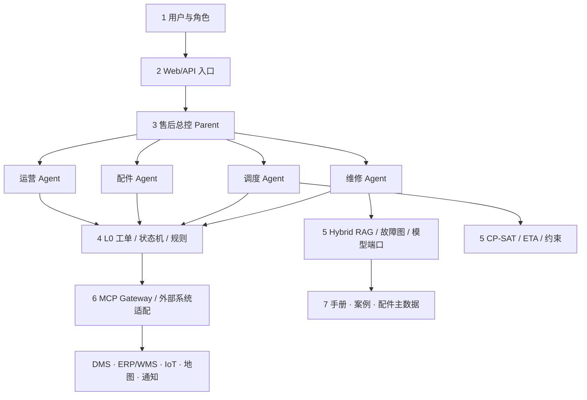
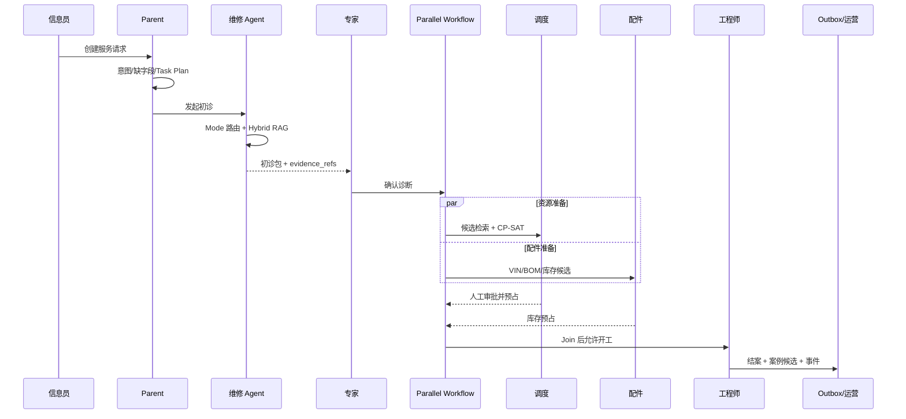

# 总体架构与七层映射

## 1. 为什么不是四个聊天机器人

维修、调度、配件和运营看似都能做成独立聊天框，但它们共享同一个业务事实：哪辆车、什么故障、谁已确认、谁被派出、哪些件被占用、是否结案。如果每个 Agent 维护自己的“真相”，很快会出现：维修改诊了，配件仍按旧诊断发货；调度改派了，旧人员租约没释放；运营把 What-if 当成真实业绩。

RoadMind 因此采用“一个聚合真源 + 多个领域草稿 + 显式工作流”的结构。Agent 可以提出计划和候选，但只有状态机、审批和领域不变量能改变已确认事实。

## 2. 七层如何落到仓库

### 第一层：用户与业务角色

`Role` 定义信息员、工程师、专家、调度员、配件管理员、运营和管理员。`ROLE_SCOPES` 映射角色到能力，例如信息员可建单和发起初诊，但不能确认诊断；运营可问数和模拟，但不能预占配件。

这里的重点是“角色决定能否提出调用”，真正的工具授权还要在 MCP Gateway 再校验一次。Agent 输出里的 tool annotation 只作为描述，不能替代授权。

### 第二层：应用入口

FastAPI 暴露结构化 API；Web 控制台是一个多角色演示入口。生产系统可把 Web 管理端、维修 App、企业微信和外部 API 分开，但它们最终都调用同一应用服务，避免每个入口复制业务规则。

### 第三层：总控与领域 Agent

`DeterministicParentAgent` 是无密钥演示 Parent，输出意图、缺失字段、路由域和 Task Plan。`DeepAgentsParentFactory` 是真实 Deep Agents 工厂。两者共享结构化契约，因此离线测试不会依赖模型随机性。

四个领域 Agent 分别拥有自己的规则：

- 维修：动力类型硬路由、证据检索、冲突检测、初诊包。
- 调度：硬过滤、CP-SAT 目标、短租约、独立验证。
- 配件：确诊门禁、VIN 兼容、原厂/副厂、库存生命周期。
- 运营：指标语义、权限范围、事实/推断/建议/情景分层。

### 第四层：业务本体和状态机

`WorkOrder` 是聚合根。它包含车辆、症状、诊断、候选资源、预占件、Task Plan、审批和时间线。状态变化必须经过 `transition()`；不允许从 `triaged` 直接跳到 `closed`。

生产中的 Ontology 可以把车辆、故障、人员、工具和配件作为对象类型，RoadMind 当前用 Pydantic 模型显式表达同样的对象、关系、动作和规则。

### 第五层：模型与知识能力

示例 Hybrid Retriever 在同一进程内实现词法相关性、向量相似度、结构化品牌/车型过滤、故障图扩展、RRF 和领域重排。生产中相同端口分别由 OpenSearch、pgvector、PostgreSQL 和 Neo4j 承担。

调度通过 OR-Tools CP-SAT 选择整数目标最优候选。模型只看通过硬约束的候选，审批后独立验证器再算一次资格条件。

### 第六层：数据与系统集成

所有外部能力注册为 `ToolSpec`，通过 `McpGateway.invoke()`。Gateway 顺序执行工具存在性、scope、限流、断路器、必填参数、审计脱敏、Trace 和实际调用。

默认 handler 是可重复运行的模拟适配器；换成真实 DMS/ERP/WMS/IoT 时不改变 Agent 与应用服务的边界。

### 第七层：知识与资料资源

`knowledge/corpus.py` 保存带品牌、车型、版本、章节和关联件号的脱敏小语料。案例不能在结案后直接写入生产索引：`close_order` 只创建 `quarantine_pending_quality_review` 候选事件。

## 3. 一张工单的数据流

## 4. 为什么默认使用内存适配器

面试项目最危险的做法之一，是把一堆基础设施写进 Compose，却没有任何业务不变量能在本地验证。RoadMind 反过来：默认适配器确保状态机、审批、补偿、RAG 和 CP-SAT 在一次 `pytest` 中跑完；生产基础设施通过明确端口替换。

这不是声称“内存等于生产”，而是把可验证的领域核心和部署依赖分开。真实边界必须在面试中主动说明。

