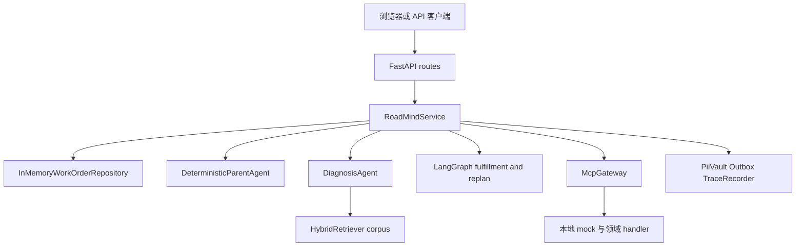

# RoadMind 总体架构与组合根

`roadmind.main:create_app` 是运行入口：创建 `FastAPI`、在 `app.state.roadmind` 放入单例 `RoadMindService`、注册 `/api/v1` 路由和静态控制台。`RoadMindService.__init__` 是应用组合根，装配内存仓储、PII Vault、Outbox、Trace、确定性 Parent、四个领域 Agent、MCP Gateway 与 LangGraph 审批示例。请求的业务真源始终是 [`WorkOrder`](../domain/work-order.md)，不是 Agent 对话。

上图描述默认本地调用路径；`build_gateway` 的 DMS、IoT、地图 handler 明确返回 `mock_*_adapter`，不是外部系统连接。

## 职责分层与入口

| 层 | 主要拥有者 | 责任与关键边界 |
|---|---|---|
| HTTP | `api/routes.py`、`api/dependencies.py` | 用 `X-User-Id`、`X-Role`、`X-Region` 形成 `Principal`；路由只委托服务，`present_order` 对非调度员/管理员遮蔽审批 token。 |
| 应用编排 | `application/service.py:RoadMindService` | 取得版本快照、执行 scope 和状态前置条件、调用 Agent/图、记录时间线，再以 `expected_version` 保存。 |
| 领域 | `domain/models.py`、`state_machine.py` | `WorkOrder`、审批、计划和状态转移规则；转移统一增加 `version` 并追加事件。 |
| 智能能力 | `agents/*`、`knowledge/*` | Parent 仅产生结构化计划；诊断只输出初诊和证据；调度/配件只计算候选和本地预占。 |
| 工具与基础设施 | `mcp/*`、`infra/*` | MCP 统一授权/校验/审计；仓储、PII、Outbox、Trace 均为进程内实现。 |

## Parent 不等于工作流

`DeterministicParentAgent.understand` 与 `.plan` 处理意图、缺失字段和 `TaskPlan` 模板；它**不**执行履约或审批。默认实现是离线确定性的，保持与 LLM Parent 相同的结构化契约。`DeepAgentsParentFactory.create` 是惰性导入的可选适配器，须安装 `agent` extra 并由调用者提供模型、工具和 prompt；当前 `RoadMindService` 没有装配它。

相反，`build_parallel_fulfillment_graph`、`build_mismatch_replan_graph` 把并行 join 和补偿顺序固定为显式 LangGraph 图。其业务落点和人工门禁见[工单生命周期](../workflow/work-order-lifecycle.md)与[履约、改诊和恢复](../workflow/fulfillment-replan.md)。

## 错误与真实边界

`create_app` 将 `WorkOrderNotFound`、`ToolNotFound` 映射为 404，将 `PermissionDenied` 映射为 403，将 `InvalidTransition`、`OptimisticLockError` 映射为 409，将业务 `ValueError` 映射为 422。它还将 Gateway 的 `RateLimitExceeded` 映射为带 `Retry-After: 60` 的 429（`error: rate_limit_exceeded`），将 `CircuitOpen` 映射为 503（`error: upstream_circuit_open`）。这使网关韧性机制成为公开 HTTP 契约；错误来源、恢复语义和聚焦测试见[MCP Gateway、权限、审计与 Trace](../platform/mcp-security-observability.md)与[HTTP API、角色与验证矩阵](../reference/api-and-validation.md)。

PostgreSQL、Redis、Neo4j 和 LangSmith 是生产替换意图：Compose 的 `infra` profile 仅声明容器，默认服务没有连接它们。详细运行边界见[运行环境与控制台](../operations/runtime-and-console.md)，数据替换面见[数据可靠性](../platform/data-reliability.md)。
