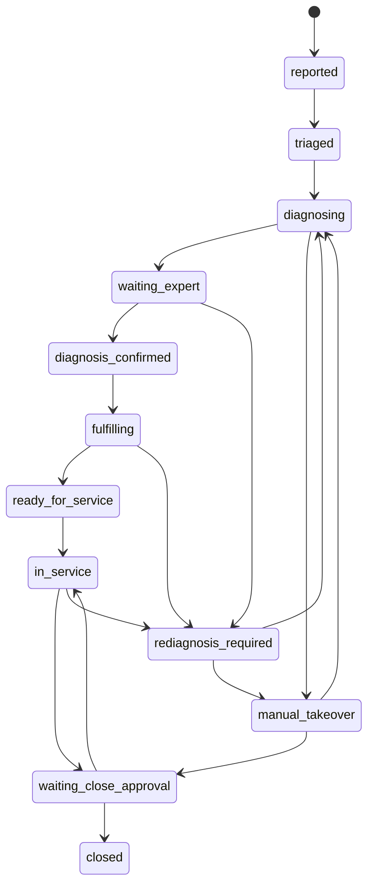

# L0 工单、版本与状态边界

`domain/models.py` 把 `WorkOrder` 定义为 L0 业务真源。`ServiceRequestCreate` 是创建输入；服务将姓名和手机号写入 `PiiVault`，工单只存 `reporter_pii_ref`。随后 `WorkOrder.model_validator:set_thread_id` 保证 `thread_id` 缺省时等于 `service_request_id`，因此同一工单的计划、时间线及可选 LangGraph 配置可以使用同一个稳定键。

## 四层记忆/数据边界

| 层 | 载体 | 可放内容 | 不变量 |
|---|---|---|---|
| L0 工单状态 | `WorkOrder` 与仓储 | 车辆、症状、DTC、诊断、候选、预占、审批、计划、时间线 | 是 Agent 可见的业务协调状态，但不含直接联系人 PII。 |
| 任务计划 | `TaskPlan`、`TaskItem` | 域、动作、依赖、任务状态、结果、`plan_version` | Parent 生成；改诊冻结旧版本而非原地伪造历史。 |
| 隐私隔离 | `PiiVault` | `reporter_name`、`reporter_phone` | 工单只存引用；`reveal(..., authorized=True)` 才允许读取。 |
| 图检查点 | `NativeApprovalWorkflow` 的 `MemorySaver` | 独立 interrupt/resume 示例状态 | 进程内、非主工单审批真源；重启即丢失。详见[履约、改诊和恢复](../workflow/fulfillment-replan.md)。 |

这不是通用长期记忆系统：语料 `knowledge/corpus.py:DOCUMENTS` 是版本化只读示例知识，结案案例只被标成隔离候选，尚未写回检索库。

## 关键对象与双版本语义

- `version`：由 `InMemoryWorkOrderRepository.save` 在每次成功保存时设为存储中当前版本加一；因此不只状态转移，任何通过仓储成功的写入都会推进版本。`transition` 负责验证状态边、写 `updated_at`、追加 `status.changed`，但不直接递增 `version`；仓储也在存储前刷新 `updated_at`。`RoadMindService` 读出时保存 `expected_version`，仓储拒绝陈旧写入；调用方收到冲突后必须重新读取，不可把旧副本再次保存。
- `plan_version`：`TaskPlan` 的流程代际。首版为 1；`report_mismatch` 新建 `old + 1` 的计划，并将旧号附加到新计划的 `frozen_versions`。该历史表示旧任务图被冻结，新的 `tasks` 从 Parent 模板重新开始；它不等于工单 `version`。改诊会保留 `replan_count`、`timeline` 和冻结版本历史，但清空已选资源、已预占件、两类候选及诊断的确认字段，随后从 `REDIAGNOSIS_REQUIRED` 再进 `DIAGNOSING`。
- `Approval`：包含随机 `token`、请求角色、状态和决定者。诊断确认、调度派工和结案确认各有审批对象；`present_order` 仅向相应请求角色或 admin 显示 token。token 没有过期字段或一次性消费标记。
- `EvidenceRef`：证据 ID、来源、品牌、可选车型、版本、评分、片段。`DiagnosisPackage` 同时保存证据列表和每个假设引用的 ID。

该图是 `ALLOWED_TRANSITIONS` 的许可边，不代表每个状态都由一个公开端点直接可达。结案路径已有两个端点：`close_order` 到 `WAITING_CLOSE_APPROVAL` 并生成 `service.close` token，`approve_closure` 批准后才到 `CLOSED`；若拒绝则回 `IN_SERVICE`。该 token 与诊断/派工 token 同属工单审批记录，具体调用顺序见[主工单生命周期](../workflow/work-order-lifecycle.md)。

## 修改守则与验证

不要直接改 `order.status`：使用 `transition(order, target, actor, reason)` 才会验证边并记录 `status.changed`；随后必须经 `repo.save(..., expected_version=...)` 持久化，后者才推进 `version`。新增状态必须同时调整 `ALLOWED_TRANSITIONS`、服务前置条件、API 行为和测试。

`tests/test_domain.py` 证明：创建时线程键相同且 JSON 不含手机号；Vault 需要显式授权；不能从 `TRIAGED` 跳到 `CLOSED`；陈旧 `expected_version` 抛 `OptimisticLockError`；无关角色不能写配件。完整状态落点见[工单生命周期](../workflow/work-order-lifecycle.md)。
