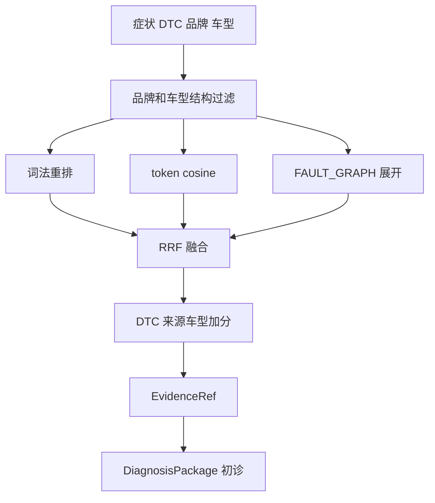

# 证据优先诊断与 Hybrid Retriever

`DiagnosisAgent.diagnose` 是初诊器，不是确诊器。它根据 `PowerType` 选择柴油 `OEM_SPECIAL_TOOL` 或新能源 `EV_MANUAL_RAG`，调用 `HybridRetriever.search`，生成假设、SOP、工具、候选件和带版本的 `EvidenceRef`；无论置信度，`requires_expert=True`。只有 `RoadMindService.confirm_diagnosis` 接收 expert 的匹配 `diagnosis_id`、`approved=True` 和非空 `confirmed_code` 后，才会写入确诊码并启动履约。

## 检索流水线

流程由 `knowledge/retrieval.py:HybridRetriever.search` 实现：

1. 先保留 `document["brand"] == brand` 且车型为通配或严格相同的 `DOCUMENTS`；无候选直接返回空。
2. `_tokens` 产生 Latin token、单汉字和汉字 bigram。词法排序使用 `_lexical_score` 的 token 重叠计数（类 BM25，并非完整 BM25 统计模型）。向量排序实际是 token Counter 的余弦相似度，不是外部 embedding 服务。
3. 用输入 DTC 在 `FAULT_GRAPH` 展开原因词，按文档 text 中原因命中数产生第三个排序。
4. 所有候选取得三个 rank，`rrf_score = Σ 1/(60 + rank)`；然后加 `0.08 * dtc_match`、FIM/SOP 的 `0.04`（case 为 `0.01`）和严格车型的 `0.03`。最多取 4 条，再按本批最高 rerank 分归一化为 `EvidenceRef.score`。

因此证据分数仅用于本次候选排序，不能跨查询解释成概率或生产 RAG 相关度。

## 安全与确诊门禁

`_build_hypotheses` 在无 DTC 时只产出 `SYMPTOM_ONLY`、0.3 假设，置信度也不会获得 DTC 加分。候选件来自检索证据中 `parts` 字段，但这不授权预占；[`PartsAgent.candidates`](../workflow/fulfillment-replan.md) 还会要求 `confirmed_code`。

新能源 SOP 必含下电、验电、挂牌和绝缘门禁，且只输出检查计划；`DW-HV-SOP-2025-06` 明示远程 Agent 不得指导带电拆装。`_detect_conflicts` 在检索片段出现“带电拆装”时报告 HV 冲突；调度端还硬过滤 `hv_certified`。这是两道独立防线，而非模型置信度条件。

## 证据与测试

`knowledge/corpus.py` 是小型、进程内、版本化演示语料，包含 FIM、SOP、案例及故障图；不是已连接的 OpenSearch/Neo4j。`tests/test_diagnosis_and_retrieval.py` 验证柴油路由、证据品牌与版本、确诊码为空且必须专家确认；验证 EV SOP/冲突包含高压门禁；验证无 DTC 的低置信假设。主调用和人工确认参见[工单生命周期](../workflow/work-order-lifecycle.md)。
