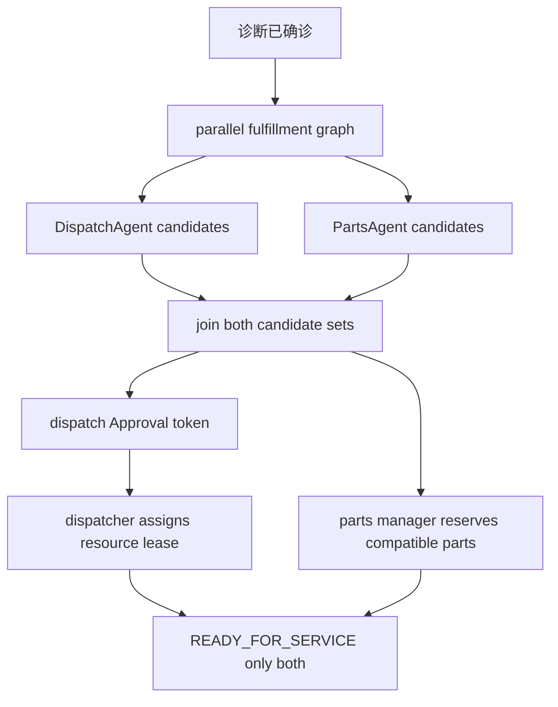
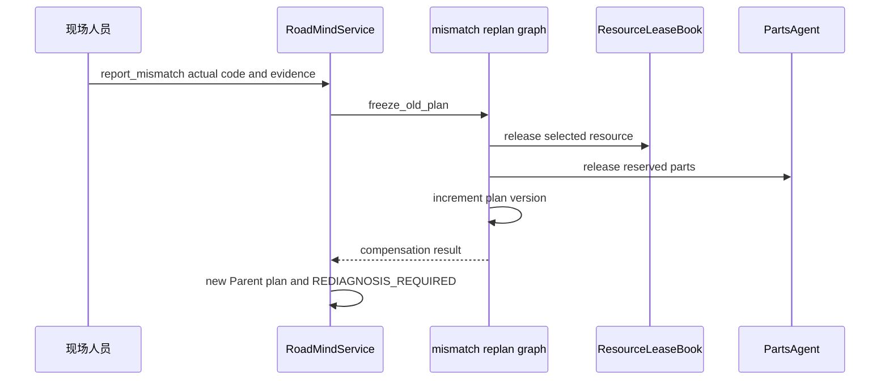

# 并行履约、改诊补偿与 LangGraph 恢复

确诊后，`RoadMindService._prepare_parallel_fulfillment` 用 `build_parallel_fulfillment_graph` 同时运行 `DispatchAgent.candidates` 和 `PartsAgent.candidates`，在 `join` 节点汇合。图只负责候选准备；真正的资源/库存写操作仍要走人工 API、审批 token 与 MCP Gateway。

## 调度、审批与 lease

`DispatchAgent.candidates` 先硬过滤可用性、品牌、服务模式、动力技能；电动车还要求 `hv_certified`。仅对剩余候选按技能、ETA、负荷和固定兼容项打分，再用 `_solve_cp_sat` 建立“一项必选”的 OR-Tools CP-SAT 最大化模型（0.5 秒上限）。这并不是跨多工单/多时段产能优化。

候选排首不等于自动派工。`approve_dispatch` 检查 pending `Approval.token`，`verify_assignment` 再次验证候选和 HV 资质，再经 `workflow.assign_resource` 调 `DispatchAgent.reserve`。`ResourceLeaseBook` 是加锁内存实现，模拟 Redis lease：同资源被其他工单在 120 秒 TTL 内持有则抛 `LeaseConflict`。修改调度约束时，应同时更新硬过滤、独立验证器、候选理由和 EV 测试，不能只改 CP-SAT 分数。

### 空候选与扩展 join 的实际语义

`join` 总会在两个节点返回后执行，但它以列表真值计算：任一候选列表为空时，`joined` 为 false，对应 `dispatch_ready` 或 `parts_ready` 也为 false。服务仍把两个（可能为空）结果写入工单、创建调度审批并将任务设为 `dispatch=WAITING_APPROVAL`、`parts=RUNNING`，然后转 `FULFILLING`；没有候选失败分支、自动人工接管或自动状态推进。因为 `_advance_if_fulfillment_ready` 仅检查 `selected_resource_id and reserved_part_codes`，空集时无法通过现有 API 合法完成预占，工单会停留在 `FULFILLING`，需要调用方/未来策略处理。

新增履约分支或改变 join 条件时，必须同步修改 `FulfillmentState`、图节点/汇合计算、`_prepare_parallel_fulfillment` 的结果映射、Parent `TaskPlan` 中相应 `TaskItem.depends_on` 与初始状态，以及 `_advance_if_fulfillment_ready` 的状态谓词；还要定义空候选与任意完成先后顺序的行为。否则图的 `joined` 只会是观测值，无法保证领域任务与 `READY_FOR_SERVICE` 的真实门槛一致。

## 配件门禁

`PartsAgent.candidates` 要求 `diagnosis.confirmed_code`，并以品牌与车型匹配作为此演示中的 VIN/配置兼容代理；`PartCandidate.compatibility` 回显 VIN 与 `configuration_code`，但没有解析 VIN 的真实零件适配表。服务只允许预占候选集合，库存扣减在 `PartsAgent.reserve` 内原子检查重复/缺货后进行。`bring_both=True` 会从候选中补入一个 OEM 和一个非 OEM 件（若都存在），以 `dict.fromkeys` 去重；它不是替代确诊的绕过路径。

## mismatch：冻结、逆补偿、再计划

`report_mismatch` 仅允许 `FULFILLING`、`READY_FOR_SERVICE`、`IN_SERVICE`。`build_mismatch_replan_graph` 依次执行 freeze、补偿、`old_plan_version + 1`；服务冻结旧版本号、清空资源/件/候选、清除确诊码、记录 `saga.compensated`，再回到 `REDIAGNOSIS_REQUIRED`。`replan_count > MAX_REPLANS`（3）才追加转 `MANUAL_TAKEOVER`，所以第 4 次才触发人工接管。这里的补偿由图内 closure 执行；`infra/outbox.py:Saga` 是可复用的逆序补偿工具，当前主路径未实例化它。

## 主审批路径与 Native interrupt 示例

主工单审批不是 `NativeApprovalWorkflow`：诊断专家和调度员分别通过 `/expert-confirm`、`/dispatch/approve`，以持久在 `WorkOrder.approvals` 中的 `Approval` 和 token 处理。`NativeApprovalWorkflow` 只是 `workflows/langgraph_flows.py` 的小型语义证明：`_human_gate` 调 `interrupt`，`start(thread_id, request)` 和 `resume(thread_id, decision)` 都以该键配置图。

它编译时使用 `MemorySaver`，检查点只在进程内；重启应用就不能恢复。`thread_id == service_request_id` 有助于将来用外部 checkpointer 对齐工单，但当前服务并未将这个示例接到专家/调度 API，也没有持久化检查点。因此不要把 `test_native_langgraph_interrupt_resume` 当作主业务审批的崩溃恢复证明；生产替换需实现持久 checkpointer、审批幂等性和与仓储版本的原子协调。

## 测试

`test_parallel_fulfillment_and_join_to_ready` 证明两个候选集均存在，且两个人工写入后才 ready；`test_dispatch_requires_valid_approval_token` 拒绝陈旧 token；`test_ev_dispatch_candidates_all_have_hv_cert` 验证安全硬约束；`test_mismatch_freezes_plan_and_compensates` 验证版本递增、冻结、库存归还和 saga 事件。执行 `pytest tests/test_full_workflow.py -q`。
