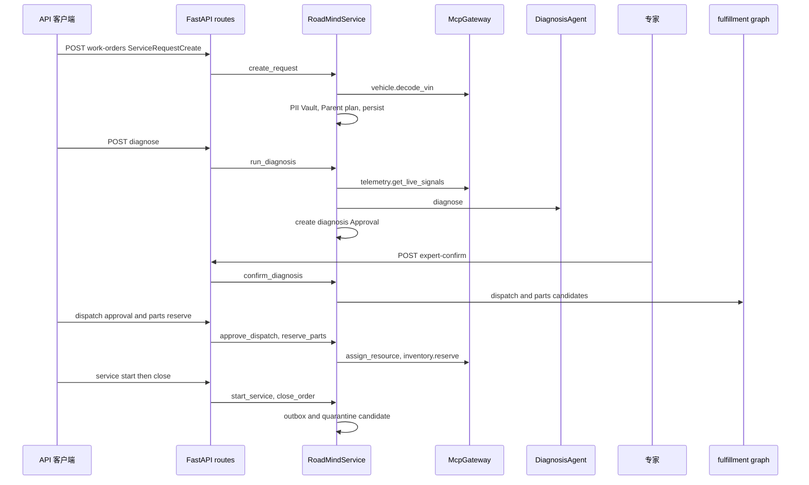

# 从 `ServiceRequestCreate` 到 `WorkOrder` 结案

所有 HTTP 路由在 `api/routes.py` 中，落入 `RoadMindService`。下图对应默认柴油成功路径；每一步都会受角色 scope、状态机和乐观锁共同约束。

该图省略读取/列表端点和失败分支；路径细节如下。

## 调用步骤与不变量

1. **创建**：`create_request` 要求 `workorder:create`，先经 `vehicle.decode_vin`（本地 mock DMS）验证 VIN，再将报告人 PII 放入 Vault。构造 L0 工单、写 `service_request.created` 时间线、调用 Parent `.plan`，转到 `TRIAGED`，`repo.create`，最后追加 `service_request.created` Outbox 消息。
2. **初诊**：`run_diagnosis` 仅允许从 `TRIAGED` 或 `REDIAGNOSIS_REQUIRED` 进入 `DIAGNOSING`。它在 agent trace 中取 mock IoT 信号，调用诊断器，将 `diagnose` 任务置成功，创建 `diagnosis.confirm` 的 expert `Approval`，转为 `WAITING_EXPERT` 并保存证据 ID。
3. **确诊与候选**：`confirm_diagnosis` 校验等待状态、诊断 ID、pending approval；拒绝则到 `REDIAGNOSIS_REQUIRED`。批准必须给 `confirmed_code`，随后转 `DIAGNOSIS_CONFIRMED`、生成并行人员/配件候选、创建 `dispatch.assign` token，转 `FULFILLING`。初诊和确诊的理由见[诊断与检索](../intelligence/diagnosis-retrieval.md)。
4. **履约 join**：调度员持未过期的匹配 token 调 `approve_dispatch`；服务先独立验证候选，再通过网关获得 120 秒资源 lease。配件管理员只能预占 VIN 兼容候选；两者都完成才由 `_advance_if_fulfillment_ready` 转 `READY_FOR_SERVICE`。细节见[履约、改诊和恢复](fulfillment-replan.md)。
5. **服务与结案**：`start_service` 需 `service:execute` 并依状态机进入 `IN_SERVICE`。`close_order` 仅接受该状态，顺序转到 `WAITING_CLOSE_APPROVAL` 后立即转 `CLOSED`，记录 service/archive 任务及 `knowledge.case_candidate_created`。该事件的 `publication_status` 是 `quarantine_pending_quality_review`；没有代码将其发布到 `DOCUMENTS`。最后添加 `workorder.closed` Outbox 消息。

## 失败路径与边界

每个写服务先读取 `expected = order.version`；合法 `transition` 会递增 `version`、写 `updated_at`、追加 `status.changed`，最终 `repo.save` 再刷新 `updated_at` 并比较该预期版本。故两个并发写入者持同一旧快照时，先保存者成功，后保存者因 current version 不同失败，HTTP 得 409，客户端必须重新读取而不能覆盖。错误角色得 403；错误状态、错误诊断 ID、失效 token、非候选配件等业务规则得 422。现场证据不匹配不应强行结案，而应调用 `/mismatch`，执行冻结和补偿后重诊；见[改诊补偿](fulfillment-replan.md)。

名称 `WAITING_CLOSE_APPROVAL` 不表示当前代码存在第二个人工关闭审批：`close_order` 在同一次调用中直接跨过该状态。这是模型可表达的生产扩展点，不是已实现的关闭人工门禁。

## 回归锚点

`tests/test_full_workflow.py:test_parallel_fulfillment_and_join_to_ready` 验证候选、token 派工、配件预占及 join；`test_normal_closure_creates_quarantined_case_and_outbox` 验证最终 `CLOSED`、隔离状态和待投递事件。运行 `pytest tests/test_full_workflow.py -q` 覆盖这条主链及改诊、HV、interrupt 测试。
