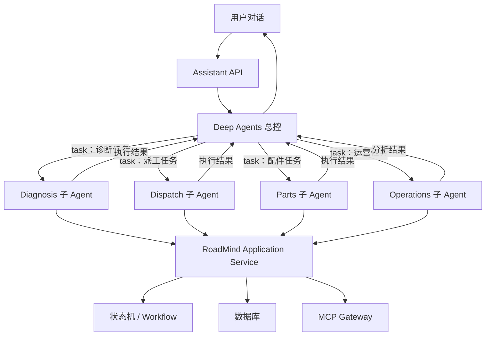
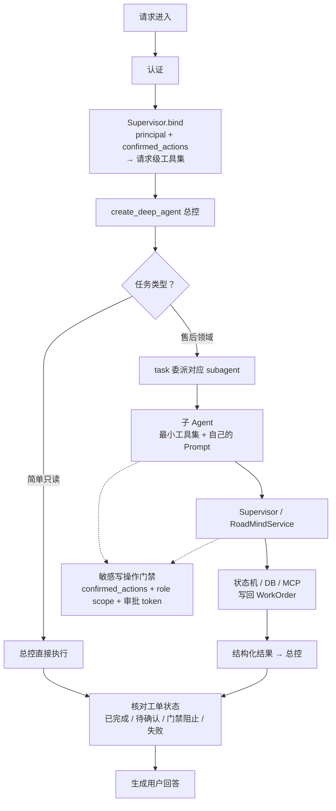
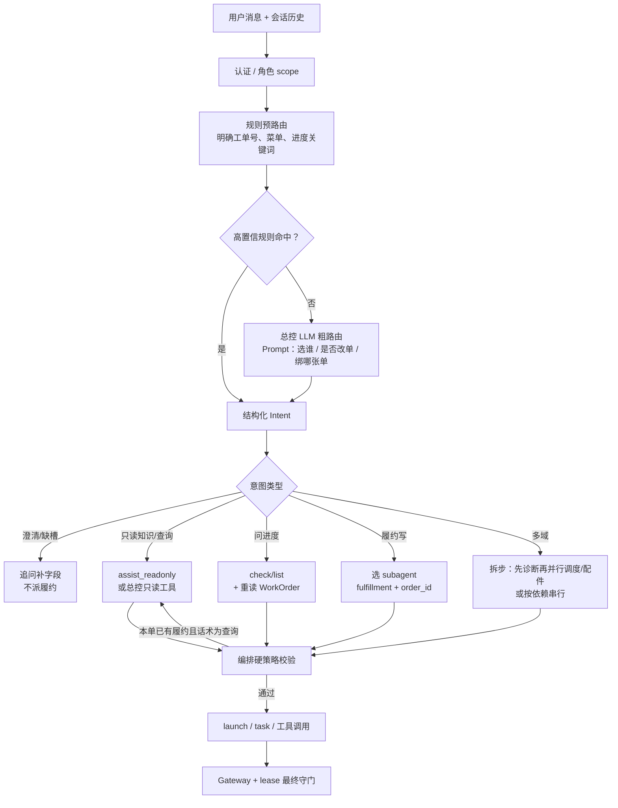
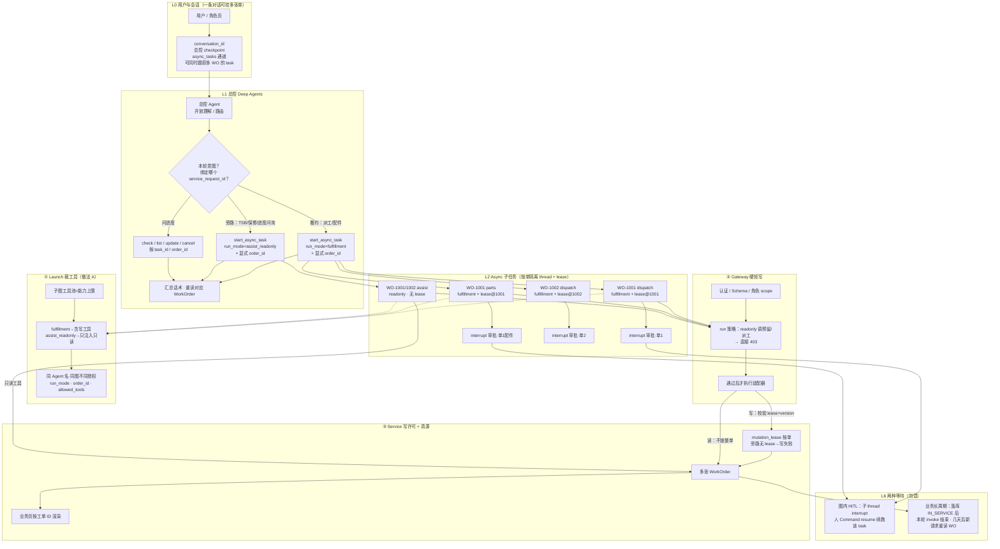
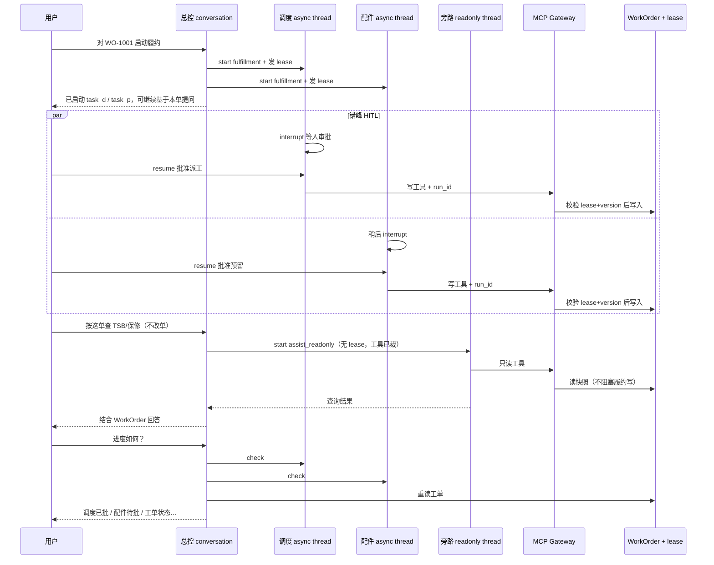
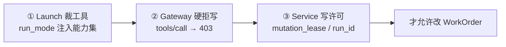
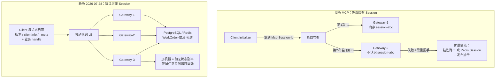
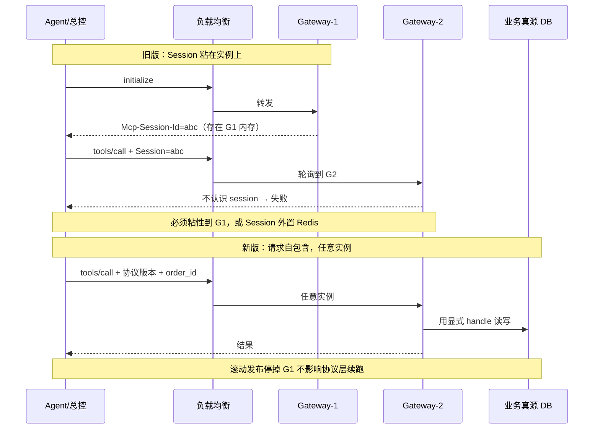
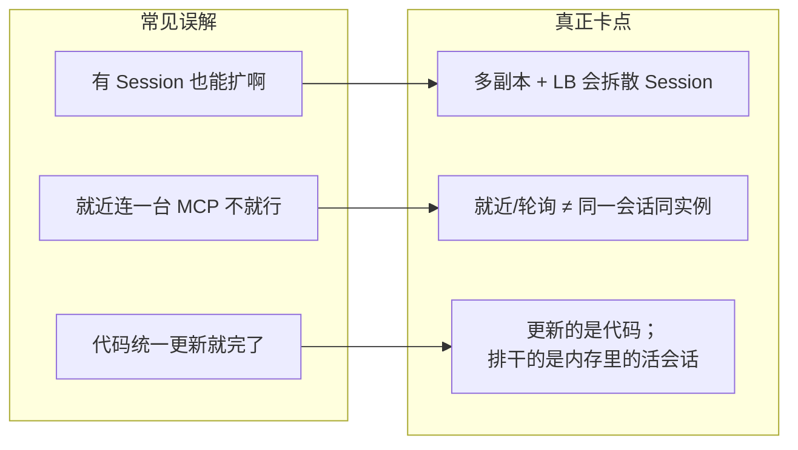

# RoadMind 总控 Agent、MCP、LangSmith 完整面试问答

> 使用方式：先只看问题，口述 60～90 秒，再展开答案核对。不要逐字背诵，要记住每题的“结论—设计—边界—改进”四段结构。

> 总控 Agent 是本人主责模块，另见专项稿：[售后服务总控Agent_主责专项深挖.md](</D:/知识库/知识库/面试/复习/售后服务总控Agent_主责专项深挖.md>)。

## 重要 ID 速查（先背清再答细节）

| ID | 管什么 | 注意 |
|---|---|---|
| `service_request_id` | WorkOrder 业务主键（如 WO-1001）；工单生命周期固定维护 | 业务真源键；前端分页面、审计、排障都靠它 |
| `conversation_id` | 总控多轮对话 ID；Deep Agents checkpoint 的 `thread_id` 当前用它 | 会话续跑用；**不等于**工单 ID |
| `thread_id`（对话） | 图执行/checkpoint 链作用域 | 当前 ≈ `conversation_id` |
| `thread_id`（领域/工单） | 文档里有时与 `service_request_id` 对齐，用于工单审计 | 与对话 `thread_id` **不是一回事**；单工单可对齐，多工单聊天不能硬绑 |
| `checkpoint_id` | 某条 thread 上某一次状态快照 | 历史回溯 / time travel 靠它；不能用租户或用户 ID 替代 |
| `tenant_id` / `org_id` | 多租户隔离 | 鉴权、DB、配额、Trace 透传；可拼进 thread 命名空间防串会话 |
| `user_id` + `role` | 用户与角色 | 请求级 principal；与 tenant 组成完整身份 |
| `version` | 工单乐观锁/并发版本 | 与 checkpoint 协调，但不是分布式事务 |
| `plan_version` | 调度/履约计划版本；改诊重规划时递增 | 旧计划可冻结；幂等键常带它 |
| 幂等键 | 如 `order_id + plan_version + action` | 防重试双写（扣库存/派工） |
| `span_id` / `parent_id` | Trace 父子调用树 | 本地 TraceRecorder / LangSmith；工具挂在当前 Agent Span 下 |
| `trace_id` / `run_id` | 一次请求观测链；Feedback 可挂 run | 按 `service_request_id` 打开根 Trace 排障 |
| MCP 业务 handle | 如 `order_id`、`basket_id`、`task_id` | 无状态协议下跨请求显式携带，不藏在 session |
| 外部工单映射 | `tenant_id + source_system + external_order_id` → 内部 `service_request_id` | 防重复建单 |
| Redis 租约 value | 常等于当前 `order_id` / 工单 ID | 短租约防双占；过期≠工单取消 |
| Skill 版本 | 如 `diagnosis-triage@1.3.0` | 会话钉版本；Trace 记 `skill_name`/`skill_version` |

**一句话关系：**

- 业务页 / WorkOrder → `service_request_id`（+ `version` / `plan_version`）
- 总控续聊 / interrupt 恢复 → `conversation_id`（= 对话 `thread_id`）+ `checkpoint_id`
- 多租户隔离 → `tenant_id` + `user_id`（+ role）；完整定位常为 `tenant_id + user_id + thread_id + checkpoint_id`
- 观测排障 → Trace 的 `span_id`/`parent_id`，并用 `service_request_id` 关联业务
- 子 Agent：`task` 当次隔离临时状态，**不**另存 4 条长期主会话 checkpoint；业务写入 WorkOrder，追踪看 Trace

---

## 一、回答口径与真实性边界

### 可以明确说已经实现

- Deep Agents 交互式总控 Agent，以及无模型密钥时可测试的确定性回退实现。
- diagnosis、dispatch、parts、operations 四个专业 Agent 的职责和最小工具集隔离。
- 总控按当前认证用户、当前对话轮次绑定工具；敏感动作需要显式确认，不能由模型自行批准。
- MCP `2026-07-28` 无状态 JSON-RPC 适配器及 `/mcp` POST 端点。
- `server/discover`、`tools/list`、`tools/call`，协议版本、客户端元数据和路由 Header 校验。
- MCP Gateway 的 scope 校验、参数校验、限流、熔断、审计、PII 脱敏和 Trace Span。
- 本地父子 Trace 树；工具 Span 自动挂在当前 Agent/Workflow Span 下。
- LangGraph checkpoint、interrupt/resume、并行 Join、改诊补偿等流程。

### 必须说明是可选集成或生产替换点

- LangSmith 云端 Trace：项目定义了兼容的 Trace 和 metadata 方案，默认本地记录，不声称在无密钥环境上传了企业数据。
- 当前 checkpointer 是 `MemorySaver`，生产应替换为持久化 saver。
- 当前 `ConversationStore` 也是进程内实现；跨重启、跨实例对话记忆尚未生产化，不能说已经有完整跨会话用户长期记忆。
- OpenShell/NemoClaw 已完成独立 Agent Harness 镜像和运行契约设计，但尚未完成真实沙箱蓝图、策略、provider 的生产联调；官方当前仍为 Alpha/预览。
- 项目是单仓多服务：代码同仓维护，但默认 Compose 的 `web`、`api`、`mcp-gateway`、`postgres`、`redis` 是五个独立容器。
- 默认 Compose 中总控 Agent 随 API 进程运行；`Dockerfile.agent` 是可选独立 Harness，尚未加入默认 Compose。四个业务 subagent 从未作为四个独立服务部署。
- 当前限流、熔断状态和审计存储主要是进程内实现，生产应迁移到 Redis、数据库或日志平台。
- Skill 统一中心、RubricMiddleware 自动修订闭环属于可以接入的增强方案，不是当前仓库已经完整上线的模块。
- 不要编造真实生产用户量、准确率、SLA、降本比例和外部企业系统接入情况。

---

## 第一轮：职责介绍

### Q1：你在项目中主要负责什么？

**标准回答：**

我主要负责 Agent 平台的控制面和运行链路，核心是三个部分。

第一是总控 Agent。我负责总控的角色边界、任务理解、专业 Agent 选择、上下文传递、结果汇总和人工确认门禁。总控本身不代替诊断专家、调度员或配件管理员做高风险决定，而是把四个专业 Agent 以 `subagents` 注册进 Deep Agents，通过框架的 `task` 工具中心化委派给 diagnosis、dispatch、parts、operations；子 Agent 各自隔离上下文、独立 Prompt 和最小工具白名单，只把最终结果回给总控，中间工具轨迹不污染总控上下文。

第二是 MCP Server 与 Gateway。我负责 Server 侧搭建与维护：`2026-07-28` 无状态 JSON-RPC 适配、`/mcp` 端点，以及 `server/discover`、`tools/list`、`tools/call` 的协议与元数据校验；同时把业务能力以标准 MCP Tool 暴露，在 Gateway 统一做身份 scope、参数 Schema、限流、熔断、审计和 Trace，避免每个 Agent 直接连接数据库或外部系统。

第三是全链路可观测。我设计了从总控、子 Agent、Workflow 到 MCP Tool 的父子 Trace，并统一携带工单、计划版本、操作者、工具风险等 metadata。默认实现是本地 TraceRecorder，生产可以镜像到 LangSmith，用于定位路由、模型、工具或业务门禁问题，并将失败 Trace 转成回归评测数据。

三部分正好构成闭环：总控负责决策，MCP 负责受控执行，Trace/LangSmith 负责观测和评测。

### Q1.1：为什么这三个模块可以串成一个职责，而不是三个不相关的技术？

**参考回答：**

它们对应一次 Agent 请求的完整生命周期。总控决定“做什么、交给谁”；MCP Gateway 决定“这个身份能不能调用、参数是否合法、外部动作如何执行”；Trace 决定“实际走了哪条路径、在哪里失败、是否绕过门禁”。如果只做总控而没有工具治理，模型可能越权；只有工具治理而没有观测，线上无法定位；只有观测没有控制面，则只能事后看问题。因此这三块共同组成 Agent 平台控制面。

### Q1.2：哪些是你个人做的，哪些是团队协作的？

**参考回答：**

我的主要工作是总控 Agent、MCP 协议适配/Gateway 和 Trace 模型的方案设计与核心实现。领域 Agent、状态机和工具契约我深度参与并负责衔接。数据库、外部 DMS/WMS/OEM 接口和云端部署属于适配器或协作边界。在这个可运行样板中，外部系统默认使用本地适配器验证契约，我不会把模拟适配器说成已经打通真实生产系统。

### Q1.3：你实际写了哪些核心代码？

**参考回答：**

总控侧包括 `BusinessAgentSupervisor`、请求级 `BoundBusinessAgentTools`、Deep Agents Runtime、四个专业 Agent 的声明式工具白名单和系统约束。MCP 侧包括无状态协议处理器、`server/discover`、`tools/list`、`tools/call`、Gateway 的 scope/Schema/限流/熔断/审计。观测侧包括基于 `ContextVar` 的父子 Span 传播，以及将 `service_request_id`、actor、risk 等写入 metadata 的统一入口。

### Q1.4：你最熟、最能被深挖的是哪一部分？

**参考回答：**

我最熟的是总控 Agent 和 MCP Gateway 的衔接，因为这里同时涉及任务委派、最小权限、人工确认、无状态协议、工具 Schema、异常语义和 Trace 传播。LangSmith 我更熟的是 Trace 与评测体系设计；云端上传属于可选集成点，我不会夸大为已上传真实企业数据。

---

## 第二轮：项目与总体架构

### Q2：用一分钟介绍项目。

**参考回答：**

RoadMind 是商用车售后知识与服务协同平台，不只是一个聊天机器人。它把故障上报、证据初诊、专家确认、人员和工具调度、配件预留、现场维修、改诊补偿、结案和运营分析串成一张可恢复工单。开放式理解由总控和专业 Agent 完成，高风险流程由 LangGraph、领域状态机和审批门禁约束，所有外部副作用统一经过 MCP Gateway。核心思想是：LLM 负责理解和候选，确定性代码负责不变量，人工负责受监管决定。

### Q2.1：为什么不是一个超级 Agent 加很多工具？

**参考回答：**

因为四个领域的上下文、目标函数、工具权限和失败策略不同。诊断关注证据和安全，调度关注硬约束与 ETA，配件关注 VIN/BOM 和库存，运营关注指标口径。全部塞给一个 Agent 会造成工具选择空间过大、Prompt 冲突和权限膨胀。拆分后每个专业 Agent 只看到最小工具集，可独立评测和降级，总控只负责跨域协调。

### Q2.2：总控 Agent、LangGraph、领域状态机分别负责什么？

**参考回答：**

- Deep Agents 总控：它本身就是建立在 LangChain 和 LangGraph 上层的 Agent 框架，负责处理开放式语言、补齐信息、通过 `task` 委派专业 Agent 并汇总结果；不是一套和 LangGraph 完全无关的系统。
- Deep Agents 子 Agent：四个专业 Agent 各自是 LangGraph 子图，编译后用 `CompiledSubAgent` 封装，再经 `subagents` 注册给总控，由 `task` 委派。
- 手写 LangGraph Workflow：固化并行 Join、interrupt/resume、改诊补偿等高风险、可形式化流程（可落在专业子图内部）。
- 领域状态机：守住业务不变量，例如没有专家确诊不能预留配件、派工和配件未就绪不能开工。

一句话：Deep Agents 是基于 LangGraph 的上层 Agent 框架，负责交互与委派；显式 Workflow 管高风险过程；Domain 管事实和规则。

### Q2.3：当前总控和四个子 Agent 到底是什么关系？

**参考回答：**

当前总控使用 `create_deep_agent()` 创建；diagnosis、dispatch、parts、operations 四个专业 Agent 各自编译为 LangGraph 子图，再用 `CompiledSubAgent` 封装后经 `subagents=build_business_subagents()` 注册。Deep Agents 给总控提供受控的 `task` 委派工具：总控不直接调子 Agent 的 Python 方法，而是通过 `task` 把任务交给对应子图；子图在隔离上下文中跑完，只把结果返回总控。

```python
create_deep_agent(
    model=model,
    tools=supervisor_tools(),
    system_prompt=SYSTEM_PROMPT,
    subagents=build_business_subagents(),  # 内含 CompiledSubAgent(runnable=compiled_graph)
    checkpointer=checkpointer,
)
```

必须说清楚：四个专业 Agent 是「LangGraph 子图 + `CompiledSubAgent` 封装」，不是纯字典声明式 subagent，也不是脱离 Deep Agents 的五套平级图。

代码定位：

- [总控创建与子 Agent 注册](/D:/ai/学习用例/简历/商用车+航空/项目/ai-commercial-vehicle-platform/src/roadmind/assistant/runtime.py:438)
- [四个子图与 CompiledSubAgent 封装](/D:/ai/学习用例/简历/商用车+航空/项目/ai-commercial-vehicle-platform/src/roadmind/assistant/prompts.py:61)

### Q2.3.1：`task` 靠什么分发？要自己挂 SubAgentMiddleware 吗？和待办清单是一回事吗？

**参考回答：**

**分发机制是 Deep Agents 内置的，不用手写中间件。**

| 项 | 说明 |
|---|---|
| 中间件 | **`SubAgentMiddleware`**（框架内置） |
| 委派工具 | **`task`**（由该中间件提供） |
| 何时挂上 | `create_deep_agent(..., subagents=[...])` 且至少有一个**同步**子 Agent 时自动挂上 |
| 怎么选人 | 总控模型按子 Agent 的 `name` / `description` 决定调用 `task`；框架把任务交给对应子图，隔离跑完只回最终结果 |

注意：

- **不要**再手动 `middleware=[SubAgentMiddleware(...)]`；也不要用 `excluded_middleware` 去掉它（文档规定会 `ValueError`）。  
- 若关掉默认 `general-purpose`（RoadMind 用 `HarnessProfile`），但只要仍传入四个业务 subagent，**`SubAgentMiddleware` + `task` 仍然存在**。  
- 只有「禁用 general-purpose **且** `subagents=` 为空」时，才没有同步 `task` 委派。

**`task` ≠ 待办事项清单：**

| | `task` | 待办 / 计划清单（如 `write_todos`） |
|---|---|---|
| 作用 | **委派给子 Agent** | 总控自己记步骤、勾进度 |
| 属于 | SubAgent 分发 | Planning 规划状态 |
| 关系 | 可先拆 todos，再对某一步调 `task` 派给 diagnosis/dispatch 等 | 勾完 todo **不会**自动等于完成了一次子 Agent 委派 |

演进：长任务/错峰 HITL 用 **`AsyncSubAgentMiddleware`**（`start_async_task` 等），与同步 `task` 是另一套工具，见难点亮点 1。

### Q2.4：当前五个 Agent 是怎么通信的？

**参考回答：**

它们不是五个 Agent 随意互相聊天，而是由总控中心化委派。通信拓扑是：



可以归纳为三条通道：任务通过 `总控 → task → 子 Agent → 结果 → 总控` 传递；业务状态通过 `RoadMindService → Repository → Database` 共享；身份和审批通过请求级 principal、role、`confirmed_actions` 和绑定后的 Supervisor 传递。

### Q2.5：以“诊断工单 WO-1001”为例，完整调用链是什么？

**参考回答：**

1. 用户说“帮我诊断一下工单 WO-1001”。
2. 总控识别为诊断任务。
3. 总控通过 Deep Agents 自动提供的 `task` 工具委派给 `diagnosis-agent`。
4. 委派描述中包含工单编号、用户目标、已知事实和缺失信息。
5. `diagnosis-agent` 调用受限工具，例如 `get_work_order`、`diagnosis_agent_run`。
6. 工具进入请求级绑定的 `BusinessAgentSupervisor`。
7. Supervisor 携带当前 principal 调用 `RoadMindService`。
8. Application Service 执行状态机、Workflow、Repository 或 MCP 能力，并更新业务真源。
9. 工具结果返回诊断 Agent，诊断 Agent 形成结构化执行结果返回总控。
10. 总控核对“已完成、待确认、失败和下一步”，整理成自然语言继续与用户交互。

### Q2.6：为什么四个子 Agent 不直接互相聊天？

**参考回答：**

企业业务不能把 Agent 对话当作事实总线。诊断 Agent 完成后，派工 Agent 不需要询问它发生了什么，而是重新读取 WorkOrder，从唯一业务真源获得当前状态、确诊码、候选、计划版本和待审批动作。这样可以避免消息丢失、上下文歧义和不同 Agent 各自保存一份冲突事实，也便于重试、审计和恢复。

任务通信只携带目标和上下文；业务事实必须结构化写回 `RoadMindService → Repository → Database`；子 Agent 的自然语言结论不能直接覆盖业务状态。

### Q2.7：维修工、配件调度员等业务页面渲染靠什么？靠 Agent state 吗？

**参考回答：**

靠 WorkOrder（经 API → RoadMindService → Repository → DB），不靠总控 Agent 的 checkpoint/state。角色分页面展示的是工单状态、诊断、计划、配件、审批等业务字段；Agent state 只维持总控多轮对话与 interrupt/resume。子 Agent 被 `task` 拉起时只有当次隔离临时状态，结果回总控，业务写入 WorkOrder；追踪与优化看 Trace/LangSmith，不靠再存 4 条长期子 Agent 主会话 state。

### Q2.8：四个子图已经用 CompiledSubAgent 了，还要怎么演进？

**参考回答：**

不是改成动态子 Agent / 异步子 Agent，也不是再换注册方式。当前挂载方式已经固定：

```text
Deep Agents 总控
    ├── DiagnosisGraph    → CompiledSubAgent
    ├── DispatchGraph     → CompiledSubAgent
    ├── PartsGraph        → CompiledSubAgent
    └── OperationsGraph   → CompiledSubAgent
```

外部仍是 `task 委派 → 子图运行 → 结果回总控`。演进指**加深每个子图内部流程**：例如候选并行再 Join、审批 interrupt/resume、改诊补偿等，让高风险步骤更可恢复、可审计。业务真源仍是 RoadMindService / 状态机 / 数据库。

### Q2.9：为什么说这是模块化单体，而不是完整微服务集群？

**参考回答：**

当前仓库优先在单进程中验证领域边界、错误路径和一致性，不把分布式复杂度提前引入。MCP Gateway 和端口已经把边界定义清楚，生产可按负载、团队和数据主权拆分，但不能因为目录多、容器多就直接宣称完整微服务化。

---

## 第三轮：总控 Agent 深挖

### Q3：总控 Agent 的一次请求怎么执行？

**参考回答：**



### Q3.0：修车这种长周期「打断」时，对话框还保留什么？

**参考回答：**

先分清两种等待，不要混成一种 interrupt：

| 类型 | 例子 | 真源放哪 | 对话框 / checkpoint 留什么 |
|---|---|---|---|
| **业务长周期** | 维修工在修车、等配件到货、工单 `IN_SERVICE` 几天 | **WorkOrder**（状态、计划、人员、timeline） | 对话轮次与意图摘要；**不**把几天维修过程塞进 Agent state |
| **图内 HITL 打断** | 审批派工、确认预留、专家签字 | checkpoint + Approval 表 | 暂停点、`interrupt` 载荷、待 resume 的决策；人批完用同一 `conversation_id`/`thread_id` 续跑 |

长周期履约：子图/流程把工单推到「维修中」后应**正常结束本轮 Agent 调用**，业务页靠 WorkOrder 渲染；用户过几天回对话框问「WO-1001 怎么样了」，总控用 `conversation_id` 续聊，并**重新读工单**回答。对话框保留的是会话连续性与待确认上下文，不是维修现场实况；现场实况在工单。

### Q3.0.1：总控不止服务工单，作为后市场企业 Agent 还能做什么？

**参考回答：**

总控是商用车**后市场领域企业入口 Agent**，工单编排是主场景，不是唯一场景。同一套「开放理解 + `task` 委派 + MCP 受控工具 + Trace」可覆盖：

| 场景 | 谁用 | 典型能力 |
|---|---|---|
| 服务工单协同 | 信息员/调度/专家 | 诊断、派工、配件、结案（现有四子 Agent） |
| 技术知识助手 | 技师/专家 | 手册、TSB、故障树、历史案例 RAG（只读） |
| 配件与互换查询 | 配件员 | VIN/BOM、替换件、库存只读、超期预警 |
| 保修与政策问答 | 站长/索赔岗 | 保修条款、责任边界、材料清单（建议+人工确认） |
| 运力与预约咨询 | 调度 | 网点产能、档期、技能匹配（查询/建议） |
| 运营与质量洞察 | 运营 | 重复进厂、时效、一次修好率等受控指标 |
| 投诉升级路由 | 客服 | 识别升级条件，路由到人工/工单，不直接改责 |

边界：总控仍不直接写高风险事实；领域写操作进专业子 Agent + 门禁；跨领域（财务总账、HR）不做。非工单意图走只读工具或轻量子能力，需要落业务时再关联/创建 `service_request_id`。

### Q3.0.2：意图路由整体怎么做？（总控核心能力）

**参考回答：**

意图路由不是「一个分类器选出四个 Agent」这么简单。每一轮总控至少要定清四件事：

| 决策轴 | 问什么 | 典型输出 |
|---|---|---|
| **领域** | 谁来干？ | diagnosis / dispatch / parts / operations / 总控直答 / 澄清 |
| **写风险** | 会不会改 WorkOrder？ | `fulfillment` / `assist_readonly` / 仅 `check` |
| **工单绑定** | 对哪张单？ | `service_request_id`；模糊则先澄清 |
| **执行形态** | 怎么派？ | 同步 `task`（当前骨架）/ `start_async_task`（演进）/ 只读工具直调 |



落地分三层，**软路由可错，硬策略与网关不可靠 Prompt**：

1. **规则预路由（硬优先）**：显式 `WO-xxxx`、角色菜单、「进度/怎么样了」、明确「批准/取消」等，先落结构化 Intent，减少模型胡选。  
2. **总控 LLM 粗路由（软）**：开放话术理解目标、补槽、选专业 Agent、建议 `run_mode`；**不**在此做权限终裁。  
3. **编排硬策略 + Gateway（最终）**：查询强制 readonly、无 lease 拒写、角色 scope、审批 token；路由错最多派错只读或被 403，不能靠「模型说不写」。

当前骨架：粗路由后同步 `task` 委派声明式/`CompiledSubAgent`。演进：粗路由后 `start_async_task`，并带 `run_mode` + `order_id`（见难点亮点 1）。

### Q3.0.3：怎么决定派给哪一个专业 Agent？

**参考回答：**

按**领域职责 + 用户目标动词**，不是按「谁工具多」：

| 信号（示例） | 路由到 | 不该路由到 |
|---|---|---|
| 故障现象、证据、初诊、确诊、改诊 | **diagnosis** | 直接 parts 扣库存 |
| 派谁、档期、技能、ETA、外出 | **dispatch** | diagnosis 里偷偷选人定案 |
| VIN/BOM、替换件、库存、预留 | **parts** | 无确诊却预留（状态机/门禁拦） |
| 指标、重复进厂、时效、报表口径 | **operations** | 用运营 Agent 改派工写库 |
| 手册/TSB/保修条款（不改单） | 总控只读或对应域 **assist_readonly** | 误开 fulfillment |
| 寒暄、澄清、多单歧义 | **总控直答/追问** | 盲目 `task` |

多域目标（「诊断完顺便派工备件」）：总控拆步——先 diagnosis；履约阶段再并行 dispatch+parts（演进 Async）；**不要**一个 subagent 一把梭。  
路由依据写入 Trace metadata（`route_to`、`order_id`、`run_mode`），供误路由 Dataset 回归。

### Q3.0.4：`fulfillment` / `assist_readonly` / `check` 怎么分？

**参考回答：**

看**这一次动作会不会改 WorkOrder**，不是「有没有异步在跑」：

| 用户意图 | 动作 | `run_mode` / 形态 |
|---|---|---|
| 启动/推进派工、预留、改计划、确诊写入 | start/update 履约 | `fulfillment`（发 lease） |
| 按本单查 TSB、保修、手册、库存 | 旁路或只读工具 | `assist_readonly`（无 lease，工具已裁写） |
| 问进度、两张单怎么样了 | `check`/`list` + 重读 WO | 不 launch 写任务 |
| 改派/取消已在跑的履约 | `update`/`cancel` 原 task | 履约通道，协调 lease |
| 槽位不全（缺工单号、缺现象） | 澄清追问 | 不派 |

硬策略示例：本单已有履约 lease，且话术是查询类 → **强制** `assist_readonly`，禁止再开无协调写 task。

### Q3.0.5：同一会话多张工单时，意图路由怎么绑 `order_id`？

**参考回答：**

会话是 `conversation_id`，工单是 `service_request_id`，路由必须**显式绑单**：

1. 用户话术含 `WO-xxxx` → 直接绑定。  
2. 否则看「活跃工单集合」（本会话未关闭的 async task / 最近操作单）。  
3. 活跃集合 > 1 且未点名 → **先澄清**「您指 WO-1001 还是 WO-1002？」，不猜测写。  
4. launch/`task`/工具参数与 Trace 一律带 `order_id`；lease 按单发放，防串写。  

业务页仍按工单 ID 打开 WorkOrder；总控只在对话里编排，不把多单揉成一个隐式「当前单」写库。

### Q3.0.6：路由错了怎么办？最大难点是不是意图分类？

**参考回答：**

**容错：** 只读误路由 → 澄清或改派即可；履约误路由 → 靠最小工具白名单 + Gateway + 状态机/lease，使「派错域」也难完成非法写；连续低置信 → 人工/菜单降级。  
**治理：** LangSmith/本地 Trace 打 `route_to`、是否改单、`order_id`；误路由进 Dataset，优化 Prompt/规则/工具 description，而不是只调温度。  

**最大难点通常不是分类准确率本身。** 路由错可澄清重试；真正难的是并行错峰审批、同单只读旁路、同会话多单与可恢复写同时成立（见难点亮点 1）。意图路由要够用、可观测、可强制降级，但不靠「把分类做成 99%」代替写路径治理。

### Q3.1：为什么工具要请求级绑定，而不是做成全局对象？

**参考回答：**

因为身份、角色、会话和确认动作都属于本轮请求上下文。请求级绑定可避免 A 用户的权限或确认状态泄漏到 B 用户，也避免长生命周期 Agent 在多个工单之间残留状态。全局可以共享无状态服务对象，但不能共享 principal 和本轮授权。

### Q3.2：总控可以直接调用哪些工具？

**参考回答：**

总控只直接暴露对话和只读工具，例如列出 MCP 能力、调用只读 MCP 工具、查看工单列表和详情。真正的诊断、派工、配件等业务动作交给专业 Agent。这样总控不会因为拥有全部写权限而成为单点越权风险。

### Q3.3：怎么防止子 Agent 越权？

**参考回答：**

有三层：第一，构图时给每个子 Agent 声明固定工具白名单；第二，Gateway 服务端重新检查 principal scope，不信任 Prompt；第三，敏感写操作还要求 `confirmed_actions` 和审批 token。模型提示词只是引导，真正安全边界必须在代码和数据层。

### Q3.4：thread_id 是什么？和工单 ID 是一回事吗？

**参考回答：**

在 Deep Agents Runtime 中，checkpoint 的 `thread_id` 当前使用 `conversation_id`，用于恢复一条持续对话；在领域模型中，WorkOrder 的 `thread_id` 与 `service_request_id` 对齐，用于工单审计。两者概念不同：一个是对话/图执行标识，一个是业务聚合标识。单工单会话可以对齐，但多工单会话不能粗暴混为一个 ID，Trace metadata 中应同时记录。

### Q3.5：Checkpoint 历史回溯靠什么 ID？和租户、用户怎么一起用？

**参考回答：**

两层 ID：`thread_id` 定哪条执行链，`checkpoint_id` 定链上哪一次快照；`get_state_history` / time travel 靠后者定位。多租户还要透传 `tenant_id` 与 `user_id`（常加 role）：用于鉴权隔离和 Trace/审计，也可拼进 `thread_id` 命名空间防串会话，但不能替代 `checkpoint_id`。完整键是 `tenant_id + user_id + thread_id + checkpoint_id`。

### Q3.6：为什么 current checkpointer 用 MemorySaver？生产怎么办？

**参考回答：**

MemorySaver 便于本地无依赖验证 interrupt/resume 和连续对话，但进程重启会丢失，也不适合多实例共享。生产应替换为 PostgresSaver 等持久化实现，并通过 thread_id、业务 version 和幂等键协调 checkpoint 与业务数据库，不能假设二者是一个分布式事务。

### Q3.7：怎么防止 Agent 无限循环或反复调用工具？

**参考回答：**

设置任务/Token/工具调用预算、同类错误去重、超时和熔断；领域 REPLAN 有次数上限；连续失败进入人工接管。写操作使用幂等键和业务版本，防止 Agent 重试产生重复副作用。

### Q3.8：Deep Agents 不可用怎么办？

**参考回答：**

项目保留确定性 Runtime，可接收显式结构化 command，不依赖外部模型密钥，便于测试和故障隔离。生产中可以将开放式总控降级为菜单/结构化操作，但不能绕过领域门禁直接写状态。

---

## 第四轮：MCP 基础、租户、LLM Gateway

### Q4：MCP 在系统中解决什么问题？

**参考回答：**

MCP 解决的是 Agent 与外部能力之间的标准化发现和调用，不负责替代业务状态机、数据库事务或模型推理框架。Agent 通过统一的 Tool 描述、输入 Schema 和 JSON-RPC 调用能力；Gateway 再统一处理身份、权限、风险和观测，从而让上层 Agent 不直接耦合具体系统 SDK。

### Q4.1：MCP 的 Tool、Resource、Prompt 怎么区分？

**参考回答：**

三个原语的关键差别是**控制方**，不是「都是一段文本」：

| 原语 | 一句话 | 控制方 |
|---|---|---|
| **Tools（工具）** | 让模型「做事」——执行函数、调 API、写文件 | **模型控制**：模型自己决定要不要调 |
| **Resources（资源）** | 让模型「读数据」——文件、表结构、API 返回体等 | **应用控制**：Host 决定怎么塞进上下文 |
| **Prompts（提示词模板）** | 让用户「选模板」——预定义提示，常带参数 | **用户控制**：用户在 UI 上选择（或 Host 代选） |

- Tool：可能有副作用，例如查询工单、预留配件；走 `tools/list` / `tools/call`。  
- Resource：偏只读资料暴露；不要把所有 GET 都机械改成 Resource。  
- Prompt：MCP Server 提供可发现模板（`prompts/list` / `prompts/get`），展开后由 Host 塞进本轮消息。

当前 RoadMind **主要使用 Tool**，因为业务能力需要参数校验、权限和审计。Prompts/Resources 可讲概念与演进，不要夸大成已全量平台化。

### Q4.1.1：哪些提示词写在 Agent/system prompt，哪些走 MCP Prompts？

**参考回答：**

**MCP Prompts ≠ 总控/子 Agent 的 system prompt。** 前者是可选作业模板；后者是 Harness 内的身份与治理规则。

| 放哪 | 放什么 | 为什么 |
|---|---|---|
| **Agent / system prompt**（Harness 内版本化） | 总控身份、能力边界、委派规则、确认与安全、输出格式；子 Agent 领域顺序、工具约束、失败返回约定；意图路由配合说明 | 每轮几乎都要，不能等人点选；属运行时控制面 |
| **MCP Prompts** | 外出救援接单话术、结案回访提纲、索赔材料清单、某车型检查步骤等**用户可选模板** | 希望在能力目录里被发现、跨客户端复用；由用户/Host 显式选用后再进对话 |
| **不要塞进 MCP Prompts** | 权限终裁、状态机规则、lease/`run_mode` 硬策略 | 这些必须在代码/Gateway，不能靠「选个模板」 |

再和相邻概念切开：

| 东西 | 放哪 |
|---|---|
| Skill（方法包） | Registry + Resolver 加载，不是 MCP Prompts |
| 工单/手册正文 | Resource 或 Tool 读数 |
| 「查库存 / 预留」 | Tool |

**RoadMind 分工：** Agent system prompt 管「谁、能做什么、怎么委派、怎么守门」；MCP 优先暴露 Tool；模板类能力才用 MCP Prompts；不要说「业务 system prompt 都通过 MCP 加载」。

### Q4.2：什么是租户？

**参考回答：**

租户是共享同一套平台、但数据、权限、配置和计费需要彼此隔离的组织单位，例如不同车企、服务网络或客户公司。租户不是单个用户：一个租户下有多个用户和角色。完整多租户通常需要 `tenant_id/org_id + user_id + role`，并在认证、数据库、缓存、RAG 索引、配额、审计和 Trace 全链路透传。

当前项目实现了 principal 的用户/角色 scope 隔离，但不能夸大成已经完成所有租户级物理隔离；生产多租户还需要显式 tenant_id、行级安全或独立库/索引以及租户级配额。

### Q4.3：LLM 网关也是通过 MCP 构建的吗？

**参考回答：**

不一定。MCP 面向工具和上下文能力，LLM 网关负责模型路由、鉴权、限额、重试、Token 和成本，通常走 OpenAI-compatible API 更自然。RoadMind 的总控模型通过配置的模型 Endpoint 调用，企业业务工具经过 MCP Gateway。

如果企业强制所有能力统一发现，也可以把“调用模型”包装成 MCP Tool，但会增加一层协议和流式传输复杂度。我的原则是：主推理链路走模型网关，业务能力走 MCP；除非统一治理收益明显，否则不为了“全 MCP”而增加抽象。

### Q4.4：MCP 是不是用来做微服务之间的通用 RPC？

**参考回答：**

不是首选。服务间高吞吐、强类型、低延迟通信可继续用 REST/gRPC/消息队列。MCP 的优势是让模型或 Agent 能发现并调用能力，包括工具描述、Schema、能力协商和 Agent 语义。纯内部服务不需要被 Agent 发现时，没必要强行 MCP 化。

---

## 第五轮：MCP 旧版会话与 2026-07-28 无状态协议

### Q5：旧版和新版最大的区别是什么？

**参考回答：**

旧版 `2025-11-25` 及更早版本需要先 `initialize/initialized`，服务端可以返回 `Mcp-Session-Id`，客户端后续请求必须携带它。服务端通常要维护 session 状态，集群需要粘性路由或共享 session store。

新版 `2026-07-28` 删除了初始化握手和协议层 session。每个请求自己携带协议版本、客户端信息和能力，任何实例都能独立处理，所以普通轮询负载均衡即可。需要跨请求业务状态时，不再藏在传输 session 中，而是通过显式 `order_id`、`basket_id` 等 handle 由工具返回、后续调用再传入。

### Q5.1：旧版请求举例。

**参考回答：**

第一步初始化：

```http
POST /mcp

{"jsonrpc":"2.0","id":1,"method":"initialize",
 "params":{"protocolVersion":"2025-11-25","capabilities":{},
 "clientInfo":{"name":"roadmind","version":"1.0"}}}
```

服务端返回 `Mcp-Session-Id: session-abc`。后续调用：

```http
POST /mcp
Mcp-Session-Id: session-abc

{"jsonrpc":"2.0","id":2,"method":"tools/call",
 "params":{"name":"workorder.get","arguments":{"order_id":"SR-1001"}}}
```

### Q5.2：新版无状态请求举例。

**参考回答：**

```http
POST /mcp
MCP-Protocol-Version: 2026-07-28
Mcp-Method: tools/call
Mcp-Name: workorder.get
Accept: application/json, text/event-stream

{"jsonrpc":"2.0","id":1,"method":"tools/call",
 "params":{"name":"workorder.get",
 "arguments":{"order_id":"SR-1001"},
 "_meta":{
   "io.modelcontextprotocol/protocolVersion":"2026-07-28",
   "io.modelcontextprotocol/clientInfo":{"name":"roadmind","version":"1.0"},
   "io.modelcontextprotocol/clientCapabilities":{}
 }}}
```

这个请求不依赖前一次 initialize，也没有 `Mcp-Session-Id`，可以落到任意实例。

### Q5.3：旧版每个 session_id 都必须建立一个连接通道吗？

**参考回答：**

不必须。MCP session 是逻辑会话，HTTP/TCP 连接是传输通道，两者不是一一对应。一个 HTTP keep-alive 连接可以顺序承载多个请求，甚至来自不同逻辑 session；同一 session 的请求也可能因连接重建走不同 TCP 连接。真正要求是：旧版后续请求要携带正确的 `Mcp-Session-Id`，服务端能根据它找到逻辑状态。若使用长 SSE 流，某个流属于某个 session，但仍不能把“session”等同于“TCP 连接”。

### Q5.4：为什么旧版集群经常需要粘性路由或共享 session store？

**参考回答：**

因为 session 状态若只存在实例 A 内存中，下一次请求被负载均衡到实例 B，B 不认识该 session。解决方法要么让相同 session 始终落到 A，要么把 session 放到 Redis 等共享存储。新版把协议级状态移除后，这一层基础设施复杂度才真正消失。

### Q5.5：无状态是不是意味着业务不能有记忆？

**参考回答：**

不是。它只表示 MCP 传输协议不再偷偷保存跨请求状态。业务记忆仍可放在数据库、checkpoint、对象存储中，通过明确的 `conversation_id`、`service_request_id`、`task_id` 访问。显式 handle 更容易审计、迁移和水平扩展。

### Q5.6：没有 session 后，服务端中途向客户端要确认怎么办？

**参考回答：**

新版使用 Multi Round-Trip Requests。服务端可以返回 `input_required` 和需要的输入请求，客户端获得用户回答后重试原调用并附带 `inputResponses`。这样审批/补参仍可实现，但不需要长期占用连接或依赖隐藏 session。

### Q5.7：这是 Claude 私有协议更新吗？

**参考回答：**

不是 Claude 私有协议。MCP 最初由 Anthropic 推动，但 `2026-07-28` 是开放 MCP 规范版本。面试时应说“最新 MCP 2026-07-28 规范”，不要只说“Claude 0728 协议”。

### Q5.8：项目如何实现最新版协议？

**参考回答：**

`McpProtocolHandler` 明确声明 `PROTOCOL_VERSION = "2026-07-28"`。每个请求同时校验 Header 和 `_meta` 中的版本、clientInfo、clientCapabilities；校验 `Mcp-Method` 与 JSON-RPC method 一致，`tools/call` 还校验 `Mcp-Name` 与工具名一致。它支持 `server/discover`、`tools/list` 和 `tools/call`，没有 initialize，也不生成 session ID。

---

## 第六轮：MCP Gateway 工程细节

### Q6：Gateway 一次工具调用的处理顺序是什么？

**参考回答：**

先根据工具名找 ToolSpec，再校验 principal scope，然后检查调用频率和熔断状态，再按 inputSchema 校验必填字段、额外字段和类型。通过后创建工具 Span，调用 handler；成功重置失败计数，失败累计并可能打开熔断；无论成功失败都写审计记录，敏感参数递归脱敏。

### Q6.1：为什么权限必须在 Gateway 服务端校验？

**参考回答：**

Prompt、工具描述和模型输出都不可信。模型声称“用户已授权”不能作为依据。Gateway 应从认证层得到 principal，根据服务端维护的 scope 和资源属性重新判断，这也是抵抗 Prompt Injection 的关键边界。

### Q6.2：当前限流怎么做？有什么生产边界？

**参考回答：**

当前按 `user_id` 使用一分钟滑动窗口，在进程内维护调用时间队列，适合本地验证。多实例生产应迁移到 Redis 原子计数/滑动窗口，并根据 tenant、user、tool 风险设置不同配额，不能声称当前内存限流已经支持完整分布式一致性。

### Q6.3：熔断怎么做？

**参考回答：**

当前按工具累计连续失败，三次失败后打开 30 秒，期间直接拒绝调用；成功后失败计数归零。生产应区分网络/5xx 与业务校验错误，业务错误不应触发基础设施熔断，并加入 half-open 探测、分布式状态和告警。

### Q6.4：工具返回错误为什么有 JSON-RPC error 和 `isError=true` 两种？

**参考回答：**

协议格式、版本、参数结构、权限等“请求无法合法执行”的问题适合 JSON-RPC error；工具已经被合法调用，但上游失败、限流、熔断或业务规则拒绝，可返回正常 JSON-RPC result，同时 `isError=true` 并给出结构化错误类别，让 Agent 能理解并选择重试、降级或提示用户。

### Q6.5：如何做幂等？

**参考回答：**

ToolSpec 通过 annotation 声明只读、破坏性和幂等提示，但 annotation 不是最终保证。真正写操作要用 `order_id + plan_version + action` 等幂等键、数据库唯一约束和已成功结果缓存。重试时返回同一业务结果，不能重复扣库存或派工。

### Q6.6：MCP 认证是协议自带的吗？

**参考回答：**

协议定义了授权框架和传输安全要求，但业务身份、租户、角色和细粒度工具权限仍要由系统实现。RoadMind 在 FastAPI 入口解析 principal，Gateway 再做 scope 和业务门禁。不能因为客户端元数据里写了 admin 就相信它，clientInfo 只适合显示和调试。

### Q6.7（加分项）：CLI 和 MCP 的本质区别是什么？

**参考回答：**

CLI 是面向本地进程和人的命令行接口，主要契约是可执行文件、argv、stdin/stdout/stderr 和 exit code；MCP 是面向 Agent 与能力提供方的标准协议，主要契约是能力发现、JSON-RPC、Tool/Resource/Prompt Schema、结构化结果和协议元数据。

CLI 更像“操作一个程序”，MCP 更像“发现并调用一个受治理的 Agent 能力”。两者并不互斥：MCP Server 可以在内部安全地封装已有 CLI；Agent Harness 也可以在隔离沙箱中直接使用 CLI。

### Q6.8：CLI 和 MCP 各自有什么优缺点？

| 维度 | CLI | MCP |
|---|---|---|
| 接入成本 | 已有命令可直接复用，简单 | 需要 Server、Schema 和协议适配 |
| 能力发现 | 依赖 `--help`、man page 和文档 | 原生 `tools/list`、Resource、Prompt 等发现机制 |
| 输入输出 | 常是字符串和非稳定文本，也可以额外支持 JSON | 结构化 Schema、JSON-RPC、structuredContent |
| 部署范围 | 适合本机、容器、CI 和沙箱 | 适合本地 stdio，也适合远程 HTTP 服务 |
| 权限 | 容易继承宿主机环境、文件和凭据，权限面可能过大 | 可在 Gateway 统一认证、scope、租户和工具风险 |
| 可观测 | 主要记录命令、exit code、stdout/stderr | 易形成 Agent→Tool 的结构化 Trace、审计和指标 |
| 兼容性 | 受操作系统、Shell、路径和转义影响 | 协议统一，但存在 SDK、版本和序列化成本 |
| 性能 | 简单本地命令开销低，但频繁启动进程有成本 | 远程有网络/协议开销，长驻服务可复用资源 |
| 适用场景 | 构建、测试、Git、Docker、数据处理和本地运维 | 企业业务工具、跨团队共享能力、多用户远程调用 |

**总结：**CLI 胜在成熟、简单和生态丰富；MCP 胜在结构化、可发现、可治理和可远程扩展。

### Q6.9：什么时候应该优先用 CLI，什么时候优先用 MCP？

**参考回答：**

代码格式化、测试、Git、Docker、编译器、一次性脚本等本地确定性任务优先 CLI，因为工具生态已经成熟，不值得全部重写成服务。涉及企业数据库、库存、工单、邮件等多人共享能力，需要身份、租户、限流、审计、远程扩展时优先 MCP。

我的选型原则是：开发者工具和沙箱内任务偏 CLI；企业业务能力和跨系统集成偏 MCP；已有高价值 CLI 则在安全边界内用 MCP 包一层，而不是重新实现核心逻辑。

### Q6.10：MCP Server 怎么安全地封装一个 CLI？

**参考回答：**

```text
Agent
  ↓ MCP Tool（结构化 Schema、身份、权限）
MCP Gateway/Server
  ↓ 固定 executable + argv
受控 CLI 进程
  ↓ exit code + bounded stdout/stderr
结构化 ToolResult
```

实现时不接收模型生成的整段 Shell 字符串，也不使用 `shell=True`；每个 Tool 映射固定可执行文件和参数白名单；设置固定工作目录、环境变量白名单、超时、输出大小和资源限制；敏感 CLI 运行在沙箱/非 root 用户下；将 exit code、stderr 和业务错误映射成结构化结果，并记录 Trace 和审计。

### Q6.11：MCP 的 stdio transport 不就是 CLI 吗？

**参考回答：**

不是。二者都可能使用进程的 stdin/stdout，但协议语义不同。普通 CLI 通常执行一次命令后退出，stdout 是给人或脚本解析的文本；MCP stdio 是客户端启动一个 MCP Server 子进程，并在管道上持续交换有 Schema 和 request id 的 JSON-RPC 消息。stdio 只是 MCP 的传输方式，不能因此把 MCP 等同于 CLI。

### Q6.12：为什么不把所有 CLI 都包装成 MCP？

**参考回答：**

没有治理、复用或远程调用需求时，包装只会增加维护成本和延迟。比如 Ruff、pytest、Git 已经有稳定 CLI，Coding Agent 在隔离环境中直接调用即可。只有当命令需要统一发现、权限、租户、结构化输出、远程服务化或审计时，MCP 包装才有明确收益。

### Q6.13：Agent 直接执行 CLI 最大的风险是什么？

**参考回答：**

最大风险不是命令失败，而是模型把不可信内容拼成命令后产生 Shell 注入、越权读写、凭据泄漏或不可逆操作。还包括文本输出解析不稳定、交互式命令挂起、输出无限增长和跨平台差异。因此应使用沙箱、命令/参数白名单、非交互模式、timeout、最小文件权限、环境隔离和人工确认；生产业务 Agent 不应默认拥有任意 Shell。

### Q6.14：RoadMind 当前为什么业务侧主要使用 MCP，而不是给总控一个 Shell？

**参考回答：**

因为工单、派工、库存和结案属于企业共享业务能力，需要 principal、role、Schema、审批、幂等、限流、熔断和审计。任意 CLI/Shell 很难保证这些业务门禁，而且可能直接接触数据库凭据。RoadMind 的 CLI 主要用于工程流程，例如启动服务、运行测试、Docker 构建和 CI；生产总控只看到受控的业务 Tool，不暴露任意命令执行能力。

### Q6.15：CLI 怎样改善文本解析脆弱的问题？

**参考回答：**

优先选择支持 `--json`、稳定字段和明确 exit code 的 CLI；固定版本；把 stdout 当结果、stderr 当诊断；对输出做 Schema 验证；大输出写文件并返回引用；禁止依赖彩色表格和自然语言提示。若 CLI 没有稳定机器接口且调用频繁，应该在它上面做适配层或 MCP Tool，而不是让 LLM直接猜文本格式。

### Q6.16：面试时如何用 30 秒回答 MCP 与 CLI？

**参考回答：**

> CLI 是面向本地进程的命令接口，复用生态快、执行直接，适合构建、测试、Git、Docker 和沙箱任务；缺点是文本解析、Shell 安全、权限和跨平台治理较弱。MCP 是面向 Agent 的标准能力协议，原生提供发现、Schema、结构化结果，并方便统一认证、租户、审计和远程扩展，但需要额外服务与协议成本。我不会二选一：本地工程工具用 CLI，企业共享能力用 MCP，已有 CLI 可以由 MCP 在参数白名单和沙箱内安全封装。

---

## 第七轮：Skill 与 MCP

### Q7：Skill 是不是集成在 MCP 中？

**参考回答：**

不是同一个层次。MCP 是 Agent 调用外部能力的协议；Skill 是一套可复用的行为知识，通常包含说明、流程、模板、示例、脚本和依赖。Skill 可以调用 MCP Tool，也可以只指导 Agent 如何完成任务；MCP Tool 本身不会自动变成 Skill。

**存在哪 / 怎么被发现（对比）：**

| | Skill | MCP |
|---|---|---|
| 存在哪 | 知识包（`SKILL.md`/脚本/模板）+ **Registry 元数据**（DB 管版本/灰度）；制品在对象存储或 Git | **MCP Server** 进程，经 Gateway 暴露 |
| 怎么被发现 | **Skill Resolver 查 Registry**（按任务、租户、角色、版本策略），再加载进上下文 | **`server/discover` → `tools/list`**，再用 **`tools/call`** |
| 用的时候 | 注入指令 + 只放开声明的工具集 | 远程调用工具 |

Skill 不是会话 checkpoint，也不是「又一个 MCP 端点」；副作用仍走 MCP。

### Q7.1：一个 Skill 怎么统一集成和管理？

**参考回答：**

我会设计 Skill Registry，每个 Skill 用 manifest 描述：name、version、owner、适用场景、入口说明、依赖 MCP tools、所需 scope、模型要求、输入输出、评测集和回滚版本。发布流程是开发、静态安全检查、依赖解析、离线评测、人工审批、灰度、正式发布。运行时由 Skill Resolver 根据任务和权限选择少量 Skill，加载其指令，并只授予声明的工具集，而不是把所有 Skill 全塞进上下文。

### Q7.1.1：Skill Registry / Resolver 的架构长什么样？

**参考回答：**

这是**平台化目标架构**（当前仓库尚未完整实现）。控制面是 Registry，运行时是 Resolver，制品与元数据分离：

```text
开发者/平台
    │  发布 Skill 包 + manifest
    ▼
┌─────────────────────────────────────┐
│  Skill Registry（控制面）            │
│  · 元数据 DB：name/version/owner…   │
│  · 制品存储：SKILL.md/脚本/模板     │
│  · 发布状态：草稿→评测→灰度→正式   │
│  · 依赖：MCP tools、scope、评测集   │
└──────────────┬──────────────────────┘
               │ 查询候选 / 拉指定版本
               ▼
┌─────────────────────────────────────┐
│  Skill Resolver（运行时）            │
│  输入：任务意图、tenant、role、     │
│       活跃工单、会话已钉版本        │
│  输出：少量 Skill 正文 + 允许工具集 │
└──────────────┬──────────────────────┘
               │ 注入上下文 / 收紧 tools
               ▼
         总控 / 子 Agent
               │ tools/call
               ▼
          MCP Gateway
```

| 组件 | 职责 | 存什么 |
|---|---|---|
| 制品库 | 不可变 Skill 包，如 `diagnosis-triage@1.3.0` | 对象存储 / Git |
| Registry DB | 索引与治理 | manifest、版本、灰度、依赖 tool、回滚指针 |
| 发布流水线 | 扫描 → 依赖解析 → 离线评测 → 审批 → 灰度 | 发布状态机 |
| Resolver | 按请求选少量 Skill 并加载 | 宜无状态；可缓存热门版本 |
| 会话钉版 | 会话选定 `skill@version` 后不漂移 | checkpoint / 会话元数据 |

**Resolver 一次请求：** 意图+身份 → 查 Registry（场景/scope/灰度）→ 若会话已钉版则用钉版 → 拉制品 → 返回 `skill_name/version`+正文+`allowed_tools` → Runtime 只挂这些工具 → Trace 记录版本。

**边界：** Registry/Resolver **不是** MCP Server，不用 `tools/list` 发现 Skill；Skill **声明依赖**哪些 MCP Tool，真正调用仍经 Gateway。部署上可先做成 Registry API + Postgres + 对象存储，Resolver 嵌 Agent 进程或旁路小服务。

### Q7.2：Skill 版本升级怎么避免影响线上？

**参考回答：**

Skill 必须不可变版本化，例如 `diagnosis-triage@1.3.0`；会话固定版本，灰度按 tenant/user hash；Trace 记录 `skill_name` 和 `skill_version`；新版本在同一 Dataset 上做回归并设置回滚阈值。不能只覆盖一个全局 SKILL.md 后让所有进行中的会话立即漂移。

### Q7.3：当前 RoadMind 是否已经实现 Skill 中心？

**参考回答：**

当前项目实现的是声明式专业 Agent 定义和工具白名单，可以作为 Skill 管理的基础，但还没有完整的 Skill Registry、版本发布和在线灰度平台。如果面试官问落地程度，我会明确说这是下一步平台化方案。

---

## 第八轮：LangSmith 全链路观测

### Q8：全链路观测到底观测什么？

**参考回答：**

不是只记录一条请求日志，而是记录父子调用树：总控决策、子 Agent 委派、Workflow 节点、模型调用、RAG 检索、MCP Tool、审批和补偿。每个 Span 至少有 name、kind、span_id、parent_id、开始/结束时间、状态、错误和 metadata。关键 metadata 包括 conversation/service_request、plan_version、actor/role、tool risk、模型/Prompt/知识索引版本。

### Q8.1：项目里如何保证父子 Span 关系？

**参考回答：**

本地 `TraceRecorder` 用 `ContextVar` 保存当前活动 span_id。进入新 span 时读取它作为 parent_id，再把自己的 span_id 写入上下文；退出时恢复旧 token。因此工具在 Agent 或 Workflow 内调用时会自动成为子节点，不需要每一层手工传 parent_id。

### Q8.2：Trace、日志和审计有什么区别？

**参考回答：**

- 日志：记录离散事件，适合文本检索和故障信息。
- Trace：记录一次请求的父子路径、时序和耗时，回答“慢在哪里、先后发生了什么”。
- 审计：记录谁在何时以什么权限执行了什么敏感动作，要求防篡改、保留策略和访问控制。

Trace 不能替代审计，普通日志也不能替代调用树。

### Q8.3：LangSmith 在当前项目中真实落地到什么程度？

**参考回答：**

项目已经实现本地 Trace 树和 LangSmith 所需的关联 metadata，并保留云端镜像集成点。无密钥环境默认不发送真实企业数据，所以准确表述是“我负责 LangSmith 兼容的全链路观测设计与接入方案，本地链路已实现，云端上传按环境开启”，不能说默认已经把生产数据上传到 LangSmith。

### Q8.4：拿到一个慢请求怎么排查？

**参考回答：**

先按 service_request_id 打开根 Trace，看总控、子 Agent、检索、工具、模型各 Span 的耗时；再判断是单条还是同一工具/模型的普遍问题。模型慢就看首 Token、输入长度、模型提供方和重试；RAG 慢就拆 Embedding、过滤、召回、rerank；MCP 慢就看 Gateway 排队、熔断、上游延迟；业务等待要区分人工 interrupt，不应误判成计算延迟。

### Q8.5：Trace 中怎么处理 PII？

**参考回答：**

直接标识进入 PII Vault，业务和 Trace 尽量只保存 ref；Gateway 审计递归脱敏 phone、token、approval_token、password；模型输入输出采样和保留期按角色控制。不能为了可观测把手机号、VIN、位置、密钥完整上传。

### Q8.6：你会在 LangSmith 中评测哪些指标？

**参考回答：**

分五层：单步路由和参数 Schema；RAG Recall@K、CitationHitRate、跨车型泄漏；轨迹是否出现必要审批、是否重复写、Join 是否完整；最终回答的 faithfulness、引用和结构；最重要的是业务不变量，例如无确诊不扣库存、高压无资质不派工、改诊不能继续旧 plan。

### Q8.7：线上 Trace 如何进入回归 Dataset？

**参考回答：**

先脱敏和权限控制，再按域、错误类型和轨迹聚类，人工确认根因，抽成最小案例并补 evaluator；修改 Prompt、Context、工具或代码后运行离线实验，达到基线再进入预发、灰度和回滚监控。不能让模型根据自己的 Trace 自动修改生产 Prompt 并直接发布。

---

## 第九轮：RubricMiddleware 与 LangSmith 评分

### Q9：RubricMiddleware 是什么？

**参考回答：**

它是 Deep Agents 的运行时 LLM-as-a-Judge 中间件。工作 Agent 先回答，grader 根据调用时传入的 rubric 逐项检查；如果是 `needs_revision`，中间件把未通过项的 gap 作为反馈重新交给工作 Agent，直到 `satisfied` 或达到最大轮数。它是“运行时自动验收和修订”，不是 LangSmith 的离线成绩表。

### Q9.1：`messages` 和 `rubric` 分别给谁？

**参考回答：**

`messages` 是工作任务，相当于考题；`rubric` 是验收标准，相当于评分细则。中间件注册一次，每次 `agent.invoke()` 可传不同 rubric；没有 rubric 时不会触发评分闭环。

```python
result = agent.invoke({
    "messages": [{"role": "user", "content": "生成 SR-1001 初诊摘要"}],
    "rubric": (
        "- 必须明确这是初诊而不是确诊\n"
        "- 每个假设必须包含 evidence_refs\n"
        "- 不得生成输入中不存在的 DTC"
    ),
})
```

### Q9.2：评分标准在哪里体现？

**参考回答：**

标准就是调用输入中的 rubric。grader 返回整体 result、explanation 和逐项 criteria；每项通常是 `passed=true/false`，失败项还有 `gap`。它默认不是 80 分这种数值。可通过 `on_evaluation` callback、stream custom events 或 checkpoint 调试状态读取；`result["messages"][-1]` 是最终业务回答，不是评分报告。

### Q9.3：评分会自动显示在 LangSmith 中吗？

**参考回答：**

开启 tracing 后可以在 LangSmith Trace 中看到工作 Agent、grader 和多轮修订，但 RubricMiddleware 的布尔结果不会自动变成正式评测列。若要在 LangSmith UI 中比较版本、统计通过率，需要配置 LangSmith Evaluator，或把结果用实际 Trace run_id 写成 Feedback。LangSmith Evaluator 可输出 Boolean、Categorical 或 Continuous 分数。

### Q9.4：RubricMiddleware 和 LangSmith Evaluator 有什么区别？

**参考回答：**

RubricMiddleware 在本次调用内打回重写，目标是让当前输出达标；LangSmith Evaluator 面向数据集实验或生产 Trace，目标是统计、监控和版本比较，默认不会返回原调用让 Agent 重写。一个负责运行时质量闭环，一个负责评测治理。

### Q9.5：Rubric 怎么写才稳定？

**参考回答：**

每条只检查一件可观察的事，避免“高质量、专业、准确”这种模糊词。比如：必须包含 evidence_refs；confirmed 必须为 false；不得出现输入外 DTC；下一步检查至少一项。确定性条件优先用代码工具校验，主观表达再交给 LLM grader。

### Q9.6：当前项目是否已经把 RubricMiddleware 放入生产总控？

**参考回答：**

当前核心实现以领域状态机、Schema、专家门禁和自动化测试守住硬约束；RubricMiddleware 是可选的输出质量增强方案。高风险不变量不能只依赖另一个 LLM 打分，仍必须由代码和人工门禁保证。

---

## 第十轮：高压追问与故障场景

### Q10：MCP 无状态后怎样做水平扩展？

**参考回答：**

每个请求自包含版本、客户端能力、身份和显式业务 handle，负载均衡可把请求发给任意实例。共享业务状态进入数据库/Redis，对象存储等外部真源；实例本身不保留协议 session。扩容只增加实例，不需要 session 粘性。

### Q10.1：工具服务挂了，总控怎么处理？

**参考回答：**

先区分只读辅助能力和核心写能力。只读检索可降级为空上下文并明确提示；敏感写操作失败不能假装成功，必须保留原业务状态、返回可重试或人工处理。Gateway 用结构化 `isError`、熔断和 Trace 给总控明确失败语义。

### Q10.2：为什么不让 LangSmith/LLM 自动修复线上问题？

**参考回答：**

因为根因判断可能错，修 Prompt 也可能回归其他车型或流程。Trace 只能生成候选根因，修复必须进入独立 Dataset、离线实验、人工评审、预发、灰度和回滚流程。高风险系统不能模型自证并自发布。

### Q10.3：面试官说“这只是 Demo，不是生产系统”怎么办？

**参考回答：**

我会先承认外部系统和默认存储有本地适配器，再说明非玩具部分：状态机不变量、人工门禁、幂等、熔断、审计、MCP 协议、改诊补偿、证据链和错误路径都有真实代码与测试。生产化路径是替换 PostgreSQL/Redis/Kafka/RAG/真实 MCP adapter 和持久化 saver，而不改领域核心。知道 Demo 与生产的距离，本身就是工程能力。

### Q10.4：这个项目最大的不足是什么？

**参考回答：**

当前主要不足是云端 LangSmith、真实企业系统和分布式基础设施仍是适配器边界；Skill Registry 和 Rubric 质量闭环也未完整平台化。若继续做，我会优先完成持久化 checkpoint、分布式限流/审计、真实只读外部系统沙箱，再扩大回归 Dataset，而不是先增加更多 Agent。

### Q10.5：你最大的设计收获是什么？

**参考回答：**

Agent 系统的难点不是让模型“更聪明”，而是明确模型什么时候不能继续执行。总控、MCP Gateway、状态机、人工门禁和 Trace 的价值，都在于把不确定推理限制在可恢复、可审计、可评测的边界内。

---

## 第十一轮：反向质疑短答

### Q11：MCP 和 Function Calling 有什么关系？

Function Calling 是模型决定调用工具的机制；MCP 是客户端和工具服务之间的标准协议。前者回答“模型怎么选择工具”，后者回答“工具怎样被发现、描述和远程调用”。两者可以一起使用。

### Q11.1：为什么不用 REST 直接调工具？

REST 完全可以。选择 MCP 是为了统一工具发现、Schema、元数据和 Agent 生态；Gateway 仍可在内部适配 REST/gRPC。MCP 不是因为 REST 做不到，而是减少每个 Agent 自定义适配。

### Q11.2：无状态每次都带 metadata，会不会浪费？

会增加少量请求字节，但换来无需握手、session store 和粘性路由，通常比维护分布式 session 更划算。客户端信息和能力可压缩、缓存发现结果，业务大 payload/模型耗时远大于这些 metadata。

### Q11.3：LangSmith 就是日志平台吗？

不是。它能展示调用树、模型/工具输入输出、耗时、Token、Feedback、Dataset 和实验对比。日志擅长事件检索，LangSmith 更偏 LLM/Agent 的 Trace 与评测生命周期。

### Q11.4：为什么高风险规则不用 Rubric 统一判断？

Rubric grader 仍是概率模型，适合表达质量和语义检查；库存、审批、HV 资质、车型隔离必须由确定性 Schema、状态机和数据库约束保证。评分不能代替授权。

### Q11.5：总控 Agent 会不会成为单点瓶颈？

总控尽量无业务状态，状态下沉到工单真源和 checkpoint，可水平扩展。真正需要关注的是模型延迟、上下文大小和下游工具依赖；可通过轻量路由、并行子任务、缓存和降级控制。无状态 MCP 也减少了实例粘性。

---

## 第十二轮：JD 定向——Harness Engineering 与 Loop Engineering

### Q12：什么是 Agent Harness Engineering？

**参考回答：**

Harness 不是单独一段 Prompt，而是包围模型、让它能够稳定完成长任务的整套运行支架。它通常包括模型适配、系统 Prompt、工具与 Schema、子 Agent、Skills、短期/长期记忆、checkpoint、middleware、权限、人工确认、上下文压缩、执行预算、异常恢复和 Trace。

RoadMind 中 `create_deep_agent()` 是 Harness 的组装入口：配置总控 Prompt、总控只读工具、四个 subagents、`MemorySaver`、请求级 `context_schema`；又通过 `HarnessProfile` 禁用了框架默认的 unrestricted general-purpose subagent，避免多出一个拥有宽工具面的子 Agent。外层再用 Supervisor、MCP Gateway 和状态机补上企业权限与业务门禁。

一句话：模型是发动机，Harness 是方向盘、仪表盘、刹车、工具箱和安全带。

### Q12.1：Harness Engineering 和普通 Agent 开发有什么区别？

**参考回答：**

普通 Demo 往往是“Prompt + 模型 + 几个工具”；Harness Engineering 更关注复杂任务能否持续、可恢复、可治理地执行。它会明确：上下文怎样装配和淘汰、工具怎样最小授权、子任务怎样隔离、失败怎样重试、何时停止、何时人工介入、如何记录轨迹以及怎样跨模型保持行为一致。

### Q12.2：当前项目做了哪些 Harness 定制？

**参考回答：**

- 用企业总控 Prompt 明确身份、委派、确认和输出规则。
- 总控只暴露只读工具，写能力放入专业 subagent。
- 四个 subagent 分别拥有独立 Prompt 和最小工具集。
- 通过 `AssistantToolContext` 注入 principal、conversation_id、Gateway 和本轮绑定的 Supervisor。
- 使用 checkpointer 保存连续对话状态。
- 禁用默认 general-purpose subagent，防止出现未纳入权限设计的第五类能力。
- 外层使用 MCP Gateway、状态机、审批 token 和 Trace，避免只依赖模型自律。

### Q12.3：什么是 Loop Engineering？

**参考回答：**

Loop Engineering 是把 Agent 的“理解—行动—观察—校验—修正”循环设计成可控系统，而不是让模型无限 ReAct。一个生产 Loop 至少要定义：当前状态、下一步选择、工具结果如何进入上下文、校验器、重试条件、停止条件、预算和人工接管。

RoadMind 的典型循环是：总控识别任务并委派；子 Agent 读取工单并调用工具；服务端返回结构化结果；Agent 判断已完成、缺字段、被门禁拒绝还是暂时失败；可修正问题才继续，敏感确认交给人，业务终态或预算耗尽就停止。

### Q12.4：Loop Engineering 和 LangGraph 是一回事吗？

**参考回答：**

不是。Loop Engineering 是设计思想，LangGraph 是实现状态、节点、边、checkpoint 和 interrupt 的工具。简单 Loop 可以由 Deep Agents 的模型—工具循环实现；高风险、长运行或需要精确恢复的 Loop 应显式建成 StateGraph。关键不在“是否画图”，而在循环有没有可验证的退出条件和恢复语义。

### Q12.5：怎样同时保证 Agent 的稳定性和自主性？

**参考回答：**

自主性放在低风险决策，例如理解意图、拆任务、选择只读工具和总结；确定性约束放在高风险动作，例如权限、状态迁移、库存、派工和审批。再用模型/工具调用上限、timeout、幂等、熔断、checkpoint 和人工接管约束运行边界。不是把 Agent 限制得不能工作，而是给它一个明确、安全的行动空间。

---

## 第十三轮：JD 定向——Prompt、Tools 与模型 API 调优

### Q13：你是怎么做 Prompt 工程的？

**参考回答：**

我不是只调措辞，而是按层组织 Prompt：身份和目标、能力边界、每轮决策步骤、委派规则、工具使用规则、人工确认与安全、输出格式。总控 Prompt 重点约束“选择谁和如何汇总”，子 Agent Prompt 重点约束“领域顺序、可用工具、失败时返回什么”。事实以工具结果为准，Prompt 不承载真正的权限和状态机。

### Q13.1：Tools 怎样做精细化调优？

**参考回答：**

我主要看六点：工具名能否表达单一意图；description 是否写明使用时机和禁止场景；inputSchema 是否结构化且严格；工具集是否按角色最小化；错误是否可机器判断；写操作是否有风险、幂等和确认标记。RoadMind 还在 Gateway 校验额外字段和类型，并给工具增加 readOnly/destructive/idempotent annotations。

### Q13.2：怎样提高工具选择准确率？

**参考回答：**

减少同义和重叠工具；按专业 subagent 隔离工具集合；description 加正反使用条件；参数名使用领域语言；提供结构化返回；把当前工单状态和缺失字段放入委派任务；用 LangSmith 收集误选 Trace，建立 route/tool-call Dataset。无法靠 Prompt 稳定解决的先决条件下沉为代码校验。

### Q13.3：怎样提高执行效率和降低 Token 成本？

**参考回答：**

先用规则或轻量模型处理明确路由；子 Agent 隔离大段工具中间结果，只向总控返回摘要；工具返回结构化且控制字段；无依赖只读步骤并行；高频检索缓存；长对话做摘要或按需加载 Skill；简单子任务使用更轻模型；设置调用预算和停止条件。优化要基于 Trace 的耗时、Token 和失败率，不凭感觉删上下文。

### Q13.4：OpenAI 和 Anthropic 模型 API 调用要关注哪些差异？

**参考回答：**

共同点是消息、工具调用、结构化输出、流式事件、usage 和错误处理；差异可能出现在工具调用块、reasoning/thinking 配置、缓存、最大输出、并行工具和流事件格式。工程上通过 LangChain chat model 和 HarnessProfile 隔离 provider 差异，业务层依赖统一 Tool/State 契约。

当前项目真实接入路径主要是 OpenAI-compatible Endpoint/OpenRouter，并为 OpenAI profile 做了 Harness 调整。Anthropic 我可以说明 API 和工具调用调优方法，但如果没有真实生产调用证据，不会声称做过大规模 Anthropic 线上调优。

### Q13.5：换模型后为什么不能只改 model name？

**参考回答：**

不同模型对系统 Prompt、工具描述、并行调用、长上下文和结构化输出的偏好不同。应固定一套代表性 Dataset，对比路由准确率、参数 Schema、轨迹合规、最终质量、延迟和成本，再通过 HarnessProfile 调整 Prompt suffix、工具可见性、middleware 和默认 subagent，而不是在业务代码散落 provider 特判。

### Q13.6：Prompt 调优怎样避免“只对几个样例有效”？

**参考回答：**

先给错误分类，例如路由错、参数错、证据不足、越权、表达差；每类建立正例、反例和边界案例；修改后跑完整 Dataset 和业务不变量；比较基线并做人工抽检。生产失败 Trace 脱敏后进入回归集，不能只用当前失败样例反复改到通过。

---

## 第十四轮：JD 定向——AI Coding、Python、Git、Docker 与 CI/CD

### Q14：你如何独立完成一个 AI 应用从需求到交付？

**参考回答：**

我的闭环是：先把业务目标拆成角色、事实、不变量和验收案例；再选择 Agent/Workflow/确定性代码的边界；定义领域模型和端口；实现最小闭环；补正常、异常和安全测试；接入 Trace 和评测；最后完成镜像、Compose、CI、配置说明和回滚方案。AI Coding 工具可以加速每一步，但架构边界和验收责任由我承担。

### Q14.1：Claude Code、Cursor、Codex 怎么融入日常开发？

**参考回答：**

我把它们用于代码库检索、需求拆解、生成局部实现、补测试、解释失败、重构和文档同步。工作方式是给出明确范围和验收条件，让工具先读取真实代码，再做小步修改；每一步通过测试、lint、diff review 和运行验证。不会把密钥、生产数据交给工具，也不会因为代码能运行就跳过权限、一致性和异常审查。

### Q14.2：举一个 AI Coding 提效的完整例子。

**参考回答：**

例如实现无状态 MCP：先根据规范拆出 Header、`_meta`、discover/list/call 和错误码测试；让 Coding Agent定位现有 Gateway 接口并生成协议适配器草稿；我审查权限与错误边界；补非法版本、Header 不匹配、权限、限流和工具错误测试；最后更新 Docker 入口和文档。提效点是检索、样板和测试生成，关键协议判断仍由规范和测试校验。

### Q14.3：异步编程在 Agent 项目中有哪些关键点？

**参考回答：**

网络模型、RAG、MCP 和数据库调用属于 I/O 密集，适合 async；互不依赖的只读调用可用 `asyncio.gather`，但要设置超时、取消和部分失败策略。CPU 密集求解不能阻塞事件循环，应放线程/进程池或独立服务。还要避免在 async 函数里调用同步 SDK、共享可变请求上下文以及无限并发。

当前项目的核心领域服务很多是同步接口，外部 HTTP 使用异步客户端的能力已预留；面试时应区分现状与进一步全异步化方案。

### Q14.4：Git 标准开发流程怎么做？

**参考回答：**

从 issue/需求建立小范围分支；提交前同步主分支并保持可审查的小 commit；提交 PR 后跑 lint、format、test、coverage、前端构建和容器构建；根据 review 修改而不是覆盖他人代码；合并后打版本或生成发布制品。敏感配置只放环境变量或密钥系统，不提交仓库。

### Q14.5：RoadMind 的 Docker 工程化有哪些点？

**参考回答：**

API/MCP 和 Agent Harness 使用独立镜像；Python 3.12 slim 降低体积；创建非 root 用户；依赖和源码分层复制；设置健康检查；配置通过环境变量注入。Compose 编排 PostgreSQL、Redis、MCP Gateway、API 和 Web，并使用 health condition 管理启动依赖。生产还应补镜像签名、漏洞扫描、资源限制、只读文件系统和密钥托管。

### Q14.6：当前 CI/CD 做到了什么？

**参考回答：**

GitHub Actions 在 push/PR 上运行三组 Job：后端执行 Ruff lint、format check、pytest 和 80% coverage gate；前端执行 npm clean install、typecheck 和 build；前两组通过后验证 Compose，并构建 API、MCP Gateway、Web 和 Agent 镜像。当前重点是 CI 和可部署制品验证；自动推镜像、环境审批、灰度部署与回滚属于下一阶段 CD，不能把“能 build”说成“已经自动生产发布”。

---

## 第十五轮：JD 定向——Browser 逆向、Redis/RabbitMQ 与加分项

### Q15：什么是 Browser 逆向工程？

**参考回答：**

在合法授权范围内，通过浏览器 DevTools 分析页面与后端的真实交互：查看 XHR/fetch、GraphQL、WebSocket、请求 Header、Cookie/CSRF、分页参数、响应结构和前端状态，再将稳定、允许自动化的能力封装为 API 或 Browser Tool。它不是绕过登录、验证码、访问控制或网站条款。

当前 RoadMind 没有真实 Browser 逆向模块；我的准确表述是理解基本方法和 Agent 接入设计，若有授权目标站点可以从只读流程开始验证。

### Q15.1：Browser 能力怎样接给 Agent？

**参考回答：**

将导航、读取 DOM/可访问性树、截图、点击、输入、等待网络等封装成受控工具或 MCP Server；按站点隔离会话和凭据；写操作必须人工确认；限制域名、下载、上传和脚本执行；Trace 记录 URL、动作、截图/DOM 证据和错误。优先使用稳定公开 API，Browser 自动化作为页面特有或无 API 场景的补充。

### Q15.2：Redis 在项目中具体怎么用？

**参考回答：**

Redis 用于资源短租约，不作为最终业务真源。预占时使用 `SET key order_id NX PX ttl` 防止两个工单同时占用同一资源；同一工单再次预占可续期；释放时用 Lua compare-and-delete，只有 value 仍等于当前 order_id 才删除，避免旧持有者误删新租约。租约过期只表示临时占用失效，不等于业务工单自动取消。

### Q15.3：RabbitMQ 在这个项目里用了吗？如果要用会放在哪里？

**参考回答：**

当前没有使用 RabbitMQ，不能说已经落地。若引入，我会用于事实提取、通知、长时诊断、Outbox relay 等异步任务，不把它当业务数据库。需要设计 exchange/routing key、durable queue、publisher confirm、manual ack、重试与死信队列，并以 event_id/业务幂等键防重复消费。数据库事务先写业务事实和 Outbox，再由 relay 投递，避免“数据库成功但消息丢失”。

### Q15.4：怎样应对分布式和高并发？

**参考回答：**

MCP 协议层无状态便于水平扩展；请求身份和业务 handle 显式传递；数据库用乐观锁和唯一约束守住事实；Redis 提供短租约和分布式限流；写操作幂等；跨系统用 Saga/Outbox；下游用 timeout、重试、熔断和隔离；异步任务用消息队列削峰。容量设计要基于 QPS、P95、队列积压和下游配额，不只说“加 Redis”。

### Q15.5：如何体现“基于数据驱动优化 Agent”？

**参考回答：**

把生产 Trace 按路由、工具、模型、Prompt/Skill 版本和错误类型聚类，形成指标基线；失败样本脱敏后进入 Dataset；通过离线实验对比 route accuracy、tool schema、轨迹合规、faithfulness、延迟和成本；只有新版本不低于基线并通过业务不变量才灰度。优化对象可能是 Prompt、工具描述、上下文、模型路由或代码，不预设所有问题都靠换模型。

### Q15.6：你有 LangChain/LangGraph 二次开发或开源贡献吗？

**参考回答：**

当前项目属于基于框架公开扩展点的工程化定制：自定义 Runtime、context schema、HarnessProfile、subagents、工具权限、MCP 协议和业务 Workflow。这可以称为二次开发，但如果没有向上游合并 PR，就不能说“给 LangChain 官方贡献过代码”。可以展示仓库、架构文档、测试和 Demo 作为能力证明，同时准备一个可独立运行的最小演示。

### Q15.7：JD 中你最匹配和需要补强的点是什么？

**参考回答：**

最匹配的是 Deep Agents/LangGraph 总控与子 Agent、Harness、MCP 2026-07-28、工具权限、Docker/Compose、GitHub Actions、Redis 租约和 Trace/评测设计。需要诚实补强的是 Anthropic 真实生产调优、Browser 逆向实战、RabbitMQ 落地和 LangSmith 云端实验数据。我的优势是已有完整工程骨架，缺口都有明确最小实践路径，而不是只会概念。

### Q15.8：OpenShell、NemoClaw 和 Deep Agents 分别负责什么？

**参考回答：**

Deep Agents/LangGraph 负责总控的推理、委派、流程状态和恢复；OpenShell 负责 Agent 的沙箱、文件/进程/网络策略、凭据和受控推理路由；NemoClaw 是在 OpenShell 上提供加固蓝图、引导式配置和生命周期管理的参考栈。它们不是替代关系。项目把交互式 Parent Harness 设计为进入 OpenShell/NemoClaw 边界，确定性业务服务和数据库仍在常规容器平台。

### Q15.9：RoadMind 为什么使用 `inference.local` 和远程 MCP？

**参考回答：**

模型调用固定走 `https://inference.local/v1`，真正模型提供方和 API key 留在宿主侧；业务能力只通过 HTTPS Streamable HTTP MCP Gateway 暴露，Agent 沙箱不挂数据库凭据。OpenShell控制网络能否到达，MCP Gateway控制当前 principal 能否调用，RoadMindService和状态机控制业务动作能否执行，形成三层门禁。

### Q15.10：你能说已经生产落地 NemoClaw 吗？

**参考回答：**

不能。当前完成的是 `Dockerfile.agent`、非 root Harness、`inference.local`、远程 MCP 和无数据库凭据的运行契约。还需要在真实环境补 OpenShell policy、provider、sandbox blueprint、持久记忆恢复和压测；而且官方当前仍把 OpenShell/NemoClaw 标为 Alpha/预览。因此它是加分的安全运行方案，不是夸大后的生产事实。

### Q15.11：总控 Agent 的完整记忆系统怎样分层？

**参考回答：**

我分八层：本轮工作记忆、ConversationStore 对话轮次、LangGraph checkpoint、L0 工单事实、L1 领域候选、timeline/Trace/Outbox 事件经历、RAG 语义知识、Prompt/Tool/Skill 程序性记忆与 PII Vault。可信顺序是当前 L0 和已批准记录最高，L1、对话摘要和模型推断不能覆盖它。当前完成了进程内对话/checkpoint、L0/L1、事件、混合检索和 PII 隔离；持久 saver、长对话摘要、用户画像和统一 Skill Memory 是生产增强点。

### Q15.12：Checkpoint、聊天记录、L0 和 RAG 的区别是什么？

**参考回答：**

Checkpoint 记住 Graph 执行到哪；ConversationStore 记住用户界面说过什么；L0 记住已确认、能驱动副作用的业务真相；RAG 记住可引用的维修知识与案例。它们可以通过 `conversation_id`、`service_request_id` 和 trace_id 关联，但不能互相替代。详细追问题见[总控 Agent 主责专项深挖](</D:/知识库/知识库/面试/复习/售后服务总控Agent_主责专项深挖.md>)。

### Q15.13：这个项目的代码和部署到底是放在一起还是分开的？

**参考回答：**

源码是一个 Monorepo：`web/` 放 React 前端，`src/roadmind` 放 API、Application Service、Domain、MCP、Assistant 和 Workflow；它们共享 Schema、测试和 CI。但运行时采用多服务：默认 Compose 将 web、api、mcp-gateway、PostgreSQL 和 Redis 分成五个容器。同仓维护不等于同进程或同容器。

### Q15.14：前端、后端和 MCP 分别怎么部署？

**参考回答：**

前端由 Node 构建后放入独立 Nginx 容器，只对宿主机暴露 80；`/api/*` 反代到独立 API 容器的 8000，`/mcp*` 反代到独立 MCP Gateway 容器的 8001。API 和 MCP使用同一个 Python package 与基础 Dockerfile，但启动入口、进程、端口、健康检查和伸缩单元都不同。二者共享 PostgreSQL/Redis，而不是共享进程内对象。

### Q15.15：Agent 和四个 subagent 怎么部署？

**参考回答：**

默认 Compose 没有独立 `agent` 服务，总控 Runtime 由 API 进程创建，通过 `/api/v1/assistant/chat` 对外；diagnosis、dispatch、parts、operations 是总控进程内的 Deep Agents subagent，不是四个容器。仓库另有 `Dockerfile.agent` 和 8010 的独立 Harness 入口，目标是部署到 OpenShell/NemoClaw，但尚未加入默认 Compose。

### Q15.16：为什么 MCP Gateway 独立部署，四个 Agent 却不独立部署？

**参考回答：**

MCP Gateway 是安全、协议和流量治理边界，需要独立扩容、审计和隔离故障；四个 subagent 是同一总控内部的角色/上下文/工具隔离，任务通过框架 `task` 委派，业务事实通过 L0 共享。把每个 subagent 都拆成微服务会引入远程调用、分布式状态和版本治理，却暂时没有独立负载或团队边界收益。

### Q15.17：独立 Agent Harness 当前完成到什么程度？

**参考回答：**

已完成独立镜像、非 root 运行、`/health`、`/v1/chat`、`/v1/conversations/{id}` 和远程 MCP/`inference.local` 运行契约；但默认 Compose 没有启动它，API也尚未通过远程 Client 将聊天流量转发给它。生产化还要补身份传递、服务发现、持久 ConversationStore/Saver、熔断和回退。因此准确说“具备独立部署入口和目标契约”，不说“默认已经独立运行”。

### Q15.18：一分钟介绍项目部署架构。

**参考回答：**

> RoadMind 是单仓多服务架构。前端、后端、MCP、Agent 和领域代码在一个 Monorepo 中统一维护，但默认运行时拆成 web、api、mcp-gateway、PostgreSQL、Redis 五个容器。Web 是 Nginx+React，反代 API 和 MCP；API承担认证、工单、审批、状态机和 Workflow，MCP Gateway承担 Tool 协议、权限、限流、熔断与审计，两者共享 PostgreSQL 业务真源和 Redis 短租约。默认总控嵌在 API 进程，四个 subagent 都是进程内委派。需要更强隔离时，可以用独立 Agent 镜像把总控放进 OpenShell/NemoClaw，但这还是可选部署目标，不是默认 Compose 已上线形态。

---

## 第十六轮：临场速记卡

### 30 秒职责版

> 我主要负责 Agent 平台控制面：总控 Agent 负责理解目标、选择四个专业 Agent、维护上下文和人工确认；MCP Gateway 负责把企业能力标准化为 Tool，并统一做权限、参数、限流、熔断、审计；Trace/LangSmith 负责把总控、子 Agent、Workflow 和 Tool 串成全链路。概括就是总控负责决策，MCP 负责受控执行，LangSmith 负责观测和评测。

### MCP 新旧版一句话

> 旧版先 initialize，服务端可下发 `Mcp-Session-Id`，集群要粘性路由或共享 session；`2026-07-28` 去掉握手和协议 session，每次请求自包含 metadata，可落到任意实例，业务状态用显式 handle 管理。

### MCP 三原语一句话

> Tool 模型控制用来做事；Resource 应用控制用来塞只读数据；Prompt 用户控制用来选模板。总控/子 Agent 的 system prompt 留在 Harness，不要整包搬到 MCP Prompts；RoadMind 当前主路径是 Tool。

### CLI 与 MCP 一句话

> CLI 适合本地工程工具和沙箱任务，简单、成熟但文本与权限治理较弱；MCP 适合企业共享能力，结构化、可发现、可鉴权和可审计。二者不互斥，已有 CLI 可以由 MCP 在白名单和沙箱内安全封装。

### Session 与连接一句话

> Session 是逻辑会话，HTTP/TCP 是传输通道，不是一一对应；旧版只要求后续请求携带正确 session ID，不要求每个 session 独占一条 TCP 连接。

### Skill 与 MCP 一句话

> MCP 是能力调用协议（Server 上 list/call 发现）；Skill 是版本化方法包（制品+Registry，Resolver 按任务加载进上下文），可依赖 MCP Tool，但不走 MCP 发现接口。Registry 管发布/版本，Resolver 管本轮选用，当前 RoadMind 尚未完整落地 Skill 中心。

### 意图路由一句话

> 每轮定四轴：派谁、会不会改单、绑哪张 WO、同步还是 async/check；规则预路由 + LLM 粗路由 + 编排硬策略/Gateway 终裁；同会话多单必须显式 `order_id`，模糊先澄清；最大难点不在分类准确率而在写路径与并行治理。

### `task` 与待办一句话

> `SubAgentMiddleware` + `task` 是 Deep Agents 内置委派（有同步 subagents 时自动挂上，不必手写中间件）；`write_todos` 类待办是规划清单，不是委派通道。可先 todos 再 `task` 派子 Agent。

### Rubric 与 LangSmith 一句话

> RubricMiddleware 在一次调用内评分并打回修改；LangSmith Evaluator 对数据集或生产 Trace 做正式评分统计，两者可以结合但不是同一功能。
### Harness Engineering 一句话

> Harness 是模型外面的完整运行支架，包含 Prompt、Tools、Subagents、Skills、Memory、Middleware、权限、HITL、预算、恢复和 Trace；不是只写一个系统提示词。

### OpenShell / NemoClaw 一句话

> Deep Agents 管总控推理与流程，OpenShell 管沙箱和权限边界，NemoClaw 管参考蓝图与生命周期；模型走 `inference.local`，业务走受控远程 MCP，原始模型密钥和数据库凭据不进入 Agent 沙箱。

### 总控记忆一句话

> Checkpoint 记住执行到哪，对话库记住说过什么，L0 记住业务真相，RAG 记住知识证据，Skill 记住怎样做事，PII Vault 决定哪些内容不能进入普通记忆。

### 仓库与部署一句话

> 这是单仓多服务：Web、API、MCP、Agent 和领域代码同仓维护；默认分成 Web、API、MCP、PostgreSQL、Redis 五个容器，总控暂时内嵌 API，四个 subagent 不独立部署，8010 Agent Harness 是可选目标形态。

### Loop Engineering 一句话

> Loop Engineering 是把“理解—行动—观察—校验—修正”设计成有状态、有预算、有停止条件和人工接管的可控循环；LangGraph 是实现它的重要工具。

### JD 匹配一句话

> 我已经真实落地总控/子 Agent、Harness、MCP、权限、Docker、CI 和 Redis 租约；LangSmith 云端、Browser、RabbitMQ 和 Anthropic 生产调优按可验证的补强项回答，不把规划说成上线。

### 被问到没实现的功能

> 当前版本没有把这一点完整生产化；我已经把接口和不变量设计清楚，生产方案是……。我会区分现有实现和规划，不用规划冒充结果。

---

## 面试前 20 分钟练习法

1. 不看答案口述 Q1、Q3、Q5、Q8、Q9、Q12、Q14、Q15，每题 60 秒。
2. 每题自评四项，每项 1 分：先给结论、说出实现、说明边界、给出改进。
3. 低于 3 分的题只重练一次，不通读全文。
4. 最后只背六句速记卡，保持回答自然。

## 官方资料

- [MCP 2026-07-28 版本说明](https://blog.modelcontextprotocol.io/posts/2026-07-28/)
- [MCP 2026-07-28 RC：无状态前后对比](https://blog.modelcontextprotocol.io/posts/2026-07-28-release-candidate/)
- [MCP Streamable HTTP 旧版 Session 管理](https://modelcontextprotocol.io/specification/2025-11-25/basic/transports)
- [LangSmith Evaluation](https://docs.langchain.com/langsmith/evaluation)
- [LangSmith LLM-as-a-Judge](https://docs.langchain.com/langsmith/llm-as-judge)
- [Deep Agents：Framework、Runtime 与 Harness 的层级](https://docs.langchain.com/oss/python/concepts/products)
- [Deep Agents Harness Profiles](https://docs.langchain.com/oss/python/deepagents/profiles)
- [Deep Agents Subagents 与 CompiledSubAgent](https://docs.langchain.com/oss/python/deepagents/subagents)
- [NVIDIA OpenShell 概览](https://docs.nvidia.com/openshell/latest/about/overview)
- [NVIDIA OpenShell Policy Schema](https://docs.nvidia.com/openshell/latest/reference/policy-schema)
- [NVIDIA NemoClaw 概览](https://docs.nvidia.com/nemoclaw/latest/user-guide/hermes/about/overview)
- [NemoClaw `inference.local` 推理路由](https://docs.nvidia.com/nemoclaw/latest/user-guide/hermes/inference/about-inference-routing)
- [Deep Agents Async Subagents](https://docs.langchain.com/oss/python/deepagents/async-subagents)

---

## 难点亮点 1：总控并行履约、错峰 HITL 与工单旁路查询（完整解法）

> **定位**：面试深挖用的架构亮点。当前仓库主路径仍是同步 `CompiledSubAgent` + `task`；本节描述为解决「调度/配件并行 + 不同时刻审批 + 同单只读旁问 + **同一会话窗口并行处理多张服务工单**」而采用的目标方案——**Async Subagent**，写保护靠 **三道防线：① Launch `run_mode` 裁工具 ② Gateway 硬拒写 ③ Service `mutation_lease`**。口述时先讲清这三道，再展开并行/多单；区分「已落地骨架」与「演进方案」。

### 0. 总览图（先看图再看文字）





---

### 1. 难点是什么（问题拆解）

一层层递进，面试按序讲：

| 层级 | 矛盾 | 若用朴素同步 `task` 会怎样 |
|---|---|---|
| L1 | 调度与配件要**并行** | 同步 `task` 会阻塞总控 |
| L2 | 两边 **HITL 时间不同** | 任一子图 `interrupt` → **整次总控 invoke 一起停**，另一边无法独立推进 |
| L3 | 履约进行中，用户还想**围着同一张单**查 TSB/保修/进度 | 同会话继续聊会污染上下文；若误 `update` 会搅乱履约 |
| L4 | 旁路查询**不能改 WorkOrder**，但履约 task **必须能写** | 整单 DB 锁会死锁履约；只靠 Prompt「别写」不可信 |
| L5 | 子 Agent 要能 resume | 子任务状态必须落在**自己的 thread/checkpoint**；不是「4 条主会话 state」，也不能「完全不存」 |
| L6 | 修车要好几天 | 不能把长履约做成连续 interrupt；应落库后结束本轮 |
| L7 | **同一会话窗口要同时推进多张服务工单** | 若会话=工单、或同步 `task` 堵死：只能串行处理一张单，信息员/调度无法在一个对话框里并行跟进 WO-1001 与 WO-1002 |
| L8 | 子 Agent 在 interrupt，信息员继续聊；维修 HITL 结束后信息员还在办事 | 误以为「两个总控冲突」；实为 **1 总控会话 + N 子 thread resume**（见 4.4.1） |

一句话难点：  
**并行错峰审批 + 同单只读旁路 + 可恢复写路径 + 同会话多工单并行**，四件事同时成立；维修 resume 与信息员续聊**不是**双总控。

---

### 2. 核心三道解法（面试必先讲清）

旁路查询与履约并行、同会话多单并行时，**不能**靠「子图看起来像只读」或整单 DB 锁。本方案用**三道叠加防线**，保证力逐层变硬：



| 道 | 机制 | 做什么 | 防什么 |
|---|---|---|---|
| **① Launch 裁工具（做法 A）** | `run_mode=fulfillment` / `assist_readonly` | 同领域图、同一 Agent 名；履约 launch 注入含写工具，旁路 launch **只注入** `get_work_order`、RAG、手册、库存查询等只读工具 | 模型在旁路 run 里「看见」预留/派工工具 |
| **② Gateway 硬拒写** | MCP `tools/call` 查本 run 的 `run_mode` / `allowed_tools` | 即使 Prompt 被绕过、或工具误挂上，预留/派工/改状态 → **直接 403** | 子图「看起来只读」但实际仍调到写工具 |
| **③ Service 写许可** | 写 WorkOrder 必须持有**该单** `mutation_lease`（或 `run_id` 在允许写集合） | 旁路 run **没有 lease** → 写失败；lease@1001 写不了 1002 | Gateway 漏网或内部直调 Service 时乱写 |

口述一句：  
> 第一道少给枪，第二道开枪就拦，第三道没写许可改不了库——还是那几个 Agent，不是第四种只读物种；同图不同授权。

与「整单锁」对比：履约 task 持有 lease 仍可写；旁路与其他单的读/写互不堵死。

---

### 3. 总原则（解题纲领）

1. **会话真源 ≠ 业务真源**：`conversation_id` 管总控续聊与 `async_tasks`；`service_request_id` / WorkOrder 管业务与角色页。  
2. **一会话可挂多单**：同一对话框用一条 `conversation_id`；每张单、每个 async task 都**显式绑定**自己的 `service_request_id`；lease / 写权限按单隔离，互不覆盖。  
3. **短门禁 vs 长履约**：审批用子 thread 的 `interrupt/resume`；修车几天用「写 WorkOrder → 结束本轮 → 日后新 invoke 重读单」。  
4. **共享读、互斥写（按单）**：查询可并发读；写必须过 **§2 三道防线**（裁工具 → Gateway → lease）。  
5. **授权在运行时收紧（做法 A）**：图上工具池是上限；每次 launch 按 `run_mode` 只注入本次工具，并带上目标 `order_id`。  
6. **最终安全在代码**：不信任模型自觉；①②③ 任一道失败都不能改单。

---

### 4. 解法分层（由外到内）

#### 4.1 通信模型：同步骨架 → Async 演进

| | 同步 `task`（当前骨架） | Async Subagent（本亮点方案） |
|---|---|---|
| 调用 | 总控阻塞至结束 | `start_async_task` 立刻返回 `task_id` |
| 并行 | 难做错峰 HITL | 调度/配件各 thread，独立 interrupt |
| 状态 | 嵌在一次 invoke / 嵌套 checkpoint | 子任务自有 thread + checkpoint；总控 `async_tasks` 记 task_id |
| 总控 | 等待结果才能说话 | 可继续基于**同一工单**做只读旁路或 check 进度 |

`launch` 含义：总控调 `start_async_task` → Agent Protocol `threads.create` + `runs.create` → 返回 `task_id`（常即子 `thread_id`），并记录 `run_id`。

#### 4.2 意图分流（何时 readonly，何时 fulfillment）

> 完整意图路由（领域选择、绑单、规则预路由、误路由治理）见上文 **Q3.0.2～Q3.0.6**。此处只收 `run_mode` 分流。

**不是**「只要有异步在跑就全局只读」。  
**而是**看**这一次新派任务会不会改 WorkOrder**：

| 用户意图 | 动作 | `run_mode` |
|---|---|---|
| 启动/推进派工、预留、改计划 | `start`/`update` 履约 task | `fulfillment` |
| 按本单查 TSB、保修、库存、手册 | `start` 旁路或总控直调只读工具 | `assist_readonly` |
| 问进度 | `check`/`list` + 重读 WorkOrder | — |
| 明确改派/取消 | `update`/`cancel` 已有履约 task（协调 lease） | 履约通道 |

判断落地三层：

1. **总控路由（软）**：Prompt / 意图分类给出建议 mode。  
2. **编排策略（硬）**：本单已有履约 lease 且话术为查询 → **强制** `assist_readonly`；禁止无协调地再开第二个写 task。  
3. **Gateway/Service（最终）**：只读 run 调写工具直接拒绝。

同会话围着某张 WO 提问 = 允许且推荐；**同会话也可同时处理多张 WO**（见 4.2.1）。换 `conversation_id` 主要用于完全无关主题或新开对话窗口，**不是**「换一张工单就必须换会话」。旁路一律走 **§2 三道防线**（`assist_readonly` + Gateway 拒写 + 无 lease）。

#### 4.2.1 同会话多工单并行（本方案附带能力）

同步 `task` +「会话约等于当前工单」时：总控一次只能堵在一张单的子 Agent 上，对话框很难同时推进 WO-1001 与 WO-1002。

本方案下：

| 层级 | 怎么隔离多单 |
|---|---|
| 会话 | 一条 `conversation_id`：对话历史 + `async_tasks` 列表（可含多单的多个 `task_id`） |
| 任务 | 每个 `start_async_task` 元数据带 `service_request_id`；子 thread 只服务这一张单 |
| 写许可 | `mutation_lease` **按单**发放：lease@1001 的 task 写不了 1002 |
| 路由 | 用户话术点名工单号，或总控维护「活跃工单集合」；模糊时先澄清再 launch/`update` |
| 真源 / 页面 | 各 WorkOrder 独立；业务页按工单 ID 打开，不共享一张「会话工单」 |

示例：

```text
同一 conversation_id：
  ├─ WO-1001：dispatch+parts fulfillment 进行中（可错峰 HITL）
  ├─ WO-1002：仅 dispatch fulfillment 进行中
  └─ 用户插问 WO-1001 保修 → assist_readonly(order_id=1001)
总控 check/list 按 task_id / order_id 汇报，重读对应 WorkOrder 再说话。
```

注意：总控 checkpoint **仍然只有一条会话链**（请求宜串行处理，避免写坏对话 state）；**并行的是各工单的 async 子 thread 与按单 lease**，不是五套总控主 state。

#### 4.3 第①道：做法 A——launch 时 `run_mode` 裁工具（详细）

> **对应 §2 第①道。** 少给枪：旁路 run 的工具列表里根本没有预留/派工。

**能力上限 vs 本次授权：**

```text
零件图工具池（构图时）= [get_work_order, search_inventory, rag_manual, reserve_parts, …]  ← 上限
launch fulfillment   → 注入全套（含写）
launch assist_readonly → 只注入 [get_work_order, search_inventory, rag_manual]  ← 本次授权
```

仍是同一个领域 Agent 名/图逻辑，**不是**再发明第四种「只读子代理物种」——**同图不同授权**。

**代码形态（演进实现要点）：**

```python
PARTS_READ = [get_work_order, search_inventory, rag_manual]
PARTS_WRITE = PARTS_READ + [reserve_parts]

def build_parts_agent(run_mode: str):
    tools = PARTS_WRITE if run_mode == "fulfillment" else PARTS_READ
    return create_agent(model=model, tools=tools, system_prompt=PARTS_PROMPT)

def start_async_task_ext(subagent_type, description, run_mode, service_request_id, principal):
    allowed = tool_names_for(subagent_type, run_mode)
    thread = client.threads.create(metadata={
        "run_mode": run_mode,
        "service_request_id": service_request_id,
        "allowed_tools": allowed,
        "tenant_id": principal.tenant_id,
        "user_id": principal.user_id,
    })
    if run_mode == "fulfillment":
        grant_mutation_lease(service_request_id, task_id=thread["thread_id"])
    run = client.runs.create(
        thread_id=thread["thread_id"],
        assistant_id=graph_id_for(subagent_type),
        input={"messages": [{"role": "user", "content": description}]},
        config={"configurable": {
            "run_mode": run_mode,
            "thread_id": thread["thread_id"],
            "service_request_id": service_request_id,
        }},
    )
    # 图入口：agent = build_parts_agent(config["configurable"]["run_mode"])
    return {"task_id": thread["thread_id"], "run_id": run["run_id"]}
```

说明：官方 `start_async_task` 仅有 `description` + `subagent_type`；**`run_mode` / 裁工具是平台在 launch 上的扩展**，面试需说清。第①道单独不够——模型若经其他路径调到写工具，还需第②③道。

#### 4.4 子任务 HITL 与总控关系

- 履约子 thread 内 `interrupt` → **该 task 挂起**，总控本次 `start` 早已返回，**不会**拖死整条主会话去空转。  
- 人审批 → 对**该子 thread** `Command(resume=…)` → 子图续跑 → 写单。  
- 调度与配件可**不同时刻** interrupt/resume，互不要求主图「只停在一个打断点」。  
- 子任务状态保存在**子 thread checkpoint**；总控只在 `async_tasks` 里保留 task_id/run_id/状态摘要，便于 `check`（避免被对话摘要丢掉）。

#### 4.4.1 维修 HITL 结束时信息员还在聊——会不会变成「两个总控」？

**不会。** 这是常见误读：把「子 Agent resume」当成「再起一个总控」。

| 线 | 是什么 | 谁驱动 | 写什么 |
|---|---|---|---|
| **总控会话（1 条）** | 同一 `conversation_id` + 一份主 checkpoint | **信息员**继续对话 | 对话/编排 state；业务只读或旁路 |
| **履约子 thread（N 条）** | 各自 `task_id`（常即子 `thread_id`）+ 子 checkpoint | **维修/审批人**在业务页点通过 → 对该子 thread `Command(resume)` | 持 lease 写 WorkOrder |
| **业务真源** | WorkOrder | 子 Agent 经 Gateway/Service | 状态机 + version |

```text
信息员 ──turn──▶ 总控 conversation（同会话请求串行/排队）
                      │ 早已 start_async_task，不阻塞
                      ▼
维修审批 ──resume──▶ 调度/配件 子 thread ──写──▶ WorkOrder
```

要点：

1. **resume 续的是子 thread，不是第二个总控 invoke。**  
2. 产品上审批宜走**审批卡/业务页 → 子 thread resume API**；信息员仍走总控聊天——两条入口，一条编排脑。  
3. 真冲突不在「双总控」，而在：① 同 `conversation_id` **并发 invoke** 写坏对话 checkpoint → **串行/排队**（见 4.8）；② 旁路误写单 → **三道防线**；③ 子任务完成结果硬塞进信息员正在打的那一轮 → 改为轮次间隙事件或下一轮 `check` + **重读 WorkOrder**。  
4. 库以 WO 为准；总控只根据 `async_tasks` + 重读单汇报，不靠「两个大脑抢话」。

#### 4.4.2 运营 Agent（operations）什么时候触发？

**不是**履约链「审批完 / 修完就自动接着跑」的下一环，而是总控按**意图**委派的第四域——指标、质量、报表口径。

| 信号（示例） | 是否 `task` → operations |
|---|---|
| 重复进厂、一次修好率、时效/SLA、报表口径 | ✅ |
| 结案后复盘「这单为何超时」 | ✅（多为只读聚合） |
| 故障怎么修 / 派谁 / 备件 | ❌ → diagnosis / dispatch / parts |
| 只问工单进度 | ❌ → `check` + 重读 WO |
| 维修 HITL `resume` 成功 | ❌ **不**自动起运营；最多更新 `async_tasks` / WO |

与 4.4.1 并存：信息员在履约 interrupt 期间问运营指标 → 总控再委派 operations（偏只读工具，**无** fulfillment lease 改派工）。  
禁止：用运营 Agent 改派工/扣库存（见 Q3.0.3）。结案写状态属工单状态机 + 门禁；运营管「跑得怎么样、口径对不对」，不替代关单写库（除非产品明确把结案回访做成其只读/受控工具）。

#### 4.4.3 Checkpoint 历史回溯靠什么 ID？（与 resume 区分）

**两层 ID，不是用租户/用户当时间点：**

| ID | 定什么 | 类比 |
|---|---|---|
| `thread_id` | **哪一条**执行链（总控侧当前 ≈ `conversation_id`；Async 子任务另有子 `thread_id`） | 哪一本日记 |
| `checkpoint_id` | 该链上**哪一次**状态快照（每个 super-step 前进会追加） | 日记里的第几页 |
| `tenant_id` / `user_id` | 鉴权、隔离、Trace；可拼进 thread 命名空间防串会话 | 谁的书架——**不能**替代 `checkpoint_id` |

完整定位键：`tenant_id + user_id + thread_id + checkpoint_id`（见文首 ID 速查、Q3.5）。

怎么回溯（LangGraph time travel 口径）：

```text
同一 thread_id 下，checkpointer 按时间顺序堆积多个 checkpoint_id
  → get_state_history(config) 列出历史快照
  → 选定某 checkpoint_id 作为起点
  → 可选 update_state 打补丁
  → invoke 从该点分叉/续跑，产生新的后续 checkpoint
```

和 HITL 的区别（面试易混）：

| | `interrupt` / `resume` | Time travel（历史回溯） |
|---|---|---|
| 方向 | 停在**当前**挂起点，人批完继续往前 | 回到**过去**某快照，可分叉重跑 |
| 定位 | 当前 thread 的挂起 checkpoint + `Command(resume)` | 显式带历史上的 `checkpoint_id` |
| RoadMind 主路径 | 子 thread 审批、总控续聊 | 调试/审计/「悔棋」；**不是**日常维修审批机制 |
| 业务副作用 | resume 后写 WO 仍过 Gateway + lease + version | 从旧点重跑若再触发写，必须靠幂等/version，不能假设可随便悔棋改库 |

Async 场景：总控一条 `conversation_id` 链；每个履约 task 一条子 thread 链——回溯时先弄清要看的是**总控对话史**还是**某个子 task 的图状态史**，两套 `thread_id` 不要混。

#### 4.5 业务长周期（修车几天）

履约推进到 `IN_SERVICE` 后：

1. 子任务把事实写入 WorkOrder 并**正常结束**（或进入等待业务事件，而非 Agent interrupt 挂几天）；  
2. 总控回话后本轮 invoke 结束；  
3. 业务页只看 WorkOrder；  
4. 数日后用户再问 = **新 invoke** + 同 `conversation_id` 加载对话 + **重读 WorkOrder**。  

禁止：用图内 interrupt 把「修车三天」吊在 checkpoint 上。

#### 4.6 第②道：MCP Gateway 硬拒写（详细）

> **对应 §2 第②道。** 保证力在网关，**不在**子图「看起来只读」。即使 Prompt 被绕过，本 run 的 `tools/call` 若是预留/派工/改状态 → **直接 403**。

每次工具调用（含 MCP `tools/call`）：

1. **认证**：解析 `tenant_id / user_id / role` → principal。  
2. **Schema**：工具名存在、参数合法。  
3. **角色 scope**：该角色是否允许该 tool（人的权限）。  
4. **Run 策略（第②道关键）**：用 `run_id`/`task_id` 查 launch 元数据；若 `run_mode=assist_readonly`（或 tool ∉ `allowed_tools`）且 tool 为写/破坏性 → **403**，不执行适配器。  
5. **业务门禁**：`confirmed_actions`、审批 token、工单状态是否允许。  
6. **限流 / 熔断 / 审计 / Trace**：写入 span，metadata 带 `service_request_id`、`run_mode`、`risk`。  
7. **执行适配器**：才触达 DB/外部系统。

两道权限正交：

- 角色 scope：这个人能不能派工；  
- run 策略：这一次后台任务允不允许写（旁路 run 在此被打死）。

#### 4.7 第③道：Service 写许可——`mutation_lease` 与 `run_id`

> **对应 §2 第③道。** WorkOrder 写入点再收一道：旁路 run **没有 lease → 写失败**；有 lease 也只能写**该单**。

| 概念 | 是什么 | 干什么 |
|---|---|---|
| `run_id` | 某次子 Agent 运行的技术 ID | Trace、`check`、与策略表/允许写集合关联 |
| `task_id` / 子 `thread_id` | Async 任务标识 | 总控追踪、resume 定位；常作为 lease holder |
| `mutation_lease` | 本单「谁允许写」的业务租约 | 例如 `WO-1001 → holders=[task_d, task_p], plan_version=3` |

写 WorkOrder 时 Service（必经）：

```text
if not lease.holder(task_id or run_id): reject   # 旁路无 lease → 失败
if order_id != lease.service_request_id: reject # 防串单
if version/plan_version mismatch: reject
if state machine forbids: reject
else: apply write + bump version
```

- **不整单 lock**：履约 holders 可写；旁路无 lease 只读；读不阻塞写。  
- Redis 资源短租约（人员/配件占用）与 mutation_lease 不同：前者防双占资源，后者防乱写工单聚合。  
- 与第②道分工：Gateway 拦「不该调的写工具」；Service 拦「调到了写接口但没有写许可」。

#### 4.8 总控 state 要不要像 WorkOrder 那样锁？

**不要。**

- WorkOrder：多角色多 task 共享 → `version` + `mutation_lease` + 状态机。  
- 总控 checkpoint：一条 `conversation_id` 的对话/编排现场 → **同会话请求串行**（或队列）即可，避免并发 invoke 写坏 checkpoint。  
- 总控 state **不当业务锁**，也不存维修现场实况。

---

### 5. 端到端步骤清单（口述可按此背）

1. 用户对 WO-1001 发起履约 → 总控 `start` 调度+配件，**①** `run_mode=fulfillment`，`order_id=1001`，**③** 发放 lease@1001。  
2. 立即返回 task_id；提示可基于本单继续查询，也可在本会话处理其他工单。  
3. 用户再提 WO-1002 → 同 `conversation_id` 再 `start` 履约，lease@1002；与 1001 并行，互不抢写。  
4. 各子 thread 独立跑；谁先到审批谁 `interrupt`，按**该单** resume。  
5. 用户批准某单 → resume → **②** Gateway 放行写工具 → **③** Service 校验该单 lease+version → 更新对应 WorkOrder。  
6. 插问 WO-1001 保修/TSB → **①** `assist_readonly`（工具已裁、无 lease）→ 若仍调预留 → **②** Gateway 403；若直打 Service → **③** 无 lease 写失败。  
7. 问「两张单进度」→ `list`/`check` + 分别重读 WO-1001/1002 → 分单汇报。  
8. 某单进入现场维修长周期 → 该单落库、相关 task 结束；会话仍可推进其他单。  
9. Trace：每个 span/task 带 `service_request_id` + `run_mode`，三道防线命中可审计。

---

### 6. 面试边界（防被打穿）

| 可说 | 不可夸大 |
|---|---|
| 已识别同步 `task` 在错峰 HITL 上的结构性缺陷 | 声称生产已全面上线 Async + 三道防线 |
| **三道解法**：① launch `run_mode` 裁工具 ② Gateway 硬拒写 ③ lease 写许可 | 说官方 `start_async_task` 已自带 `allowed_tools`；或只靠 Prompt/「只读子代理物种」 |
| 同单旁路 + **同会话多工单**靠 order_id/task/按单 lease | 整单 DB 锁、或「有异步就全局只读」、或「一会话只能一单」 |
| 业务页始终按工单 ID 吃 WorkOrder | 用总控 checkpoint 当多工单页面真源 |
| 多单时总控靠显式工单号 / 澄清路由 | 声称模型从不会串单（仍需 ID + ②③） |
| 维修 HITL = 子 thread resume；信息员 = 同一总控串行续聊（4.4.1） | 说成「两个总控」或审批也再起一套 Parent |
| 运营按意图触发，不接在 resume 自动链上（4.4.2） | 声称修完必跑 operations，或用运营 Agent 改派工 |
| 历史回溯靠 `thread_id` + `checkpoint_id`（4.4.3）；与 resume 不同 | 用 `tenant_id`/`user_id` 当时间点，或把 time travel 当成日常审批 |

**收束句：**  
难点是并行错峰审批、同单只读旁路、同会话多工单并行；亮点是会话与工单解耦，并用 **三道写保护**——Launch 裁工具、Gateway 硬拒写、Service `mutation_lease`——让旁路与多单查询不能改库，履约 task 仍能按单安全写入 WorkOrder。维修审批续的是子 thread，不是第二个总控；运营按意图委派；checkpoint 时间点靠 `checkpoint_id` 而非用户 ID。

---

## 难点亮点 2：MCP 从「有协议 Session」到 `2026-07-28` 无状态——为什么水平扩展变容易

> **定位**：讲清「不是有 Session 就不能扩，而是多副本后要多背粘性/共享/排干成本」。RoadMind 已落地 `2026-07-28` 无状态 JSON-RPC 适配与 Gateway；水平扩展的业务真源仍在 PostgreSQL/Redis，不是每个 Gateway 自己存工单。

### 0. 总览图（先看图）







---

### 1. 「扩展」在这里指什么

| 类型 | 含义 |
|---|---|
| **水平扩展** | Gateway / MCP Server **多实例、加机器**，前面挂 LB，流量分摊 |
| **能力扩展** | 多加 Tool、多租户、多客户端（总控/子 Agent）打同一 Gateway |
| **运维扩展** | 滚动发布、故障转移、自动扩缩容 |

本亮点主攻 **水平扩展**：旧版不是「加不了机器」，而是 **加机器后必须解决 Session 落在哪台**。

---

### 2. 旧版协议怎么工作（为何会绑实例）

旧版（如 `2025-11-25`）：

```text
initialize → 返回 Mcp-Session-Id
→ 后续 tools/list、tools/call 必须带该 ID
→ 服务端常按 Session 记协商结果 / 部分上下文（常在实例内存）
```

单机或「客户端写死连同一 host」时，体感没事。  
一上 **多副本 + 负载均衡**，第二次请求可能打到另一台 → **不认识 Session**。

---

### 3. 反驳三种「感觉没影响」的说法（重点）

#### 3.1 「有 Session ID 也能扩展呀」

对，**能扩**。很多系统靠粘性或 Redis Session 扩。  
说「不好扩展」是指成本变高：

| 方案 | 代价 |
|---|---|
| **粘性路由**（按 Session 哈希到固定实例） | LB 配置复杂；该实例挂了，粘在上面的会话全废 |
| **共享 Session Store（Redis）** | 多一层存储与一致性；延迟与运维上升 |
| **无协议 Session（新版）** | 扩副本 ≈ 加无状态服务；状态在业务 DB |

面试句：  
> 不是有 Session 就不能扩，而是多副本后要多背 **粘性或共享 Session**；新版把这层从协议里拿掉。

#### 3.2 「就近连接 MCP 不就行了」

「就近」只在 **永远只有一台、或始终连同一 endpoint** 时成立。  

有了 LB：

- 轮询 / 最少连接 = **不保证**同一 Session 回同一实例  
- 就近机房也不等于同一 Pod  

要保持 Session，必须显式做 **会话亲和**，不能假设「连一下就近的就行」。

#### 3.3 「更新时代码统一更新不就完了」

**代码版本**可以一起发；痛的是 **运行时还活着的 Session**：

1. Gateway-1 内存里还有未结束的 `Mcp-Session-Id`  
2. 滚动把 Gateway-1 换成新版本 → 内存 Session 清空  
3. 客户端仍拿旧 Session 打过来 → 批量失败  

于是只能：优雅摘流等会话结束（发布变慢）、Session 外置、或强制全员重握手。  

**统一更新代码 ≠ 自动排干会话。** 无协议 Session 时，实例停掉即可，下一个请求自带 metadata + 业务 handle。

---

### 4. 新版 `2026-07-28` 为什么水平扩展变容易

| 旧版 | 新版 |
|---|---|
| 先 initialize，带 `Mcp-Session-Id` | **无协议层 Session**，无握手 |
| 服务端记 Session | **每请求自包含**：协议版本、clientInfo、capabilities、`_meta` |
| 常要粘性 / Session Store | **任意 Gateway 实例**可处理 |
| 业务易藏进 Session | **显式 handle**：`order_id` / `service_request_id` 等 |

RoadMind：`server/discover`、`tools/list`、`tools/call`；校验 Header/`_meta`；不生成 Session ID。

水平扩展形态：

```text
Agent → LB → Gateway×N（无协议状态）
                ↓
         PostgreSQL / Redis（工单、限流、租约）
```

加机器 = 加 Gateway 副本；扩的是接入层，不是每台自建业务真相。

---

### 5. 无状态 ≠ 没有业务记忆（防抬杠）

- 无状态的是 **MCP 传输/协议层**  
- 业务记忆仍在 DB、WorkOrder、checkpoint、对象存储  
- 用 `conversation_id`、`service_request_id`、`task_id` 等 **显式访问**  

扩展时职责分离：

> 协议无状态 → 好扩副本；业务有状态 → 扩存储与领域服务。

审批补参也不靠长 Session：可用 MRTR / `input_required`，客户端带 `inputResponses` 重试，仍是自包含请求。

---

### 6. 与难点亮点 1 的衔接

亮点 1 里多个 Async task、只读旁路、多 run 同时打 Gateway——都希望请求 **落到任意实例且自带 run/工单上下文**。  
若仍是旧版 Session 粘性：并行多 task 还要保证「每个逻辑会话粘对机器」，运维复杂度再抬一档。  
新版 MCP 是「多 Agent / 多 task 共用 Gateway 水平扩展」的底座。

---

### 7. 口述 60 秒版

> 旧版 MCP 要 initialize 并携带 Session，多副本时请求若打到另一实例会丢会话，所以要粘性或 Redis Session；滚动发布还要排干内存会话——不是代码不能一起更新，而是活会话绑在实例上。  
> `2026-07-28` 去掉协议 Session，每请求自带版本和元数据，业务用显式 handle；Gateway 任意实例可处理，加机器就是加无状态副本。  
> 有 Session 也能扩，但贵；新版把扩展成本从会话基础设施挪回业务真源设计。我们 Gateway 按新版无状态实现，工单仍在 DB。

---

### 8. 面试边界

| 可说 | 不可说 |
|---|---|
| 已实现 `2026-07-28` 无状态适配与校验 | 声称已在生产跑大规模多机房 Gateway 集群 |
| 说清粘性/Redis/排干相对无 Session 的成本差 | 贬低「有 Session 就完全不能扩展」 |
| 业务状态在 DB/Redis，协议层不藏工单 | 无状态 = 系统没有任何记忆 |

**收束句：**  
难点不是「会不会用 Session」，而是多副本下 Session 与实例的绑定；亮点是用新版无状态 MCP 让 Gateway 水平扩展回到普通无状态服务模型，业务连续性交给显式 handle 与真源存储。
