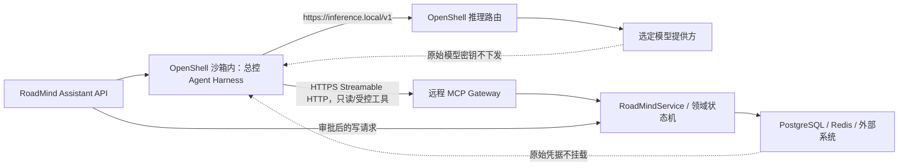
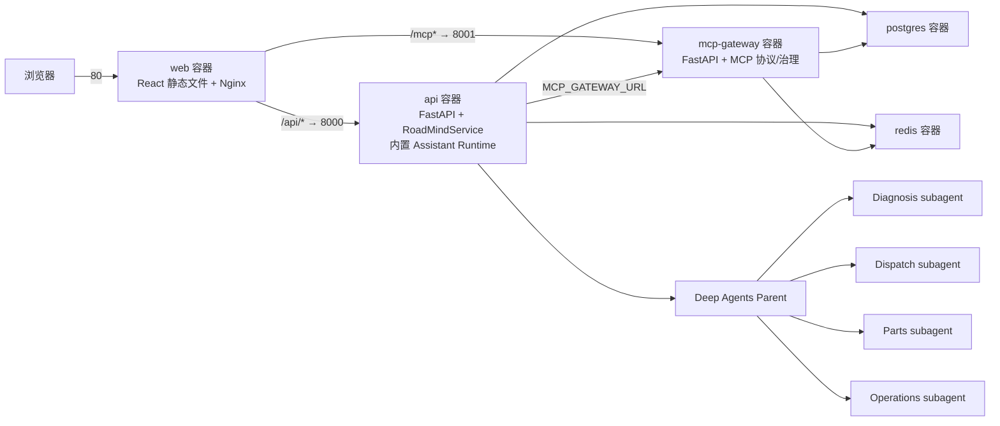
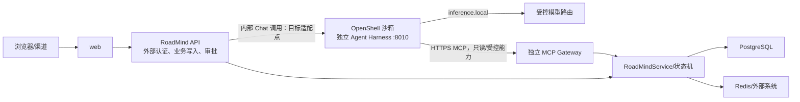

# 售后服务总控 Agent（编排中枢）主责专项深挖

> 目标：能够围绕 Parent/Workflow、双入口/L0、Task Plan/Join/REPLAN、**并行错峰 HITL / 同单旁路**、Outbox/Saga、OpenShell/NemoClaw 与完整记忆系统连续承受 45～60 分钟追问。

## 一、先守住真实性边界

| 简历表述 | 当前代码实际状态 | 面试准确口径 |
|---|---|---|
| Deep Agents Parent | 已用 `create_deep_agent()` 创建总控并注册四个 subagent | 可以说已实现 |
| LangGraph 子图/Workflow | 已有 parallel fulfillment、mismatch replan、NativeApprovalWorkflow | 可以说关键流程已显式化；四个 subagent 尚未分别手写成 StateGraph |
| closure Graph | 结案由 Application Service、状态机、Approval 和 Outbox 完成 | 不能说已有独立 closure StateGraph；这是适合继续图化的目标 |
| Checkpoint/Interrupt/Resume | Deep Agents 和 NativeApproval 使用 `MemorySaver`；原生 interrupt/resume 已验证 | 可以说语义已实现；生产持久化 saver 尚待替换 |
| OEM_HOOK / OPERATOR_ASSISTED | 架构设计存在；当前 `ServiceRequestCreate` 未显式包含 entry_source/OEM 映射字段 | 必须说“设计了”，不要说完整代码已上线 |
| `thread_id=service_request_id` | WorkOrder validator 已实现 | 业务真源靠统一 WorkOrder；thread 绑定只为排障便利。对话用 conversation_id，不替代 L0 |
| L0 工单总线 | WorkOrder、Task Plan、timeline、version、Repository 已实现 | 可以说已实现 L0 聚合；“总线”是共享真源语义，不是 Kafka 总线 |
| 数据中台主题沉淀 | 已有 Outbox topic 契约，未接真实 Kafka/中台消费者 | 说已设计事件出口，真实中台链路是生产适配点 |
| 动态 Task Plan | 有结构化 Planner 接口和版本；当前高风险任务拓扑是固定模板 | 说“支持版本化规划与重规划”，不要说 LLM 每次自由生成任意 DAG |
| 并行 Fan-out/Join | 候选生成图已实现；业务就绪 Join 在服务层实现 | 可以说双层 Join 已实现（当前是同步图骨架） |
| 错峰 HITL + 同单旁路 | 主路径仍是同步 `CompiledSubAgent` + `task` | **演进方案**：Async Subagent + launch 时 `run_mode` 裁工具 + `mutation_lease` + Gateway run 策略；勿说已全面生产上线 |
| `run_mode` / 做法 A | 架构设计；官方 `start_async_task` 仅有 description + subagent_type | 可说平台在 launch 上扩展 `run_mode`/`allowed_tools`；勿说官方 API 已自带 |
| `mutation_lease` | 与 Redis 资源短租约概念已分离设计 | 工单写租约防乱写；资源 NX+TTL 防双占；勿混为一谈 |
| REPLAN/冻结/补偿 | mismatch graph、任务重写、frozen_versions、资源释放已实现 | 口述重点：子 Agent 重写 Task + Graph 补偿；frozen/plan_version 是挡迟到回调的实现，勿说成「总控新开一套计划」 |
| degraded_mode | 字段和人工恢复路径已实现 | 通用超时/工具失败自动进入 degraded_mode 尚未完全实现 |
| Outbox + Saga | Outbox Store、PostgreSQL 表、补偿图和 Saga 语义已实现 | 当前工单保存与 Outbox append 不是同一 SQL 事务，生产需收口 |
| OpenShell/NemoClaw | 已有独立 Agent 镜像和运行契约，约定 `inference.local`、远程 MCP、无数据库凭据 | 可以说“完成适配设计与 Harness 镜像”；不能说已在 NVIDIA 平台生产上线；官方当前仍标记 Alpha/预览 |
| 对话记忆 | `ConversationStore` 保存轮次，Deep Agents 用 `MemorySaver` 按 `conversation_id` checkpoint | 语义已实现，但两者均为进程内；重启、扩容后不持久，生产要换 PostgreSQL Store/Saver |
| 长期用户记忆/Skill 记忆 | 当前未向 `create_deep_agent()` 注入持久 `memory` backend，也没有用户画像记忆表 | 不能说已经有跨会话长期记忆；这是生产目标方案 |
| 语义知识记忆 | 已有带证据引用的混合检索，支持品牌/车型硬过滤和多路召回 | 当前样板以本地语料为主，外部向量库和知识治理是生产适配点 |
| PII 记忆隔离 | PII Vault 将姓名、电话等直接标识符移出 L0，只保存 `pii_*` 引用 | 可以说已实现隔离接口和内存/PostgreSQL 适配器；读取仍必须显式授权 |
| 单仓多服务 | 前端、后端、MCP、Agent 与领域代码都在同一个 Git 仓库 | “同仓维护”不等于“同容器部署”；必须分别描述源码边界和运行边界 |
| 默认 Compose | `web`、`api`、`mcp-gateway`、`postgres`、`redis` 五个独立服务 | Agent Runtime 当前随 API 进程运行；默认 Compose 没有第六个 `agent` 服务 |
| 独立 Agent Harness | `Dockerfile.agent` 可构建 8010 服务，入口为 `roadmind.assistant.main:app` | 是可选/目标部署；尚未接入默认 Compose，API 到独立 Harness 的代理适配也未完成 |
| 四个业务 subagent | Deep Agents 在总控 Runtime 内创建并执行 | 不是四个 Pod、四个 FastAPI 服务或四个代码仓库 |

关键代码：

- [Deep Agents 总控创建](/D:/ai/学习用例/简历/商用车+航空/项目/ai-commercial-vehicle-platform/src/roadmind/assistant/runtime.py:438)
- [四个专业 subagent 定义](/D:/ai/学习用例/简历/商用车+航空/项目/ai-commercial-vehicle-platform/src/roadmind/assistant/prompts.py:61)
- [Application Service 编排中枢](/D:/ai/学习用例/简历/商用车+航空/项目/ai-commercial-vehicle-platform/src/roadmind/application/service.py:47)
- [Task Plan 规划器](/D:/ai/学习用例/简历/商用车+航空/项目/ai-commercial-vehicle-platform/src/roadmind/workflows/task_planner.py:13)
- [显式 LangGraph Workflow](/D:/ai/学习用例/简历/商用车+航空/项目/ai-commercial-vehicle-platform/src/roadmind/workflows/langgraph_flows.py:10)
- [L0 WorkOrder 与版本字段](/D:/ai/学习用例/简历/商用车+航空/项目/ai-commercial-vehicle-platform/src/roadmind/domain/models.py:190)
- [领域状态机](/D:/ai/学习用例/简历/商用车+航空/项目/ai-commercial-vehicle-platform/src/roadmind/domain/state_machine.py:10)
- [Outbox 与 Saga](/D:/ai/学习用例/简历/商用车+航空/项目/ai-commercial-vehicle-platform/src/roadmind/infra/outbox.py:1)
- [NemoClaw/OpenShell 运行契约](/D:/ai/学习用例/简历/商用车+航空/项目/ai-commercial-vehicle-platform/docs/how-to/NemoClaw总控Agent运行契约.md:1)
- [独立 Agent Harness 镜像](/D:/ai/学习用例/简历/商用车+航空/项目/ai-commercial-vehicle-platform/Dockerfile.agent:1)
- [对话存储与用户隔离](/D:/ai/学习用例/简历/商用车+航空/项目/ai-commercial-vehicle-platform/src/roadmind/assistant/store.py:1)
- [总控 Checkpoint 与 thread_id](/D:/ai/学习用例/简历/商用车+航空/项目/ai-commercial-vehicle-platform/src/roadmind/assistant/runtime.py:475)
- [PII Vault](/D:/ai/学习用例/简历/商用车+航空/项目/ai-commercial-vehicle-platform/src/roadmind/infra/pii_vault.py:1)
- [混合知识检索](/D:/ai/学习用例/简历/商用车+航空/项目/ai-commercial-vehicle-platform/src/roadmind/knowledge/retrieval.py:1)
- [默认 Docker Compose 五服务拓扑](/D:/ai/学习用例/简历/商用车+航空/项目/ai-commercial-vehicle-platform/docker-compose.yml:1)
- [API/MCP 共用的 Python 基础镜像](/D:/ai/学习用例/简历/商用车+航空/项目/ai-commercial-vehicle-platform/Dockerfile:1)
- [前端独立构建镜像](/D:/ai/学习用例/简历/商用车+航空/项目/ai-commercial-vehicle-platform/web/Dockerfile:1)
- [Nginx 对 API 与 MCP 的反向代理](/D:/ai/学习用例/简历/商用车+航空/项目/ai-commercial-vehicle-platform/web/nginx.conf:1)
- [业务 API 进程入口](/D:/ai/学习用例/简历/商用车+航空/项目/ai-commercial-vehicle-platform/src/roadmind/main.py:1)
- [独立 MCP 进程入口](/D:/ai/学习用例/简历/商用车+航空/项目/ai-commercial-vehicle-platform/src/roadmind/mcp/main.py:1)
- [独立 Agent Harness 进程入口](/D:/ai/学习用例/简历/商用车+航空/项目/ai-commercial-vehicle-platform/src/roadmind/assistant/main.py:1)

---

## 二、90 秒主回答

> 我主要负责售后服务总控 Agent，也就是整个多 Agent 系统的编排中枢。我的核心设计是把开放式理解、确定性流程和业务真源分开。
>
> 第一层是 Deep Agents Parent。它负责持续对话、理解员工目标、补齐缺失信息，并粗路由到诊断、调度、配件和运营四个专业 subagent。它可以决定“下一步做什么”，但不能直接越过审批修改库存、派工或确诊。
>
> 第二层是显式 LangGraph Workflow 与任务编排。parallel fulfillment、现场改诊 replan、人工审批等高风险流程用 Graph 固化 Fan-out、Join、Interrupt、Resume 和补偿。当前主路径是同步 `task` + 候选并行图；针对「调度/配件并行 + 不同时刻审批 + 同单只读旁问」，演进方案是 Async Subagent：各子任务自有 thread 错峰 HITL，总控按意图分流 `fulfillment` / `assist_readonly`，launch 时裁工具（做法 A），写路径靠 `mutation_lease` + MCP Gateway run 策略，不整单锁、不靠 Prompt 自律。
>
> 第三层是 L0 WorkOrder。业务真源是同一张 `service_request_id`/WorkOrder（含 Task Plan）。改诊由维修/现场子 Agent 上报，走 Graph：按需补偿副作用，并由子 Agent **重写 Task 内容与后续判断**；不是总控改确诊字段，也不是整单新开一套计划再 cancel 重跑。超阈值转人工。短审批走子 thread interrupt/resume；修车长周期落库后结束本轮，日后新 invoke 重读单。
>
> 敏感动作仍经 HITL、角色 scope 与审批 token；跨系统一致性用 Saga 与 Outbox。重点不是模型自由度最大，而是可恢复、可审计、可验证边界内的自主性。
>
> 运行隔离上，我设计把交互式 Parent Harness 放进 OpenShell/NemoClaw 边界，而不是把数据库和全部微服务一起塞进沙箱。模型只通过 `inference.local` 访问受控推理，通过 HTTPS Streamable HTTP 访问远程 MCP；原始模型密钥和业务数据库凭据不进入 Agent 沙箱，写操作仍走 RoadMind 审批 API。
>
> 记忆上我分为执行 checkpoint、对话记录、L0 工单事实、L1 领域草稿、事件经历、RAG 语义知识、Prompt/Skill 程序性记忆和 PII 隔离。当前代码完成了进程内 checkpoint、对话轮次、L0/L1、timeline、混合检索和 PII Vault；跨重启持久记忆、用户画像与统一 Skill Memory 是生产替换点，不会夸大成已上线。
>
> 工程部署采用单仓多服务：React 前端、Python 业务后端、MCP Gateway 和 Agent 代码在同一 Monorepo 统一维护、测试和版本发布，但运行时不是一个进程。默认 Compose 将 web、api、mcp-gateway、PostgreSQL、Redis 分成五个容器；Agent 默认嵌在 API 进程提供 `/api/v1/assistant/chat`。面向 OpenShell/NemoClaw 的独立 Agent Harness 使用另一份镜像和 8010 入口，目前是可选部署目标，尚未加入默认 Compose。四个专业 subagent 是总控进程内的受控执行单元，不是四个独立微服务。

---

## 三、总体分层与 Parent 深挖

### Q1：你负责的“总控 Agent”到底是什么？

**参考回答：**

它是员工与售后业务能力之间的持续交互入口与编排中枢：理解目标、补字段、意图分流（履约写 / 同单旁路读 / 问进度）、选择专业 Agent、追踪 async 任务、汇总并解释下一步。不直接保存业务事实；不代替专家/调度/配件员做受监管决定；业务页只吃 WorkOrder。

### Q2：Parent、Subagent、Planner、Workflow、Service 分别负责什么？

**参考回答：**

- Parent：开放式对话、意图分流、粗路由、`async_tasks` 追踪与结果汇总；**不当业务锁、不存维修现场实况**。
- Subagent：单一领域最小工具集；履约可持 `mutation_lease`；旁路 `assist_readonly` 无写工具。
- WorkOrderPlanner：输出 `PlanningDecision` 与带依赖/版本的 `TaskPlan`，不是交互式总控。
- LangGraph Workflow：固化审批、并行、Join、补偿和恢复；Async 演进下子任务各自 thread/checkpoint。
- RoadMindService/状态机：最终写 L0，校验 lease、version、审批与状态机。

记忆句：Parent 决定做什么，Workflow/子 thread 决定怎样走，Domain 决定能不能写，Repository 保存已经发生了什么。

### Q3：为什么 Parent 不直接调用所有业务工具？

**参考回答：**

否则总控会同时持有诊断、库存、派工、结案等宽权限，Prompt Injection 或误路由的影响面过大。当前总控只直接拥有只读/对话工具，业务写能力交给受限 subagent；即使 subagent 调用工具，仍经 Supervisor、**Gateway run 策略**、状态机和审批 token 再校验。旁路查询绝不靠 Prompt「别写」，而靠 launch 裁工具 + Gateway 拒写。

### Q4：Deep Agents 与 LangGraph 是什么关系？

**参考回答：**

Deep Agents 是建立在 LangChain/LangGraph 上层的 Agent Harness，不是与 LangGraph 平行的另一套系统。当前 Parent 和声明式 subagents 都由 Deep Agents 组装并编译；另外，对高风险流程再显式手写 StateGraph，使节点、Join、中断和恢复更可控。

### Q5：当前四个专业 Agent 已经是四套 LangGraph 子图了吗？

**参考回答：**

还不是。当前它们是 `subagents=build_business_subagents()` 生成的声明式配置，包含 name、description、system_prompt 和工具白名单。Deep Agents 底层仍基于 LangGraph 运行，但不是我分别手写的四个业务 StateGraph。已经手写的是 parallel fulfillment、mismatch replan 和 NativeApproval 等 Workflow。

### Q6：哪些流程必须显式 Graph，哪些不需要？

**参考回答：**

涉及并行汇合、跨时人工审批、部分成功补偿、长时恢复和严格顺序的流程应显式 Graph。简单只读查询、一次工具调用或无状态格式化不必图化。判断依据是是否需要状态、恢复和可验证控制流，而不是为了展示 LangGraph 使用量。

### Q7：为什么不把所有业务规则都写进 Graph 节点？

**参考回答：**

Graph 负责执行协调，领域规则要保持普通可单测代码，才能被 API、批处理和消息消费者复用。如果把“无确诊不能配件”“无资质不能派工”只藏在节点里，其他入口可能绕过；因此规则最终由状态机、Service 和验证器保证。

### Q8：五个 Agent 怎样通信？

**参考回答：**

当前骨架：`Parent → task → Subagent → 结果 → Parent`。演进：`Parent → start_async_task → 子 thread(task_id)`，总控 `async_tasks` 只记 task_id/run_id/摘要，用 `check` 问进度。业务状态一律经 `RoadMindService → Repository → WorkOrder`；身份与审批经 principal、confirmed_actions、审批 token。Subagent 不互相聊天，不以自然语言当事实总线；业务页只渲染 WorkOrder，不渲染总控 checkpoint。

### Q8.1：会话真源和业务真源怎么分？

**参考回答：**

业务只认 WorkOrder（`service_request_id`）：状态、审批、履约、角色页都读这张单。`conversation_id` 只管总控续聊与编排现场，不当业务锁、不存维修实况。同单旁问可继续同一会话；换单或无关主题再换会话。Async task 有独立 checkpoint 也只是执行恢复，写回仍指向同一张 WorkOrder。

---

## 四、双入口与 L0 工单记忆总线

### Q9：为什么设计 OEM_HOOK 和 OPERATOR_ASSISTED 双入口？

**参考回答：**

主机厂系统已经有结构化工单时，应通过 OEM_HOOK 自动映射，减少重复录入；电话、司机口述或信息不完整时，由信息员通过 OPERATOR_ASSISTED 补齐字段。入口不同，但最终必须归一成同一个 `ServiceRequestCreate/NormalizedServiceRequest`，走相同 VIN 校验、PII 隔离、状态机和 Task Plan，不能形成两套业务真源。

### Q10：OEM_HOOK 怎样保证幂等？

**参考回答：**

生产设计使用映射表：`tenant_id + source_system + external_order_id` 唯一，对应内部 `service_request_id`，并保存 payload_hash。重复请求且 hash 相同直接返回原工单；相同外部 ID 但内容冲突则返回 409 或生成受审计的更新事件，不能再建一张工单。并发场景依靠数据库唯一约束，而不是先查后插的应用锁。

### Q11：OPERATOR_ASSISTED 怎样避免信息员乱填？

**参考回答：**

按最小必填字段分步收集；VIN、品牌、动力类型等结构字段做 Schema 和业务校验；电话姓名进入 PII Vault；信息不足时保留 missing_fields，不伪造 DTC；创建动作记录 actor 和 source；高风险信息仍需后续专家确认。AI 可以帮助归一描述，但不能把推断写成确认事实。

### Q12：双入口当前代码实现到什么程度？

**参考回答：**

当前统一建单、信息员角色、VIN 校验、PII Vault、L0 创建和幂等主键契约已经有代码；但 `ServiceRequestCreate` 尚未显式包含 `entry_source`、`external_order_id` 和 OEM 映射表。所以准确说法是“双入口架构和幂等映射已设计，当前样板完成统一建单核心，入口来源模型是待补适配器”。

### Q13：为什么 `thread_id=service_request_id`？

**参考回答：**

核心不是「靠 thread_id 体系解决跨 Agent 共享」，而是**所有业务事实统一落在同一张 WorkOrder（`service_request_id`）上**。Agent / Workflow / 审批 / 角色页都读写这张单，不靠互相聊天或会话 state 当真源。

把业务图的 `thread_id` 设成 `service_request_id`，只是方便：checkpoint、Trace、timeline 与工单用同一键排障。对话继续用 `conversation_id` 做聊天恢复即可；它不替代 WorkOrder。Async 子任务若有独立 checkpoint，也必须带着 `service_request_id` 回写同一张单，而不是再造第二份业务真源。

### Q14：L0 到底是什么？为什么称作“记忆总线”？

**参考回答：**

L0 是 `WorkOrder` 聚合代表的跨领域业务真源，保存确认状态、当前诊断、选定资源、预留配件、Task Plan、审批、timeline、version、plan_version、degraded_mode 等。称作记忆总线是因为所有 Agent 都通过它交换已确认业务事实，而不是共享彼此聊天记录；它不是消息中间件，也不是模型长期记忆。

### Q15：候选数据算不算 L0 事实？

**参考回答：**

候选可以随工单保存以便审批验证和审计，但它属于 L1 领域草稿，不等于确认事实。例如 dispatch_candidates 是某一版本计划下的建议，只有人工批准并通过独立校验后，`selected_resource_id` 才成为 L0 确认事实。生产拆表时也必须绑定 order/version/plan_version。

### Q16：L0 和数据中台怎么分工？

**参考回答：**

L0 管单工单的过程一致性和当前决策，例如状态、审批、计划和履约；数据中台管跨工单、跨系统的主数据、历史事实和分析语义，例如车辆主数据、库存主题、服务质量指标。L0 引用或快照中台数据版本，领域结论通过 Outbox 主题事件沉淀中台。当前项目有事件契约，真实 Kafka/主题消费者仍是生产适配点。

### Q17：timeline 和当前状态为什么都要？

**参考回答：**

当前状态回答“现在是什么”，timeline 回答“为什么变成这样”。审计、重放、补偿、SLA 和效果分析需要事件历史。状态改变统一通过 `transition()`，同时追加 `status.changed`，领域动作再补充 diagnosis、approval、saga 等事件。

### Q18：工单 version 和 plan_version 有什么区别？

**参考回答：**

`version` 是聚合每次保存的乐观锁版本，解决并发覆盖；`plan_version` 是业务执行方案版本，只在 REPLAN 时递增。一次计划内可能保存多次，所以 version 会变化而 plan_version 不变。不能用其中一个替代另一个。

---

## 五、Task Plan、并行 Fan-out、Join 与错峰旁路

> **纲领（难点亮点 1）**：会话真源 ≠ 业务真源；短门禁 HITL vs 长履约落库；共享读、互斥写（lease）；授权在 launch 按 `run_mode` 收紧；最终安全在 Gateway + Service。当前仓库主路径仍是同步 `task`；Async 方案口述时标明演进。

### Q19：Task Plan 为什么不是 Todo List？

**参考回答：**

先分清两层「规划」：

| | Deep Agents / LangChain `TodoListMiddleware` | RoadMind **Task Plan** |
|---|---|---|
| 定位 | Agent 执行中的**轻量待办**（可选；v0.7 起默认不再内置，需显式挂 middleware） | 挂在 WorkOrder 上的**业务任务 DAG** |
| 工具 | `write_todos`；状态 `pending` / `in_progress` / `completed` | `depends_on`、TaskStatus、`plan_version`、reason、`frozen_versions` |
| 持久化 | 写入**代理 state**，便于长多步自组织、UI 流式进度 | 写入 **L0**，可审计、可 REPLAN、可拒绝迟到回调 |
| 用途 | 弱模型问责、复杂对话内自排步骤 | 履约门禁、改诊冻结、业务 Join、跨系统补偿 |

框架 Todo 不能替代 Task Plan：它不管工单生命周期，也没有版本冻结与依赖汇合。RoadMind 里 **Task 状态 ≠ `WorkOrderStatus`**——前者是计划节点，后者是整单生命周期。若总控额外挂 `todoListMiddleware`，只服务会话内自规划，**业务真源仍只认 WorkOrder 上的 Task Plan**。

### Q20：初始任务依赖是什么？

**参考回答：**

`diagnose → expert_confirm → (dispatch || parts) → service → archive`。dispatch 与 parts 在专家确认后可以并行，service 同时依赖两者。当前 deterministic planner 固化这套高风险骨架，OpenRouter planner主要补充理解与 rationale，而不是自由改写任意 DAG。

### Q21：为什么简历写“动态编排”，代码却是固定任务图？

**参考回答：**

动态性体现在 Parent 粗路由、子 Agent 在领域内推进/重写 Task、任务状态随执行变化，以及 mismatch 时由 Graph + 子 Agent 重判任务内容；当前高风险拓扑模板固定以保证可测。更准确：「受控 Task 重写与 Graph 补偿」，不是「LLM 任意动态生成流程」，也不是总控每次整单新开计划。

### Q22：parallel_fulfillment 怎么实现？

**参考回答：**

**当前骨架**：LangGraph 从 START 同时连 dispatch_candidates 与 parts_candidates，两边返回后 join；并行的是**候选准备**，不是未经批准直接派工/扣库存；结果写入工单候选与 timeline。

**演进目标（难点亮点）**：调度/配件改为 Async 子任务各 thread；总控 `start` 立即返回 task_id，两边可**错峰** interrupt/resume，互不拖死对方，也不拖死主会话。业务 Join 仍看 L0：`selected_resource_id` + `reserved_part_codes`，不靠「两边 Agent 聊完」。

### Q23：为什么说有“双层 Join”？

**参考回答：**

| 层 | 判定什么 | 当前同步骨架 | Async 演进 |
|---|---|---|---|
| **计算 Join** | 两边准备结果是否都回来 | 图节点等 dispatch/parts 候选都返回 | **不再**靠总控一次 invoke 阻塞汇合；各子 task 独立写回，用 `check`/重读 WO 看是否都就绪 |
| **业务 Join** | 资源是否真履约 | 看 L0：`selected_resource_id` + 非空 `reserved_part_codes` | **不变**：仍只认 WorkOrder 字段；满足才 FULFILLING → READY_FOR_SERVICE |

候选齐全 ≠ 已派工/已预占。Async 与双层 Join **不冲突**：Async 拆掉的是「主会话同步等两边」；业务 Join 本来就是工单真源上的门禁，错峰审批下反而更依赖重读 L0，而不是等 Parent 收齐两次 `task` 返回值。

### Q24：一条支线失败怎么办？

**参考回答：**

不能把空结果当成功 Join。按错误类型 timeout/retry；保留另一支线与版本；可恢复则重试，不可恢复则 degraded_mode/人工；已有副作用则登记补偿。当前图偏正常路径验证；Async 下失败支线用自身 task 状态 + L0/timeline 表达，完整错误边与持久恢复仍是生产增强点。

### Q25：为什么不让 LLM 判断 `dispatch_approved AND parts_ready`？

**参考回答：**

这是可精确表达的业务不变量，必须由代码根据确认字段判断。LLM 可解释缺哪一项，不能裁定条件是否成立。Async/`check` 场景同样：总控只汇总，最终以 Service 读 L0 字段为准。

### Q25.1：同步 `task` 在并行履约上的结构性缺陷是什么？

**参考回答：**

同步 `task` 会阻塞总控；任一子图 `interrupt` 往往让**整次总控 invoke 一起停**，另一边无法独立推进；履约中同单旁问也容易污染上下文或误 `update`。一句话难点：**并行错峰审批 + 同单只读旁路 + 可恢复写路径**须同时成立——这正是 Async + `run_mode` + lease + Gateway 的动机。

### Q25.2：意图何时 `fulfillment`，何时 `assist_readonly`？

**参考回答：**

看**这一次新派任务会不会改 WorkOrder**，不是「有异步在跑就全局只读」：

| 意图 | 动作 | `run_mode` |
|---|---|---|
| 启动/推进派工、预留、改计划 | start/update 履约 task | `fulfillment`（发 lease） |
| 按本单查 TSB/保修/手册/库存 | 旁路 task 或直调只读工具 | `assist_readonly`（无 lease，工具已裁写） |
| 问进度 | `check`/`list` + 重读 WorkOrder | — |
| 改派/取消 | update/cancel 履约 task（协调 lease） | 履约通道 |

落地三层：总控路由（软）→ 编排策略（硬，本单已有履约 lease 且话术为查询则强制 readonly）→ Gateway/Service（最终拒写）。

### Q25.3：做法 A（launch 时裁工具）是什么？

**参考回答：**

图上工具池是**能力上限**；每次 launch 按 `run_mode` 只注入本次工具。仍是同一领域 Agent，不是再发明「只读子代理物种」。`fulfillment` 注入读写；`assist_readonly` 只注入读。官方 `start_async_task` 仅有 description + subagent_type；`run_mode`/`allowed_tools` 是平台 launch 扩展，面试须说清。

### Q25.4：`mutation_lease`、`run_id`、Redis 资源租约怎么区分？

**参考回答：**

| 概念 | 作用 |
|---|---|
| `run_id` | 某次子 Agent 运行句柄：Trace、`check`、Gateway 策略关联 |
| `task_id` / 子 `thread_id` | Async 任务标识：追踪与 resume |
| `mutation_lease` | 本单谁允许写 WorkOrder（如 holders=[task_d,task_p] + plan_version） |
| Redis 资源短租约 | 人员/配件占用 NX+TTL，防跨单双占 |

写单：无 lease / version 不匹配 / 状态机禁止 → reject。**不整单 DB 锁**：履约 holders 可写，旁路无 lease 只读，读不阻塞写。总控 checkpoint **不当业务锁**。

---

## 六、Diagnosis Mismatch、REPLAN 与补偿

### Q26：现场改诊的完整流程是什么？

**参考回答：**

一句话：现场确诊不对时，**由维修/现场子 Agent 在 Graph 里重写并判断 Task 内容**；需要时图内做资源补偿。不是总控改字，也不是整单「作废后再新开一套版本计划、cancel task 重跑」。

**谁触发 / 谁决策：** 维修或现场侧子 Agent（或业务入口）上报 mismatch。mismatch/REPLAN **机制写在显式 Graph**（门禁、补偿边、回诊断节点）。总控最多路由说明，不手搓编排，也不负责取消/重启异步 task。

场景：工单已在 `FULFILLING` / `READY_FOR_SERVICE` / `IN_SERVICE`，现场诊断与原确诊不一致。

图内主路径（记三点即可）：

1. **门禁**：状态机允许改诊；`replan_count` 超限则进人工接管节点。
2. **有副作用就补偿**：若已派人/占件/发运，走 Saga 补偿边（放人、放件、拦截物流），顺序与执行大致相反。
3. **子 Agent 重写 Task**：在同一张 WorkOrder 的 Task Plan 上，由相关子 Agent **自行判断并改写任务内容**（哪些节点重做、依赖怎么调、确诊/候选/履约字段怎么更新），再沿图回到诊断或后续履约节点。

要点：**业务真源仍是这一张单上的 Task + L0 字段**；改的是任务内容与状态，不是 Parent 另起炉灶开「新计划套餐」。Async 迟到写靠 Service/状态机/版本门禁拒绝，不靠总控 cancel。

### Q27：为什么不能直接修改 confirmed_code？

**参考回答：**

旧确诊已经驱动过人/件/物流。只改 `confirmed_code` 几个字，Task Plan 和外部副作用还停在旧结论上，单会自相矛盾。

正确路径：现场子 Agent 上报 mismatch → Graph 按需补偿 → **子 Agent 重写相关 Task 并重新判断后续步骤**（该重诊就重诊，该改履约任务就改）。一致性靠「任务内容 + 副作用」一起收口，不靠总控改字段，也不靠口头「新开一版计划」代替任务重写。

### Q28：frozen_versions 解决什么问题？

**参考回答：**

挡「任务已被子 Agent 改写作废后，外面还拿旧方案回调」的迟到写。

实现上把已失效方案的 `plan_version`（或等价指纹）记入 `frozen_versions`：带该标记的审批/库存/物流回执 **拒绝落当前单或只审计/补偿**。它是**写库门禁**，配合 Task 重写；不是业务流程等于「再开一张新计划」。生产回调应带版本并条件更新；字段已有，外部适配器强校验仍需补齐。

### Q29：为什么补偿顺序通常与执行顺序相反？

**参考回答：**

补偿是 Graph 里的 **Saga 边**，在子 Agent 重写 Task 之前/同时清掉已占资源。后一步常依赖前一步，逆序解开最稳：例如执行是占人 → 占件 → 发运，补偿就先拦物流 → 放件 → 放人。真实业务也可能是依赖图，由补偿节点按当前 L0 状态选边，不是 Parent 口头决定顺序。

### Q30：`MAX_REPLANS=3` 的当前代码细节是什么？

**参考回答：**

这是 Graph **门禁节点**的安全阀，限制「同一工单上 mismatch → 子 Agent 重写 Task」能自动走几轮，不是「允许新开几套计划」。

代码：每次 mismatch `replan_count += 1`，条件 `replan_count > MAX_REPLANS` → 前三次自动进重写/补偿路径，第四次进 `MANUAL_TAKEOVER`。`3` 是演示阈值；若产品要「第三次就人工」，改成 `>=`。超限后不再让子 Agent 自动改 Task，转人工。

### Q31：补偿失败怎么办？

**参考回答：**

补偿失败时 **不能假装 Task 重写已成功**。每个补偿动作要有幂等键、状态、有限重试；仍失败 → dead letter/人工任务 + 告警；工单进 `degraded`/`manual`，**禁止**子 Agent 继续改写履约 Task 或新占资源。已做成/未做成的步骤都写 timeline。不靠总控 cancel async 冒充补偿完成。

### Q32：Saga 和数据库回滚有什么区别？

**参考回答：**

改诊时人在 Redis、件在 WMS、货在物流——**一个本地 DB transaction 回滚不掉**。Saga 是 Graph 里用**新的业务动作**抵消旧副作用（放人、放件、拦截），配合子 Agent 重写 Task。补偿不是时间倒流：货已发出只能发拦截/退货并留事件。DB 回滚管单库原子；Saga 管跨系统与 Task/L0 一致。

---

## 七、HITL、Checkpoint 与 degraded_mode

### Q33：哪些环节必须 HITL？

**参考回答：**

专家确诊、派工选择、配件预留、现场开工、上报诊断不一致和结案批准都属于敏感动作。确认必须来自当前认证用户，并同时满足角色 scope、本轮 confirmed_actions、审批 token、工单状态和候选仍有效。自然语言里的“按最优方案”不能自动视为合法确认。

### Q34：Checkpoint、Interrupt、Resume 怎么工作？

**参考回答：**

节点 `interrupt(request)` → checkpointer 按 thread_id 保存 → 返回待人工信息；人用同 thread_id `Command(resume=decision)` 从中断点续跑。当前 NativeApproval 用 MemorySaver 验证语义，生产换持久化 saver。

**错峰要点（演进）**：履约子 thread 内 interrupt **只挂起该 task**；总控 `start` 早已返回，不拖死主会话。调度与配件可不同时刻 resume。子状态在子 thread checkpoint；总控 `async_tasks` 只留 task_id/run_id/摘要供 `check`。

### Q34.1：两种“等待”为什么不能混？

**参考回答：**

| 类型 | 机制 | 用途 |
|---|---|---|
| 图内 HITL | 子 thread interrupt → 人 resume 续跑该 task | 分钟～小时级审批 |
| 业务长周期 | 写 WorkOrder（如 IN_SERVICE）→ 本轮 invoke 结束 → 日后新请求重读 WO | 修车几天 |

禁止用图内 interrupt 把「修车三天」吊在 checkpoint 上；角色页始终吃 WorkOrder。

### Q35：为什么有 checkpoint 还需要 Approval 表？

**参考回答：**

Checkpoint 是技术执行状态（图/子 task 跑到哪）；Approval 是业务审计事实（谁何时批了什么、token 是否消费）。恢复靠 checkpoint，合规与 L0 靠审批记录。二者不能互替，也不能假设跨库原子。

### Q36：degraded_mode 的触发和行为是什么？

**参考回答：**

设计上，OEM 工具不可用、RAG/外部能力持续失败、自动 REPLAN 超限等会触发降级：保留已确认事实，停止敏感自动写，使用可用证据给出有限建议，并创建人工接管任务。当前代码已有字段和 manual takeover 恢复路径，但通用 timeout/工具失败自动置位尚未完整接入，因此要区分目标策略与现状。

### Q37：降级和失败有什么区别？

**参考回答：**

失败表示当前操作没有完成；降级表示系统在明确缩小能力和风险边界后继续提供有限服务。例如检索不可用时可以展示历史工单和请求专家，但不能继续声称已完成证据诊断或自动预留配件。旁路 `assist_readonly` 是正常产品能力，不是 degraded_mode。

### Q38：怎样避免人工审批时数据已经过期？

**参考回答：**

审批 token 绑定 action、order_id、plan_version、候选 ID、audience 和过期时间；批准时重新读取工单并独立验证候选、权限、资源与 **lease holder**；通过条件更新一次性消费 token。审批页是快照，提交必须重校验。

### Q39：closure 当前怎么控制？为什么还值得图化？

**参考回答：**

当前 close_order 先要求 IN_SERVICE，提交维修事实后转 WAITING_CLOSE_APPROVAL 并生成 approval；approve_closure 校验角色、token 和实际配件，批准后 CLOSED，驳回则回到 IN_SERVICE。它已由 Service、状态机和审批控制，但还没有独立 closure StateGraph。若结案要跨质检、知识脱敏、客户回访和事件发布，就适合显式图化并加入持久 checkpoint。

### Q39.1：MCP Gateway 在旁路/履约里多做了哪一步？

**参考回答：**

流水线：认证 → Schema → 角色 scope → **run 策略（readonly 拒写）** → 确认/审批 token → 限流熔断审计 Trace → 执行适配器。角色 scope 答「这个人能不能」；run 策略答「这一次后台任务允不允许写」。最终安全在 Gateway + Service lease/version，不信任模型。

---

## 八、Outbox、Saga 与一致性深挖

### Q40：Outbox 解决什么问题？

**参考回答：**

它解决“数据库事实已经提交，但消息还没发布时进程崩溃”的双写不一致。标准做法是在保存 WorkOrder 的同一 PostgreSQL 事务中插入 OutboxMessage，由独立 relay 读取 pending、发布到 Kafka/RabbitMQ，成功后标记 delivered；消费者按 message_id 幂等。

### Q41：当前 Outbox 是否已经做到真正事务一致？

**参考回答：**

还差最后一层。项目已有内存/PostgreSQL Outbox Store 和消息状态，但 RoadMindService 当前是先 `repo.save()` 再 `outbox.append()`，二者各自开启事务，因此仍存在中间崩溃窗口。生产要让 Repository 和 Outbox 共用一个 Unit of Work/SQLAlchemy Session，在同一事务提交。这是我会主动说明的真实边界。

### Q42：Outbox Relay 怎样避免重复发布？

**参考回答：**

常见方式是 `SELECT ... FOR UPDATE SKIP LOCKED` 抢批次，发布成功后标记 delivered；发布确认与标记之间仍可能崩溃，所以系统通常提供至少一次投递，消费者必须以 message_id 或业务键幂等。不能声称 Outbox 天然“绝不重复”。

### Q43：Outbox 和 Saga 有什么区别？

**参考回答：**

Outbox 保证本地业务事实与事件最终一致；Saga 协调多个系统的业务步骤和补偿。Outbox 可以负责可靠发布 `inventory.release.requested`，Saga 决定在改诊时为什么、按什么顺序释放库存和人员。

### Q44：工单并发更新怎么防覆盖？

**参考回答：**

Repository 保存带 expected_version；UPDATE 同时校验 service_request_id 与 version，rowcount≠1 则 OptimisticLockError。写路径再校验 `mutation_lease` holder 与状态机。冲突方重读最新工单再决定重试/提示/放弃，禁止旧对象覆盖。总控 checkpoint 只串行同会话请求，**不当** WorkOrder 业务锁。

### Q45：如果进程在“释放人员成功、释放库存前”崩溃怎么办？

**参考回答：**

生产 Saga 需要持久化步骤状态。恢复器读取当前 saga_id/plan_version，识别人员步骤已成功、库存步骤待执行，使用相同幂等键继续；不能从头盲跑，也不能只依赖内存 Graph state。若库存持续失败则进入人工接管，并禁止新计划进入履约。

---

## 九、压力场景与复盘题

### Q46：线上反馈工单一直停在 FULFILLING，怎么排查？

**参考回答：**

先按 service_request_id 看 L0：dispatch/parts 候选或履约字段、审批 pending、TaskStatus、plan_version、`mutation_lease` holders。再看 Trace：parallel/async task_id、run_id、派工/库存 Span；token 过期、租约冲突、库存不足、Gateway 拒写或熔断。最后区分：计算 Join 未完、业务 Join 未完、子 task 卡在 HITL、旁路误开写、还是旧版本回调被拒。

### Q47：两个调度员同时批准不同资源会怎样？

**参考回答：**

两边读同一 version，仅第一个条件更新成功并消费 token；第二个 OptimisticLockError 后必须重读。Redis 资源租约 NX+TTL 防跨单双占；`mutation_lease` 还校验写者是否为履约 holder。生产把 token 消费、工单更新与审计收进同一事务边界。

### Q48：为什么最大难点不是模型路由？

**参考回答：**

路由错可澄清重试；真正难的是 **并行错峰审批 + 同单只读旁路 + 部分成功可恢复写** 同时成立。同步 `task` 会拖死总控；整单锁会死锁履约；只靠 Prompt 拒写不可信。价值在分层：会话编排、子 thread HITL、launch 裁工具、Gateway run 策略、lease/version——而不是只提高意图分类准确率。

### Q49：如果再给两周，你优先改什么？

**参考回答：**

第一，OEM_HOOK 幂等映射与 entry_source；第二，WorkOrder+Outbox 同事务；第三，timeout/工具失败 → degraded_mode 显式错误边；第四，外部回调强制 plan_version；第五，关键审批持久化 saver。若专攻并行履约亮点：落地 `start_async_task` + `run_mode` 裁工具 + lease 发放/校验 + Gateway run 策略，并补 API→子 thread resume 联调。优先一致性与门禁，不先堆 Agent 数量。

### Q50：这套总控设计最核心的一句话是什么？

**参考回答：**

让 Parent 处理开放世界与意图分流，让子 thread/Workflow 控制封闭世界与错峰 HITL，让 L0+lease 保存唯一可写事实，让 Gateway run 策略挡住旁路误写，让 HITL/Outbox/Saga 承担模型不能独立负责的责任与一致性。

**收束（难点亮点）：** 难点是并行错峰审批与同单只读旁路并存；亮点是把会话编排、任务线程、运行时工具裁剪、网关 run 鉴权、工单写租约分层，使总控可继续服务后市场对话，而不把 WorkOrder 写权限交给模型或旁路任务。

---

## 十、OpenShell / NemoClaw 运行隔离深挖

### 先记住这张边界图



| 层 | 职责 | 放什么 |
|---|---|---|
| Docker / K8s | 镜像、调度、基础隔离 | Web、API、MCP、PostgreSQL、Redis |
| OpenShell | Agent 执行边界（文件/网络/凭据/`inference.local`） | 仅 Parent Harness |
| NemoClaw | 加固蓝图与生命周期 | 可选生产目标栈 |

口诀：**Harness 进沙箱；业务控制面留外面；制品仍是 Docker 镜像。**

### Q51：OpenShell 和 NemoClaw 分别是什么？二者是什么关系？

**参考回答：**

OpenShell 是 Agent 的安全运行时，提供沙箱、文件系统限制、非 root/进程限制、默认拒绝的网络出口、凭据代理和受控推理路由。NemoClaw 是建立在 OpenShell 上的开源参考栈，负责引导式安装、加固蓝图、状态迁移、模型路由和生命周期管理。记忆句是：**OpenShell 管“执行边界”，NemoClaw 管“参考装配和生命周期”**。它们都不是 Agent 编排框架；Deep Agents/LangGraph 仍负责推理与流程。

### Q52：为什么把总控 Parent 放入沙箱，不把全部业务微服务也放进去？

**参考回答：**

需要隔离的是会读取自然语言、调用模型并动态选择工具的高不确定性执行面。诊断服务、状态机、数据库、Redis 和 MCP Gateway 是确定性业务控制面，继续由常规容器/Kubernetes 管理更合适。全部塞进 Agent 沙箱会扩大凭据和数据暴露面，也把正常微服务的伸缩、事务和运维与 Agent 生命周期错误绑定。

### Q53：OpenShell/NemoClaw 与 Docker、Kubernetes 是替代关系吗？

**参考回答：**

不是。Docker/Kubernetes 解决镜像、进程、调度、服务发现和基础资源隔离；OpenShell 在容器之上补 Agent 特有的文件/网络策略、凭据改写、推理路由和沙箱审计；NemoClaw 提供参考蓝图与生命周期。确定性服务仍跑 Compose/K8s；总控用 `Dockerfile.agent` 打包后进入更严沙箱。

### Q53.1：Harness 要放进沙箱，还是和 OpenShell 分开？

**参考回答：**

**Harness 放进去。** Harness 是 Agent 怎么跑（推理循环、Prompt、subagent、工具客户端）；OpenShell 是这个进程能碰什么。分开的是业务控制面（API/审批/状态机、MCP Gateway、DB），不是 Harness 与沙箱各跑一套。四个业务 subagent 随 Parent 同进程进沙箱，不是四个独立沙箱服务。

### Q53.2：独立 Agent 怎么部署？

**参考回答：**

制品仍用 Docker：`Dockerfile.agent` → 非 root Harness 镜像（8010）。默认 Compose 可不启独立 `agent`；加强隔离时把该镜像放入 OpenShell/NemoClaw，网络只放行 `inference.local` 与远程 MCP HTTPS；模型密钥与 DB 凭据不进沙箱，写操作仍走 RoadMind 审批 API。当前是可选目标形态，不是默认 Compose 已上线。

### Q54：`inference.local` 到底做了什么？

**参考回答：**

沙箱内 SDK 始终请求 `https://inference.local/v1`，OpenShell 在宿主侧把它转发到已配置的模型提供方和模型。真正的 provider、model 和上游 API key 由宿主侧管理，沙箱里的 `ASSISTANT_API_KEY` 只是满足 SDK 非空校验的占位值。这样能换模型而不改 Agent 代码，也不把原始模型密钥交给可能受 Prompt Injection 影响的进程。

### Q55：这是不是等同于普通 LLM Gateway？

**参考回答：**

有交集但不完全相同。二者都能统一模型入口、切换提供方和保护密钥；OpenShell 的推理路由还与沙箱身份、网络出口策略和 provider credential system 绑定。企业仍可在其上游接自己的 LLM Gateway 做配额、成本、内容治理和模型路由。回答时不要把 `inference.local` 夸大成已经包含企业所有网关能力。

### Q56：总控怎样访问 MCP？

**参考回答：**

生产契约要求 MCP Gateway 暴露标准 HTTPS Streamable HTTP 地址。沙箱只允许 Agent 进程访问这个经过 allowlist 的 host、port、method/path；鉴权值由 OpenShell provider 管理，Agent 配置里只保留凭据占位符。当前 Compose 的 `http://mcp-gateway:8001/mcp` 只用于本地网络，不能直接当生产跨边界地址。

### Q57：为什么 MCP Gateway 仍然必须自己做鉴权？OpenShell 不是已经隔离了吗？

**参考回答：**

OpenShell 解决“进程能不能发出这个网络请求”，MCP Gateway 解决“这个用户能不能调用这个业务工具”。网络可达不等于业务授权。Gateway 仍需验证 JWT、tenant/user scope、工具 Schema、限流、审计和风险级别；服务层仍需验证工单状态、审批 token 和资源版本。这里是沙箱、协议网关、领域门禁三层纵深防御。

### Q58：为什么不让沙箱直接连接 PostgreSQL？

**参考回答：**

数据库连接通常意味着宽表读取和高影响写权限，容易让模型绕过状态机、审批和审计。项目镜像不挂载业务数据库凭据；Agent 只能通过 MCP 或 RoadMind API 调用窄接口，服务端再按 principal 做授权。这样即使 Agent 被诱导，也只能触达明确公开的能力面。

### Q59：为什么写操作不直接暴露给总控的 MCP 工具？

**参考回答：**

派工、库存预留、确诊和结案都包含法律或运营责任。总控可以读取候选、解释差异和发起审批，但真正写入必须经 RoadMind 审批 API、角色 scope、一次性 token、状态机和乐观锁。即使未来提供写型 MCP Tool，也必须保持同样的服务端门禁，不能把“工具调用成功”当作“业务批准”。

### Q60：OpenShell 的网络策略怎样降低数据外泄？

**参考回答：**

网络出口默认拒绝，只允许策略中匹配的调用二进制、目标 host/port 和 L7 method/path。对 RoadMind，最小集合通常只有 `inference.local`、MCP Gateway 和必要的内部观测出口。任何新增域名都要作为策略变更审查；不能为了省事开放任意互联网访问，否则沙箱失去主要价值。

### Q61：文件系统和进程层怎么控制？

**参考回答：**

Harness 镜像以非 root 的 `roadmind` 用户启动。OpenShell再通过声明式策略限制可读/可写目录，通过 Landlock 做内核级文件访问约束，并用 seccomp/非特权身份阻止危险系统调用和提权。生产安全基线应使用严格模式验证宿主内核能力，策略不可用时宁可启动失败，而不是静默降级为无限制运行。

### Q62：`NEMOCLAW_TOOL_DISCLOSURE=progressive` 在当前项目中实现到哪？

**参考回答：**

当前 `Dockerfile.agent` 声明了这个构建参数和环境变量，表达工具应渐进披露的运行契约；但仓库业务代码尚未消费它去动态筛选 MCP `tools/list` 或加载 Skill。因此只能说“镜像预留了 progressive disclosure 配置”。完整实现应先给模型工具目录摘要，按任务和权限再加载少量工具 Schema，并在 Gateway 端继续强制授权。

### Q63：沙箱重启后，总控怎么恢复？

**参考回答：**

沙箱应视为可替换计算单元，不能把唯一状态只放在其本地磁盘或内存。生产恢复顺序是：用 principal 恢复身份；用 `conversation_id` 从持久 ConversationStore 和 LangGraph saver 恢复会话/执行；用 `service_request_id` 从 L0 重读最新业务事实；再校验 plan_version、审批和外部资源。当前项目的两个 Store 仍是内存实现，所以只能验证语义，不能承诺跨重启恢复。

### Q64：OpenShell/NemoClaw 故障时如何降级？

**参考回答：**

区分三类：推理路由失败时停止新的开放式规划，保留确定性 API；MCP 不可达时只返回只读缓存或进入人工队列，不伪造成功；沙箱崩溃时由平台重建 Harness，并从外部 checkpoint/L0 恢复。已发出的写操作必须凭幂等键查询实际状态，不能因超时盲目重发。

### Q65：你能否说“项目已经生产使用 NemoClaw”？

**参考回答：**

不能。准确口径是：项目已经提供独立 `Dockerfile.agent` 和运行契约，明确 `inference.local`、远程 MCP、凭据隔离与服务边界，属于可部署适配设计；尚缺 OpenShell policy、provider、sandbox blueprint 的真实环境联调和压测。并且 NVIDIA 官方当前把 OpenShell/NemoClaw 标为 Alpha/早期预览，不应把它包装成成熟生产依赖。可以说它是安全架构探索和加分项，而不是简历核心能力的唯一支撑。

### 官方资料口径

- [NVIDIA OpenShell 概览：沙箱、策略与四层隔离](https://docs.nvidia.com/openshell/latest/about/overview)
- [NVIDIA OpenShell Policy Schema](https://docs.nvidia.com/openshell/latest/reference/policy-schema)
- [NVIDIA NemoClaw 概览](https://docs.nvidia.com/nemoclaw/latest/user-guide/hermes/about/overview)
- [NemoClaw 推理路由与 `inference.local`](https://docs.nvidia.com/nemoclaw/latest/user-guide/hermes/inference/about-inference-routing)
- [NemoClaw MCP CLI：Streamable HTTP、provider 与凭据占位符](https://docs.nvidia.com/nemoclaw/latest/user-guide/openclaw/reference/commands)

---

## 十一、总控 Agent 完整记忆系统深挖

### 先背“八层记忆”，不要把所有存储都叫 Memory

| 层次 | 保存什么 | 主键/范围 | 当前实现 | 是否业务真源 |
|---|---|---|---|---|
| M0 工作记忆 | 本轮消息、工具结果、临时推理状态 | 单次 invoke | Deep Agents/LangGraph state | 否 |
| M1 对话记忆 | 用户与 Assistant 的展示轮次 | `conversation_id + user_id` | `InMemoryConversationStore` | 否 |
| M2 执行记忆 | 图节点、pending interrupt、恢复位置 | `thread_id` | `MemorySaver` | 否 |
| M3 L0 业务记忆 | 工单状态、确认事实、Task Plan、审批、版本 | `service_request_id` | WorkOrder + Repository | **是** |
| M4 L1 领域草稿 | 诊断/派工/配件候选与 EvidenceRef | `service_request_id + plan_version` | 候选字段/领域包 | 否，批准后才晋升 |
| M5 情节/事件记忆 | timeline、Trace、Outbox、Saga 历史 | event/trace/saga ID | 已有本地实现和事件契约 | 审计真源，不直接等于当前状态 |
| M6 语义知识记忆 | 维修手册、案例、图谱、检索证据 | 文档版本/车型/品牌 | HybridRetriever | 知识证据，不等于本工单事实 |
| M7 程序性与隐私记忆 | Prompt、工具 Schema、Skill/SOP；PII 引用 | 版本/角色；`pii_*` | Prompt/工具和 PII Vault 已有，统一 Skill Memory 未接 | 规则/隐私边界 |

### Q66：总控 Agent 的“完整记忆系统”一句话怎么定义？

**参考回答：**

我不会把聊天历史直接等同于记忆，而是把记忆拆成工作上下文、图 checkpoint、对话展示记录、L0 业务真源、L1 候选草稿、事件经历、RAG 语义知识、程序性 Skill/Prompt 和 PII 隔离。每一层有不同主键、生命周期、可信等级和写入权限；总控只按任务检索最小必要上下文，模型不能随意把推断写成业务事实。

### Q67：`ConversationStore`、checkpointer、L0、Trace 有什么区别？

**参考回答：**

- ConversationStore 回答“用户界面展示过哪些轮次”。
- Checkpointer 回答“LangGraph 执行到哪个节点，如何 resume”。
- L0 回答“工单当前被确认的业务事实是什么”。
- Trace 回答“本次运行实际调用了什么、耗时和错误在哪里”。

四者可用相同关联 ID 串起来，但绝不能相互替代。删掉聊天记录不应删除工单；重放 Trace 也不能直接恢复业务状态。

### Q68：当前代码里的短期对话记忆怎么工作？

**参考回答：**

`EnterpriseAssistantService.chat()` 生成或接收 `conversation_id`，先把 user turn 写入 `ConversationStore`，调用 Runtime，再写 assistant turn。Deep Agents Runtime 用同一个 `conversation_id` 作为 LangGraph `thread_id`，`MemorySaver` 保存图状态。因此 UI 记录和执行状态相关联，但目前都是进程内存，多个实例不共享，进程重启会丢失。

### Q69：为什么已经有 checkpointer，还要再保存 AssistantTurn？

**参考回答：**

Checkpoint 是框架内部状态，格式可能随 Graph 版本变化，并可能包含工具中间态；AssistantTurn 是稳定的产品对话模型，用于列表、审计、导出和权限控制。生产应分别持久化，建立 correlation，而不是让前端直接解析 checkpointer blob。

### Q70：`conversation_id` 和 `service_request_id` 为什么不能强行合一？

**参考回答：**

一次自然语言对话可能先咨询知识，再讨论两张工单；一张工单也可能被不同角色在不同会话中处理。所以对话线程用 `conversation_id`，业务 Workflow 和 L0 用 `service_request_id`。若产品明确“一工单一专用会话”，可以建立一对一映射，但仍保留两个字段和约束，避免概念耦合。

### Q71：`thread_id=service_request_id` 与当前 Runtime 用 `conversation_id` 是否矛盾？

**参考回答：**

不矛盾。业务真源只有 WorkOrder；`conversation_id` 只服务对话/总控 checkpoint。业务 Workflow 用 `service_request_id` 作 thread 键是关联便利。委派与 Trace 带上工单号即可，不要用 conversation_id 冒充业务 ID，也不要把「多套 thread」讲成另一套事实总线。

### Q72：L0 为什么是最重要的记忆？

**参考回答：**

它保存已经确认、可以驱动副作用的业务事实，并受状态机、乐观锁和审批保护。Agent 重启、模型切换或聊天摘要出错，都必须能通过重读 L0 恢复正确判断。可信优先级是：**当前 L0 与已批准记录 > 同版本 L1 草稿 > 事件/对话摘要 > 模型推断**。

### Q73：L1 候选怎样“晋升”为 L0 事实？

**参考回答：**

候选必须带 `service_request_id`、`plan_version`、生成依据和有效期。人工选择后，服务端重新读取当前工单，校验角色、审批 token、候选仍存在、资源仍可用和版本未冻结；条件更新成功后，选定结果才成为 L0。不能让模型直接把自己的候选 JSON 写入 confirmed 字段。

### Q74：timeline、Outbox 和 Trace 都记录事件，有什么区别？

**参考回答：**

timeline 是面向工单的业务时间线；Outbox 是可靠发布给其他系统的集成事件；Trace 是一次 Agent/Workflow 执行的技术观测。一个 `parts.reserved` 可能同时产生三份关联记录，但目的和保留策略不同。生产通过 event_id、trace_id、service_request_id 和 plan_version 关联，不要求三者完全同构。

### Q75：RAG 知识库是不是长期记忆？

**参考回答：**

它属于语义知识记忆，但不是用户记忆，也不是本工单真源。当前 HybridRetriever 对品牌、车型等做硬过滤，再组合词法、向量和图检索并返回 EvidenceRef。模型可以引用它支持诊断建议，但知识库中的案例不能自动变成当前车辆的故障事实。

### Q76：怎样避免把错误 RAG 内容长期污染系统？

**参考回答：**

知识写入与在线检索分离：入库要有来源、文档版本、适用车型、时间、质量状态和审批；用户对话或模型回答不能自动回写正式语料。检索结果作为不可信证据进入上下文，要求引用、冲突检测和版本过滤；高风险结论仍需专家确认。错误内容应可撤回、重建索引并追踪受影响回答。

### Q77：Skill、Prompt 和工具 Schema 为什么也算程序性记忆？

**参考回答：**

它们保存的是“系统应该怎样做事”，而不是“发生过什么”。Prompt 定义角色和边界，工具 Schema 定义可调用动作，Skill/SOP 定义按需加载的操作方法。它们应版本化、评测后发布并支持回滚。当前项目已有 Prompt 和工具白名单，但没有把统一 Skill Registry 或持久 Skill Memory 注入 Deep Agents，所以不能说完整上线。

### Q78：用户长期画像应该怎么设计？当前有吗？

**参考回答：**

当前没有跨会话用户画像记忆。若生产需要，应独立建立 `UserMemory`：包含 owner/tenant、类型、规范化内容、来源、用户确认、置信度、created_at、expires_at、敏感级别和 supersedes 关系。只保存对体验有价值且用户可预期的信息；推断性偏好不能悄悄永久化，且必须支持查看、纠正、删除和过期。

### Q79：PII 为什么不放进聊天历史或 L0？

**参考回答：**

姓名、手机号等直接标识符的访问范围、保留周期和删除要求不同。项目通过 PII Vault 存储原值，L0 只保存 `pii_*` 引用；只有带明确 scope 的服务端路径才能 reveal。Prompt、Trace、向量库和普通 timeline 默认只保留脱敏值，避免一次调试导出扩大泄露面。

### Q80：多租户/多用户怎样做记忆隔离？

**参考回答：**

所有读写都必须由服务端从 principal 注入 `tenant_id/user_id`，不能相信模型参数。ConversationStore 当前至少校验 conversation owner；生产数据库主键和查询条件要同时包含 tenant/user/thread，向量检索必须做 tenant metadata 硬过滤，checkpoint namespace 也要隔离。跨租户共享的只能是经过治理的公共知识，不能共享私有对话、工具结果或 PII。

### Q81：每轮请求怎样组装上下文？

**参考回答：**

顺序是：认证 principal；加载当前对话最近轮次和摘要；解析涉及的 `service_request_id`；优先加载 L0；按任务加载同 plan_version 的 L1；必要时带硬过滤做 RAG；加入少量相关程序性 Skill；按“系统规则 > 业务事实 > 证据 > 对话”分区并控制 token 预算。原始 PII、无关旧工具输出和其他工单内容不进入 Prompt。

### Q82：对话太长时怎样压缩，避免摘要篡改事实？

**参考回答：**

保留最近 N 轮原文，把更早内容压缩成结构化摘要，至少分为 user_goal、confirmed_facts、open_questions、decisions、referenced_ids；摘要带来源 turn_id、版本和生成时间。任何与 L0 冲突的摘要都由 L0 覆盖。审批、token、库存和确诊等高风险事实不只依赖自然语言摘要恢复。

### Q83：记忆冲突怎么处理？

**参考回答：**

先按可信等级和版本决策：L0 当前版本最高，已批准事件其次，同 plan_version 的候选再其次，对话和用户画像只用于辅助；过期计划或冻结版本直接拒绝。如果两个同级来源冲突，不让 LLM拍板，标记冲突、展示证据并进入澄清或人工审批，同时保留 supersedes/冲突关系供审计。

### Q84：记忆写入策略是什么？

**参考回答：**

- 对话轮次由 Assistant Service 追加，不能覆盖历史。
- Checkpoint 由 Graph saver 管理。
- L0 只能经 RoadMindService、状态机、审批和乐观锁更新。
- L1 由领域工具写入并绑定 plan_version。
- 正式知识库走离线治理和版本发布。
- 用户画像只写用户明确提供、允许持久化的内容。
- PII 只进 Vault，Trace 和向量库不保存明文。

核心原则是模型提出 memory candidate，确定性服务决定是否、写到哪一层。

### Q85：记忆怎样过期、删除和归档？

**参考回答：**

按层设置策略：工作记忆随运行结束；checkpoint 在流程结束后保留短期恢复窗口再归档；对话按产品留存和用户删除要求处理；L0/审批/事件按业务合规周期保留；候选和租约随 plan_version 失效；用户画像有 TTL 和撤回；知识库按文档版本下架但保留审计索引。删除必须传播到摘要、向量索引和缓存，审计记录只保留法律允许的最小元数据。

### Q86：生产化记忆系统要怎样替换当前内存实现？

**参考回答：**

第一，把 `InMemoryConversationStore` 换成 PostgreSQL ConversationStore，并以 tenant/user/conversation 建索引；第二，把 `MemorySaver` 换成 PostgreSQL/Redis 支持的持久 saver，并处理 Graph 版本迁移；第三，引入摘要表和 token budget 策略；第四，把本地检索适配为带 tenant/车型/版本过滤的向量与图存储；第五，为用户画像、PII、删除与保留建立独立服务；第六，用 LangSmith/Trace 评测“召回是否相关、是否越权、是否引用过期记忆”。

### Q87：OpenShell 沙箱与记忆系统怎样配合？

**参考回答：**

沙箱是可销毁计算边界，持久记忆必须放在外部受控服务中。Agent 不拿数据库凭据，而是通过 authenticated API/MCP 获取最小上下文；推理和工具结果只在沙箱短暂存在。重建沙箱时从持久 checkpoint、ConversationStore 和 L0 恢复。这样既避免本地状态成为单点，也让删除、权限和审计在服务端统一执行。

### Q88：怎样评测记忆系统，而不是只看“能不能想起来”？

**参考回答：**

至少分六类指标：相关记忆召回率、无关记忆注入率、事实新鲜度、跨用户/租户泄露率、冲突处理正确率、删除/过期生效率。再加业务指标：是否引用正确 plan_version、是否把 L1 当 L0、是否因旧摘要绕过审批。用固定多轮数据集和生产脱敏 Trace 回放，在 LangSmith 中把每一类设成独立 evaluator，而不是只给最终回答一个总分。

### Q89：当前记忆实现最大的三个缺口是什么？

**参考回答：**

第一，ConversationStore 和 checkpointer 都是进程内，不能支持多实例和跨重启恢复；第二，没有正式的长对话摘要与跨会话用户画像；第三，Prompt/工具已版本化在代码中，但统一 Skill Memory/Registry 尚未接入。优先级上先解决持久化与隔离，再做摘要和评测，最后才扩展“记住更多”，因为错误或越权的长期记忆比没有记忆更危险。

### Q90：完整记忆系统最核心的一句话是什么？

**参考回答：**

**Checkpoint 记住执行到哪，对话库记住说过什么，L0 记住业务真相，RAG 记住可引用知识，Skill 记住怎样做事，PII Vault 决定哪些内容不能进入普通记忆。**

---

## 十二、代码仓库与独立部署边界

### 12.1 先说结论：单仓维护，多服务部署

```text
一个 Git Monorepo
├── web/                         React/Vite 前端源码
├── src/roadmind/api/            HTTP API 路由与认证
├── src/roadmind/application/    RoadMindService 用例编排
├── src/roadmind/domain/         WorkOrder、状态机、权限规则
├── src/roadmind/assistant/      Deep Agents 总控与独立 Harness 入口
├── src/roadmind/mcp/            MCP Client、Gateway、协议与独立服务入口
├── src/roadmind/workflows/      LangGraph Workflow
├── src/roadmind/agents/         确定性领域能力/兼容模块
├── tests/                       同仓契约、集成与单元测试
├── Dockerfile                   API/MCP 共用 Python 镜像定义
├── Dockerfile.agent             独立 Agent Harness 镜像定义
├── web/Dockerfile               前端静态镜像定义
└── docker-compose.yml           本地/演示五服务编排
```

这里必须分清两个问题：

1. **代码放在哪里维护？** 前端、后端、MCP、Agent、Workflow 和领域模型都在一个仓库，便于共享契约、原子修改和统一 CI。
2. **运行时放在哪里？** 前端、API、MCP、PostgreSQL、Redis 是独立容器；Agent 可以随 API 运行，也可以使用 `Dockerfile.agent` 变成独立 Harness。四个 subagent 不单独部署。

### 12.2 当前默认 Compose：真实已经运行的五个独立服务



| 部署单元 | 是否独立容器 | 源码位置 | 端口/入口 | 当前职责 |
|---|---:|---|---|---|
| `web` | 是 | `web/` | 宿主机 `80` | Nginx 提供 React SPA，并反代 `/api`、`/mcp` |
| `api` | 是 | `src/roadmind/api`、`application`、`domain`、`workflows`、`assistant` | 容器 `8000`，默认只 `expose` | 登录、工单、审批、状态机、Workflow；当前也创建 Assistant Runtime |
| `mcp-gateway` | 是 | `src/roadmind/mcp`，并复用领域/infra 代码 | 容器 `8001`，默认只 `expose` | MCP discover/list/call、权限、Schema、限流、熔断、审计和工具执行 |
| `postgres` | 是 | 官方 `pgvector/pgvector:pg16` 镜像 | 内部 `5432` | 工单、PII、Outbox、用户等共享持久真源 |
| `redis` | 是 | 官方 `redis:7-alpine` 镜像 | 内部 `6379` | 人员/资源短租约；不作为工单最终真源 |
| 独立 `agent` | **默认没有** | `src/roadmind/assistant` + `Dockerfile.agent` | 可选 `8010` | 面向 OpenShell/NemoClaw 的独立 Harness 入口 |
| 四个 subagent | 否 | `assistant/prompts.py`、`runtime.py` 及领域工具 | 无独立端口 | 在 Parent 所在进程内被 Deep Agents 通过 `task` 调用 |

### 12.3 “同一个 Python 项目”为什么还能是两个独立服务？

`api` 和 `mcp-gateway` 都从同一个 `src/roadmind` Python package 构建，甚至当前 Compose 都使用根目录的同一份 `Dockerfile`；但它们的启动命令不同：

```text
api:
  uvicorn roadmind.main:app --port 8000

mcp-gateway:
  uvicorn roadmind.mcp.main:app --port 8001
```

因此它们共享代码和数据契约，却拥有独立进程、端口、健康检查、故障域和伸缩单元。**共享镜像/仓库不等于共享运行时。**生产也可以从同一 commit 构建两个带不同 tag 的镜像，或先共用基础镜像、再按入口分别发布。

### 12.4 当前 Agent 的两种启动方式

| 模式 | 当前状态 | Agent 在哪里 | 对外入口 | MCP 调用 |
|---|---|---|---|---|
| 默认 Compose 集成模式 | 已接入默认部署 | `api` 进程内部，由 `roadmind.main:create_app()` 创建 | `/api/v1/assistant/chat` | `api → http://mcp-gateway:8001/mcp` |
| 独立 Harness 模式 | 镜像和入口已有，默认 Compose 未编排 | 独立容器/OpenShell 沙箱，`roadmind.assistant.main:app` | `/v1/chat`，端口 8010 | 生产契约为 `https://.../mcp` |

不能说“当前默认就有 api、mcp、agent 三个 Python 服务”，因为 Compose 中只有 `api` 和 `mcp-gateway` 两个 Python 服务。若启用独立 Harness，生产还要补充 API 到 Harness 的内部代理/服务发现、持久 ConversationStore/Checkpointer、身份传递和故障降级；当前代码提供两个入口，但没有完成默认流量切换。

### 12.5 OpenShell/NemoClaw 目标拓扑：Agent 独立，但业务系统不搬家



目标边界是：

- `web`、`api`、`mcp-gateway`、`agent-harness` 分别部署、分别伸缩。
- 只有开放式总控和四个进程内 subagent 进入 Agent Harness/OpenShell 沙箱。
- `RoadMindService`、状态机、数据库、Redis 和确定性业务服务留在业务平台。
- 模型密钥由 `inference.local` 宿主路由管理，数据库凭据不进入 Agent 沙箱。
- 写操作继续由 API/Service 审批链执行；Agent 不能直连数据库。
- 当前仓库已具备 Harness 镜像和服务入口，但 API→Harness 远程适配器属于下一步，不能说默认拓扑已经如此运行。

### Q91：这个项目到底是 Monorepo 还是微服务项目？

**参考回答：**

源码组织是 Monorepo，运行架构是多服务。前端、API、MCP、Agent、领域模型、Workflow 和测试都在同一 Git 仓库；部署时 web、api、mcp-gateway、PostgreSQL、Redis 分成独立容器，Agent 还有可选独立 Harness。Monorepo 和微服务不是反义词，一个描述代码治理，一个描述运行边界。

### Q92：为什么不把前后端、MCP 和 Agent 拆成四个 Git 仓库？

**参考回答：**

当前团队和项目规模下，它们共享 Pydantic 模型、MCP Tool Schema、工单状态机和集成测试。一次字段变更往往需要同步修改 API、Gateway、Agent 工具和前端类型，Monorepo 可以在一个 PR 中原子变更，并由统一 CI 验证。未来如果团队所有权、发布节奏和安全边界稳定分化，可以抽出独立 SDK/Schema 包后再拆仓，不应为了“像微服务”提前增加跨仓版本协调成本。

### Q93：前端和后端是放在一起部署的吗？

**参考回答：**

不在一个容器。前端源码在同一仓库的 `web/`，由 Node 构建后放入独立 Nginx 镜像；后端是独立 Python/FastAPI 容器。浏览器只访问 web 暴露的 80 端口，Nginx 将 `/api/*` 反代到 `api:8000`，将 `/mcp*` 反代到 `mcp-gateway:8001`。这是同仓维护、分镜像构建、分容器部署。

### Q94：后端 API 和 MCP Server 是不是同一个服务？

**参考回答：**

不是同一运行服务。它们复用同一个 Python package 和基础 Dockerfile，但 API 入口是 `roadmind.main:app`、端口 8000；MCP 入口是 `roadmind.mcp.main:app`、端口 8001。两者拥有独立健康检查和进程，API 通过 `MCP_GATEWAY_URL` 发起远程 MCP 请求。

### Q95：为什么 API 和 MCP 复用源码，而不是复制一套领域代码？

**参考回答：**

MCP 是业务能力的协议与治理边界，不应该重新实现工单规则。两者共享 domain、repository 接口和 Tool Schema，可以保证 API 人工入口与 Agent 工具入口遵守同一套状态机和数据模型。独立部署解决故障、权限与伸缩边界；共享代码解决规则漂移问题。

### Q96：MCP Gateway 内的每一个 Tool 都是独立服务吗？

**参考回答：**

不是。当前 MCP Gateway 是一个独立 FastAPI 服务，多个 Tool 注册在同一个 Gateway 进程，由它统一 discover/list/call、权限、限流和审计。工具背后的 DMS、WMS、IoT 或知识库未来可以是独立下游服务，但 MCP Tool 本身不等于一个 Pod。只有当某类能力的团队、负载或安全边界明显独立时，才考虑拆成多个 MCP Server。

### Q97：四个业务 Agent 是不是四个独立容器？

**参考回答：**

不是。diagnosis、dispatch、parts、operations 当前是 Deep Agents `subagents` 定义，由 Parent 所在 Runtime 进程通过 `task` 委派。它们没有独立 HTTP 端口、数据库或部署清单。它们的逻辑隔离依靠独立 Prompt、上下文和工具白名单，真实业务状态仍共享 L0。未来即使升级为 CompiledSubAgent/LangGraph 子图，也不意味着必须拆成微服务。

### Q98：总控 Agent 当前到底独立部署了吗？

**参考回答：**

要分两种模式回答。默认 Compose 中，总控由 API 启动并提供 `/api/v1/assistant/chat`，所以没有单独 Agent 容器；仓库同时提供 `Dockerfile.agent` 和 `roadmind.assistant.main:app`，可以作为 8010 独立 Harness 启动，用于 OpenShell/NemoClaw 隔离，但它尚未加入默认 Compose。准确说是“独立部署能力和契约已准备，默认演示仍是 API 内嵌模式”。

### Q99：既然 API 和 MCP 是两个进程，它们如何共享工单状态？

**参考回答：**

Compose 下两者都连接同一个 PostgreSQL 和 Redis。PostgreSQL 保存工单、PII、Outbox 和用户等持久事实；Redis保存短租约。它们不通过 Python 内存共享状态，所以完整分离演示必须使用同一外部数据库。README 也明确说明：如果两个进程各用内存适配器，会形成两份临时状态，因此本地无数据库时应使用进程内 Gateway。

### Q100：默认 Compose 下，一次 Agent 请求经过哪些部署单元？

**参考回答：**

浏览器请求先到 web/Nginx，再经 `/api` 反代到 API；API 内的 Assistant Runtime 创建请求级 principal 和 Supervisor，Parent 委派进程内 subagent；需要 MCP 能力时，API 通过内部网络请求独立 mcp-gateway；Gateway 再访问 PostgreSQL/Redis或下游适配器；结果原路返回。四个 subagent 之间没有网络 RPC。

### Q101：独立 Harness 模式下调用链怎么变化？

**参考回答：**

目标上，外部渠道仍先到 API 完成认证，API 再把对话和受控 principal 传给 OpenShell 内的 Agent Harness；Harness通过 `inference.local` 调模型、通过 HTTPS MCP 调企业能力，审批写入回到 API/Service。与默认模式相比，Parent 从 API 进程移到了独立沙箱。当前仓库已有 Harness 入口，但 API→Harness 的远程代理和完整身份交换仍需补齐。

### Q102：为什么独立 Agent Harness 不直接提供公网入口？

**参考回答：**

Harness 聚焦 Agent 运行，不应重复建设外部登录、渠道协议、限流、租户路由和审批 UI。公网流量应由 web/API 或统一网关接入，Harness 只暴露内部服务。这样可以替换模型和沙箱而不影响外部 API 契约，也避免两个认证真源。

### Q103：这些服务可以分别扩容吗？

**参考回答：**

部署边界允许分别扩容：web 静态层按流量，API 按 HTTP/业务请求，MCP Gateway 按工具调用量，Agent Harness 按并发会话和模型等待。PostgreSQL/Redis独立治理。但当前 ConversationStore、MemorySaver、Gateway 限流/熔断部分状态仍是进程内，多副本前必须迁移到 PostgreSQL/Redis或集中观测，否则会话恢复和配额会按实例割裂。

### Q104：单仓多服务如何发布，怎样避免版本不兼容？

**参考回答：**

CI 在同一 commit 上分别测试 Python、Web，并构建 API、MCP、Web、Agent 四种制品。发布时给镜像写入同一 commit SHA/版本，先验证 MCP Schema 与 API/Agent 契约兼容，再按数据库迁移兼容性滚动部署。共享仓库不代表必须同时停机发布，但需要向前/向后兼容窗口，例如先让 Gateway 同时接受新旧字段，再升级 API/Agent，最后清理旧契约。

### Q105：面试时用一分钟怎么讲部署边界？

**参考回答：**

> 这个项目采用单仓多服务。React 前端、Python 后端、MCP Gateway、总控 Agent、Workflow 和领域模型在一个 Monorepo 维护，便于共享 Schema 和一体化 CI；但运行时不是一个大容器。默认 Docker Compose 将 web、api、mcp-gateway、PostgreSQL、Redis 分成五个容器。Web 用 Nginx 反代 API 和 MCP；API 与 MCP虽然由同一个 Python package 构建，但使用不同入口、端口和进程，API通过远程 MCP Client 调 Gateway，共享的业务事实放 PostgreSQL，短租约放 Redis。当前总控 Runtime 默认嵌在 API 中，四个 subagent 都是进程内委派，不是四个微服务。仓库另有 `Dockerfile.agent`，可把总控作为 8010 独立 Harness 放进 OpenShell/NemoClaw，但该模式尚未加入默认 Compose，API到 Harness 的远程适配仍是生产接入点。

### 部署边界速记

```text
同仓：Web + API + MCP + Agent + Domain + Workflow + Tests

默认独立容器：
Web | API（内嵌总控） | MCP Gateway | PostgreSQL | Redis

可选独立容器/沙箱：
Agent Harness :8010（默认 Compose 未启用）

绝对不是独立服务：
Diagnosis | Dispatch | Parts | Operations 四个 subagent

代码边界 ≠ 进程边界 ≠ 容器边界 ≠ 数据真源边界
```

---

## 十三、5 分钟白板顺序

```text
第 1 分钟：双入口
OEM_HOOK ─┐
           ├─> Normalize / Idempotency ─> L0 WorkOrder
Operator ─┘

第 2 分钟：控制面 + 真源
conversation_id（总控/async_tasks）≠ service_request_id（WorkOrder）
Parent 意图分流 -> fulfillment | assist_readonly | check
RoadMindService + 状态机 + Gateway run 策略

第 3 分钟：并行履约（骨架→演进）
骨架：候选 Fan-out/Join（同步图）
演进：Async 调度∥配件 · 错峰 HITL · mutation_lease
旁路：同单 readonly（裁工具 + Gateway 拒写）
业务 Join：selected_resource + reserved_parts → READY_FOR_SERVICE

第 4 分钟：异常与两种等待
mismatch（维修子 Agent 上报）-> Graph 补偿（按需）
-> 子 Agent 重写 Task 内容/判断后续（非总控新开计划）
HITL=子 thread interrupt；长履约=落库后新 invoke 重读单

第 5 分钟：运行与记忆边界
Dockerfile.agent -> OpenShell 内 Harness；API/MCP/DB 在外
inference.local / remote MCP；写走审批 API
Checkpoint=执行；Conversation=对话；L0=真源；RAG=证据；PII=隔离
```

## 十四、30 分钟强化练习

1. 口述 90 秒主回答两遍，第二遍必须不超过 90 秒。
2. 连续回答 Q2、Q8.1、Q21、Q23、Q25.1、Q25.2、Q34.1、Q39.1、Q48、Q50、Q53.1、Q54、Q67、Q71、Q91、Q94、Q98、Q105，每题不超过 60 秒。
3. 每题按四项各 1 分：结论、代码事实、真实性边界、生产改进。
4. 任一题低于 3 分，只重练该题，不重新通读全文。
5. 最后默写下列等式：

```text
Parent ≠ Planner ≠ Workflow ≠ Domain
TodoListMiddleware / write_todos ≠ WorkOrder Task Plan
conversation_id ≠ service_request_id（聊天恢复 ≠ WorkOrder 真源）
version ≠ plan_version
候选 Join ≠ 业务 Join
同步 task 骨架 ≠ Async 错峰演进
fulfillment ≠ assist_readonly（run_mode）
mutation_lease ≠ Redis 资源短租约
角色 scope ≠ Gateway run 策略
图内 HITL ≠ 业务长周期等待
Checkpoint ≠ Approval ≠ Outbox
Harness ∈ OpenShell；API / MCP / DB ∉ 沙箱
Conversation ≠ Checkpoint ≠ L0 ≠ RAG ≠ PII Vault
同仓维护 ≠ 同进程运行 ≠ 同容器部署
```
